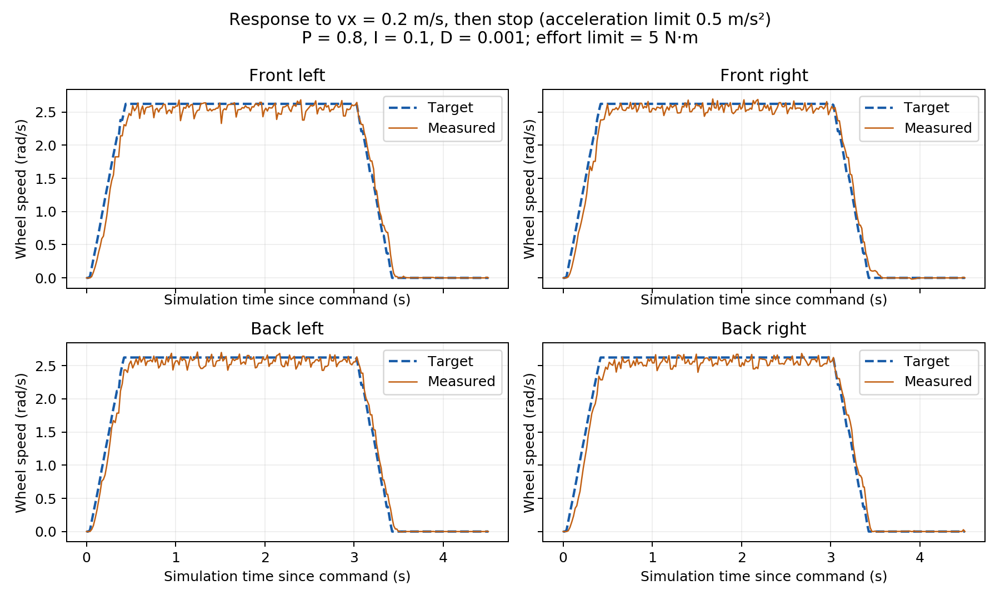

# 验收结果

日期：2026-11-11。环境：Ubuntu 20.04 容器、ROS Noetic、Gazebo 11.15.1、CLion 2026.3、GCC 9.4。
测试对象为仿真中的英雄底盘，使用 realistic 滚子模型和 DefaultRobotHWSim。

## 已检查的功能

| 项目 | 检查方式 | 结果 |
|---|---|---|
| 必做参考仿真 | 控制器运行、关节反馈、实际车体位移 | 通过；保留第三方源码不改 |
| CLion 编译与调试 | 远程构建、运行、附加实际 gzserver | 通过；参考 init/update 与新 PID 输出断点均已命中 |
| 插件加载 | controller_manager 列表 | joint_state_controller、hero_chassis_controller 均 running |
| 四个独立 PID | 四轮反馈、在线修改一个轮子增益 | p 从 0.8 改为 0.7 生效，再恢复 0.8 |
| 前进 | vx=0.2，运行 3 仿真秒 | 车体前移约 0.534 m |
| 后退 | vx=-0.2，运行 3 仿真秒 | 车体后移约 0.531 m |
| 左移 | vy=0.15，运行 3 仿真秒 | 车体左移约 0.393 m |
| 逆时针旋转 | wz=0.5，运行 3 仿真秒 | 实际转约 1.329 rad |
| 指令超时 | 停止发布速度 | 超时后四轮目标归零 |
| 输出限幅 | 临时加大增益和指令 | 输出达到并限制在 5 N·m，结束后恢复参数 |
| 里程计与 TF | odom 消息、tf_echo、RViz 订阅 | odom → base_link 正常，速度来自实际轮速 |
| 世界坐标控制 | 转向后对比相同 x 指令 | 世界模式保持 odom X 方向 |
| TF 失败停车 | 临时指定不存在的世界坐标系 | 四轮目标为零，测试结束恢复 odom |
| 加速度限制 | 对目标速度随时间求变化率 | x 最大约 0.500 m/s²，配置值 0.5 |
| 键盘控制 | 输入 i、J，观察 /cmd_vel | 观察到前进、左移与松键后的零指令 |
| 单元测试 | gtest，5 个测试用例 | 0 失败，覆盖符号、正逆转换、里程计、限幅与超时 |
| 仿真集成测试 | verify_simulation.py，14 项检查 | 全部通过，采集 1898 组样本 |

位移来自 Gazebo 车体真值，按动作开始时的车体坐标计算；没有拿 odom 充当真值。
每个动作都包含加速过程，因此 0.2 m/s 持续 3 秒的位移略小于 0.6 m。
轮速稳态平均绝对误差约为前进 0.072、后退 0.074、左移 0.104、旋转 0.131 rad/s。

## 怎样看 PID 曲线



蓝色虚线是目标轮速，橙色实线是实际轮速。输入从静止切换到 vx=0.2 m/s，
控制器先按加速度限制把目标轮速逐渐提高到 2.623 rad/s，3 秒后主动发送零速度减速。
因此图中的目标是斜坡，不是直接跳变的轮速阶跃。
四轮实际值能跟随目标，停车后回到零附近；接触模型仍带来小幅波动。
这组增益可以完成本次动作，不代表适用于所有质量、地面或真实电机。

图由自动测试采样绘制，可在容器里重新生成：

```bash
python3 /root/catkin_ws/src/hero_chassis_controller/test/plot_response.py \
  /tmp/hero-simulation.json /tmp/pid-response.png
```

## 世界模式检查的具体数值

转向后，轮式里程计的车头方向约为 1.459 rad（83.6°）。同样输入 x=0.2、y=0：

| 输入模式 | 换算到 odom 的目标 vx | 换算到 odom 的目标 vy |
|---|---:|---:|
| base_link | 0.021 m/s | 0.199 m/s |
| world | 0.200 m/s | 约 0.000 m/s |

数值来自轮速目标反算的底盘速度，再按实时朝向转换到 odom；
基础动作另外检查了 Gazebo 车体位移，避免只验证数学公式本身。
world 默认使用 odom；轮式里程计误差仍会影响世界模式的真实运动方向。

## 源码与提交

本包按 rm_template 的包组织和安装方式建立，保留模板许可。
独立开发仓库保留了主分支和四个功能分支，记录中包含一次真实的本地内容冲突及处理过程。
本目录是开发提交 ce89ebb 的源码快照，复制到课程仓库时没有嵌入独立的 .git 目录。
详见 [Git 记录](git-workflow.md)。这是本地分支练习，不是多人协作的证明。

仓库仅包含本包源码、测试、配置、许可及使用文档；本地工作说明、日志、
构建产物和编辑器私有配置不在提交范围内。课程仓库的 origin 指向
`https://github.com/SaoF-A/missing-semester.git`。源码整理和远程上传是两个独立步骤。

本轮完成软件功能与仿真检查。视频按个人讲解准备，不计入本报告的已完成项。
学习时先读 [代码讲解](code-walkthrough.md)，再按 [操作指南](operation-guide.md) 复现。
