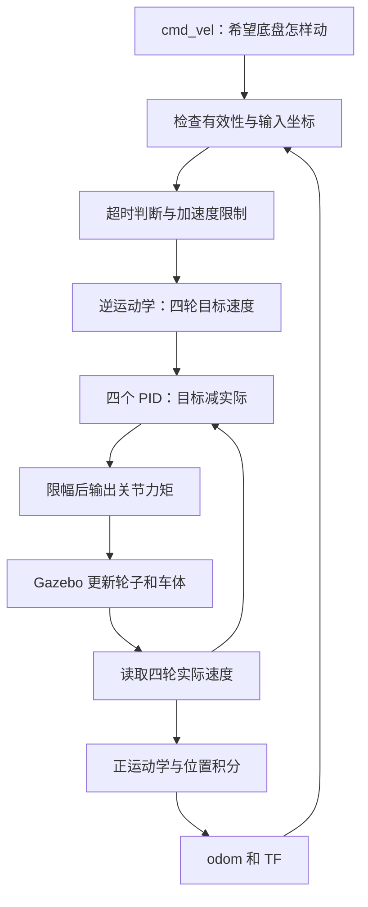

# 从一条速度指令读懂底盘代码

先学会回答三个问题：希望车怎样运动？每个轮子应该多快？电机现在应该出多大力？
它们分别对应 Twist、运动学和 PID。不要把“目标轮速”与“输出力矩”当成同一个量。

建议每次只学一节。先读说明，找到代码，再完成小实验；能说清现象为什么出现，再进入下一节。
操作命令见 [仿真操作与验收](operation-guide.md)。

## 第一节：程序在哪里开始运行

这个控制器是一个动态库，没有自己的 main。Gazebo 中的 gazebo_ros_control 插件创建模拟关节接口，
controller_manager 按 YAML 的 type 查找 plugin XML，再加载本包的 `.so` 动态库。

依次打开这四个文件：

1. `launch/simulation.launch`：先启动世界和模型，再读配置，最后运行 controller spawner。
2. `config/controllers.yaml`：`type` 指定 `hero_chassis_controller/ChassisController`。
3. `hero_chassis_controller_plugins.xml`：将这个名字对应到 C++ 类和动态库路径。
4. `src/chassis_controller.cpp`：最后的 `PLUGINLIB_EXPORT_CLASS` 导出该类。

类有四个主要入口：

| 方法 | 何时运行 | 本包做什么 |
|---|---|---|
| init | 加载时 | 读参数、取得四个关节、建立 PID、订阅和发布接口 |
| starting | 开始运行时 | 重置积分状态、限速状态和里程计原点 |
| update | 每个控制周期 | 算轮速、算力矩、读反馈、算里程计 |
| stopping | 停止运行时 | 四个关节输出零力矩 |

`JointHandle` 可以理解为一个关节的操作入口：`getVelocity()` 读实际轮速，
`setCommand()` 在 EffortJointInterface 中写入的是力矩，单位 N·m。
它不是 setVelocity。速度要通过 PID 间接控制。

小实验：运行 list_controllers 服务，确认 type 与 XML 完全一致。
如果 XML、YAML 或库名任意一个拼错，可能在加载阶段失败，还没有执行到控制循环。

## 第二节：/cmd_vel 里装的是什么

`geometry_msgs/Twist` 有 linear 和 angular，各包含 x、y、z。
本平面底盘只使用 `linear.x`、`linear.y`、`angular.z`：

| 字段 | 底盘模式含义 | 单位 |
|---|---|---|
| linear.x | 朝车头的速度 | m/s |
| linear.y | 朝车体左侧的速度 | m/s |
| angular.z | 逆时针转向速度 | rad/s |

注意：角速度不是“转到多少度”，持续发送 0.5 rad/s 会一直转，不会在 0.5 rad 停下。
速度也不是“走到多远”，持续发送 0.2 m/s 会一直走。

读 `receiveCommand()`：它检查数值是否有效、限制输入范围、记录收到指令的仿真时间，
然后写入 `raw_command_`。它没有直接给电机输出。

`transformCommand()` 在底盘模式直接保留方向；世界模式先转换方向，
再把可用命令放到 `body_command_`。`update()` 才读取命令用于控制。

小实验：只发一次非零指令，观察约 0.3 秒后目标归零；用 `-r 20` 再发一次，观察持续运动。
这说明 cmd_vel_timeout 管的是“多久没有收到新指令”，不是“车已经走了多久”。

## 第三节：一个底盘速度怎样变成四个轮速

打开 `include/hero_chassis_controller/kinematics.h` 的 `inverse()`。
数组顺序固定为左前、右前、左后、右后；参数配置中的 joints 也必须使用这个顺序。
麦克纳姆轮的斜滚子允许轮子共同产生侧向运动。
公式把“前进、横移、转向”三个分量叠加到每个轮子：

```text
左前轮 = (vx - vy - L*wz) / r
右前轮 = (vx + vy + L*wz) / r
左后轮 = (vx + vy - L*wz) / r
右后轮 = (vx - vy + L*wz) / r
```

r 是轮半径，L 是半轴距加半轮距。本模型 r=0.07625 m、L=0.4 m。
只前进时 vy=wz=0，四轮都等于 vx/r。发送 vx=0.2，得到每轮 2.623 rad/s。
只左移时，左前与右后为负，另外两轮为正；只逆时针旋转时，两侧轮速符号相反。

代码中的 `limited_` 是经过加速度限制的底盘指令。
默认加速度 0.5 m/s²、周期 0.001 s，所以每周期 vx 最多改变 0.0005 m/s。
从静止到 0.2 m/s，理想目标斜坡至少需要 0.4 秒。
超时和 TF 失败直接把目标设为零，不再慢慢爬坡；正常主动减速仍遵守加速度限制。

小实验：先不运行程序，在纸上写出四个基础动作的轮速符号，再对照实际 state/set_point。
如果轮子转了但车方向不对，应检查顺序、公式和 wheel_signs，先不要靠修改 PID 修正方向。

## 第四节：PID 怎样让轮子跟上目标

定位 `update()` 中的四轮循环：

```cpp
measured_[i] = signs_[i] * joints_[i].getVelocity();
error_[i] = target_[i] - measured_[i];
effort_[i] = clamp(pids_[i].computeCommand(error_[i], period), effort_limits_[i]);
joints_[i].setCommand(signs_[i] * effort_[i]);
```

1. 先读实际轮速，而不是假设电机已经达到目标。
2. 用目标减实际得到误差。目标更快时，误差通常为正，需要增加驱动力矩。
3. PID 根据误差计算力矩，最后限制在 ±5 N·m。
4. 把数学方向转换成关节方向并写入硬件接口。

PID 可写为 `力矩 = P×当前误差 + I×累计误差 + D×误差变化率`。

- P 像“落后多少就推多大力”。太小跟得慢，太大容易抖动。
- I 像“长期一直差一点，就逐渐多补一点力”。本包限制积分力矩，避免越积越大。
- D 根据误差变化速度作出反应，可能影响快速变化，也容易放大轮速噪声。

本次 CLion 实际断点中，左前轮读到：

```text
目标速度     0.006557 rad/s
实际速度    -0.009288 rad/s
误差         0.015845 rad/s
误差积分     0.111972
误差变化率  24.871807
P/I/D        0.8 / 0.1 / 0.001
输出力矩     0.048745 N·m
```

代入：`0.8×0.015845 + 0.1×0.111972 + 0.001×24.871807 ≈ 0.048745`。
`i_error_` 是误差积分，乘 I 后才是积分项力矩；`d_error_` 也要乘 D。
这只是一个 1 ms 周期的快照，不能用它一个点判断整个 PID 调得好不好。
应看一段曲线的跟随速度、持续偏差、振荡和力矩是否经常触顶。

小实验：四轮都保持原参数，只把左前 p 改为 0.7，观察该轮反馈；结束后恢复 0.8。
要比较同样的指令和初始状态，不要同时改三个参数，否则难以知道是什么起了作用。

## 第五节：轮子已经转了多少，车走到了哪里

打开 `forward()`，它从四个实际轮速计算实际底盘速度。
逆运动学解决“希望车这样动，每轮应多快”；正运动学解决“每轮实际这样转，车大概怎样动”。

得到车体 vx、vy 后，还要考虑车头朝向。例如车头朝左时，车体前进主要使 odom 的 y 增加，
不能直接把车体 vx 累加到世界 x。代码用 sin/cos 转换方向，再乘周期 dt 累计位置。
`yaw_` 则累计实际转向速度，最后规范到 [-pi, pi]。

`publishState()` 同时发布 `/odom` 和 TF `odom → base_link`：
前者是一条带位置、速度、误差估计的消息，后者让其他节点知道两个坐标系的相对关系。
它们来自相同的 x、y、yaw，避免两个位置来源互相矛盾。

小实验：抬起轮子或发生打滑时，轮子转动不一定等于车体平移。
因此轮式里程计会有误差，Gazebo model_states 真值与 odom 不应被当作同一个数据源。

## 第六节：车头转了，为什么世界指令方向不变

在底盘模式中，x 轴跟着车头转；在世界模式中，输入 x 轴属于 odom，不跟着车头转。
假设车头逆时针转了 90°，世界坐标的 X 正向速度 vx=0.2，
换算到车体后大约是 vx=0、vy=-0.2，即沿车体右侧横移。
车体看来是横移，世界看来仍沿 odom 的 X 轴移动。

`transformCommand()` 中的 `transformVector()` 做的就是这个方向转换。
它用向量变换，不把坐标原点平移量加到速度上。平移量对位置有意义，对速度方向没有这种意义。
如果 TF 缺失，就无法可靠地知道车头相对世界的方向，所以清零目标并报警。

测试记录中车头约为 1.459 rad，同一条 x=0.2 指令换算到 odom 后：
底盘模式约为 `(0.021, 0.199)` m/s，世界模式约为 `(0.200, 0.000)` m/s。
这证明两种输入坐标的区别，不能只看四轮是否转动来判断。

## 最后把整条链连起来



头文件里的数组都按同一个轮序排列。`raw_command_` 保存原输入，`body_command_` 保存转换后的输入，
`limited_` 保存斜坡输出，`target_`、`measured_`、`error_`、`effort_` 对应轮速控制链的四步。

ROS 回调和 Gazebo 更新在不同线程，RealtimeBuffer 用于交换数据。
耗时的 TF 查询放在回调中；发布器用 trylock，拿不到锁就跳过本次发布，控制循环继续运行。
这样控制器不会为了等待界面或话题发布而拖慢物理更新。

能自己回答下面四题，就掌握了第一轮阅读目标：

1. 为什么 EffortJointInterface 不能直接写 2.623 来表示 2.623 rad/s？
2. 只让车左移时，哪两个轮子应为负？为什么修改 PID 不能修复轮序错误？
3. 为什么里程计要读取 measured_，不能直接读取 target_？
4. 车头转 90°后，世界 x 正方向的指令，在车体坐标中大约是什么方向？
