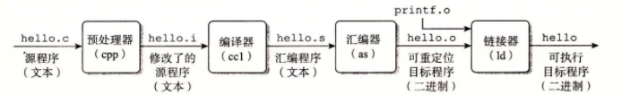
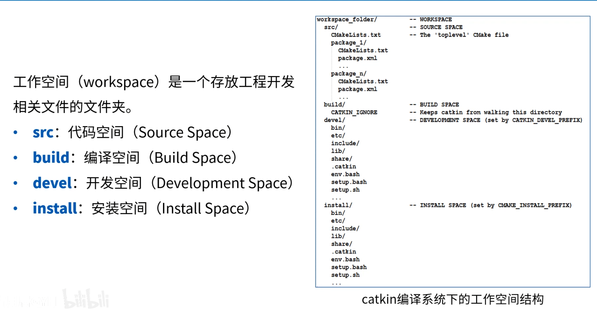

# 程序详细编译过程

## 程序编译的整体流程

GCC编译器驱动程序读取源程序文件并把它翻译成一个可执行目标文件，这个翻译过程分为四个阶段：**预处理（Preprocessing）、编译（Compilation）、汇编（Assembly）、链接（Linking）**。执行这四个阶段的程序（**预处理器、编译器、汇编器、和链接器**）一起构成了编译系统。

以hello程序为例子

```c
#include <stdio.h>
int main()
{
    printf("hello, world\n");
    return 0;
}
```

会得到如下图的流程：



跟着链表一步步往下。

## 预处理器

展开所有的宏、删除所有的注释、处理预编译指令......总的来说把无关信息删掉、把原本的代码压缩成更有效的信息。
使用 `gcc -E hello.c -o hello.i` 命令来进行预处理， 预处理得到的另一个程序通常是以 `.i` 作为文件扩展名。

## 编译

编译器将上一步处理完的文本文件进行一系列的分析优化，翻译成一个包含汇编语言程序的文本文件(hello.s)。

那汇编语言是干什么的？它为不同高级语言的不同编译器提供了通用的输出语言。

总之编译过程干了这6件事：**扫描（词法分析）、语法分析、语义分析、源代码优化、代码生成、目标代码优化**。[^1]

## 汇编

汇编器（as）将hello.s翻译成机器语言指令，把这些指令打包成一种叫做**可重定位目标程序**的格式，并将结果保存在目标文件hello.o中，hello.o是一个二进制文件。

## 链接

链接（linking）是将各种代码和数据片段收集并组合成为一个单一文件的过程，这个文件可被加载到内存并执行。链接可以执行于**编译时**，也就是在源代码被翻译成机器代码时；也可以执行于**加载时**，也就是在程序被**加载器**加载到内存并执行时；甚至执行于**运行时**，也就是由应用程序来执行。链接是由叫**链接器**（linker）的程序自动执行的。

像我们熟知的静态库、动态库，就是通过链接的方式去加载的，这样差不多能很生动的理解链接的意义，总之结果就是把所有链接得到一个hello文件，它是一个**可执行目标文件**，可以被加载到内存中，由系统执行。

---

# CMake

## 介绍

CMake 是一个跨平台的构建系统生成工具，用于管理 C/C++ 项目的编译过程。
通过编写 CMakeLists.txt 配置文件，我们可以定义项目的构建规则、依赖关系和编译选项，CMake 会自动生成对应平台的构建文件。

## CMakeLists.txt

CMake 通过读取 CMakeLists.txt 中的指令来了解项目的结构、源文件列表和编译要求。
**而** CMakeLists.txt 由一系列 CMake 指令组成，它们的格式为：`命令名(参数列表)`

下面是构建 CMake 项目时最常用的指令及其实例：

### 指定CMake的最低版本

```cmake
# 示例：要求 CMake 版本不低于 3.10
cmake_minimum_required(VERSION 3.10)
```

### 定义项目名称和语言

```cmake
# 语法：project(<项目名> [<语言>...])
project(MyProject CXX)
```

### 添加可执行文件

```cmake
# 语法：add_executable(<目标名> <源文件>...)
add_executable(MyApp main.cpp utils.cpp)
```

### 添加库文件

```cmake
# 语法：add_library(<目标名> [STATIC | SHARED ] <源文件>...)
# STATIC：静态库（.a / .lib），编译时直接嵌入可执行文件
# SHARED：动态库（.so / .dll），运行时加载
add_library(MyLib STATIC library.cpp)
```

### 链接库到目标

```cmake
# 语法：target_link_libraries(<目标> <库>...)
target_link_libraries(MyApp PRIVATE MyLib)
```

### 执行CMake命令

```bash
# cmake 命令原型
$ cmake CMakeLists.txt文件所在路径
# 然后目标文件及一些其他文件就会被生成在当前目录里面
```

### 设置变量

```cmake
# 语法：set(<变量名> <值>...)
# 定义一个普通变量，后续通过 ${变量名} 引用
set(CMAKE_CXX_STANDARD 17)
set(SOURCES main.cpp utils.cpp helper.cpp)

add_executable(MyApp ${SOURCES})

# 指定c++标准，增加-std=c++17
set(CMAKE_CXX_STANDARD 17)

# 指定目标文件输出的路径
set(HOME /home/robin/Linux/Sort)
set(EXECUTABLE_OUTPUT_PATH ${HOME}/bin)
```

### 为目标指定头文件路径

```cmake
# 语法：target_include_directories(<目标> | [PUBLIC | PRIVATE | INTERFACE] | <路径>)
# PUBLIC：当前目标和依赖它的目标都能使用该路径
# PRIVATE：只有当前目标能使用
# INTERFACE：只有依赖当前目标的其他目标能使用
target_include_directories(MyApp PRIVATE ${PROJECT_SOURCE_DIR}/include)
```

### 搜索方式

```cmake
# 搜索路径下所有文件，dir=目标路径，variable=被储存变量
aux_source_directory(<dir> <variable>)

# file(GLOB/GLOB_RECURSE 变量名 要搜索的文件路径和文件类型)
# GLOB:只搜索一级   GLOB_RECURSE：一锅端
file(GLOB MAIN_SRC ${CMAKE_CURRENT_SOURCE_DIR}/src/*.cpp)
```

### 库

```cmake
# 制作静态或者动态库
add_library(库名称 STATIC/SHARED [源文件1] [源文件2] ...)
# 在linux中，静态库： lib+名字+.a ; 动态库： lib+名字+.so

# 包含自建库，填写地址变量和 库名字就能自动帮你找好了
find_library(<变量名> <库名>)
# 查找外部包及其详细信息
find_package(<PackageName>)
# 链接动静库，里面填入一个个库名字
target_link_libraries(app PRIVATE 库名字/地址...)
```

### list

```cmake
# 第一个变量决定功能，第二个变量是对象，往后是变化的内容

# 追加，拼接
list(APPEND <list> <element> ...)
# 字符串删除
list(REMOVE_ITEM <list> <value> <value> ...)
# 获取长度，把 list 的长度 赋给 后值
list(LENGTH <list> <output variable>)
# 读取索引元素，可以赋给另一个变量，-1代表倒数第一，以此类推
list(GET <list> 1 2 ... <output variable>)
# 用连接符连接字符串，比如把a b c 用 - 连成 a-b-c
list(JOIN <list> <glue> <output variable>)
# 查找元素，未找到返回-1，找到存索引
list(FIND <list> <value> <output variable>)
```

[^2]

### 常用宏

| 宏                       | 功能                                     |
| ------------------------ | ---------------------------------------- |
| PROJECT_SOURCE_DIR       | 使用cmake命令后紧跟的目录，一般是工程的根目录 |
| PROJECT_BINARY_DIR       | 执行cmake命令的目录                      |
| CMAKE_CURRENT_SOURCE_DIR | 当前处理的CMakeLists.txt所在的路径       |
| CMAKE_CURRENT_BINARY_DIR | target 编译目录                          |
| EXECUTABLE_OUTPUT_PATH   | 重新定义目标二进制可执行文件的存放位置   |
| ARCHIVE_OUTPUT_DIRECTORY | 用于指定静态库文件输出目录               |
| LIBRARY_OUTPUT_DIRECTORY | 用于指定动态库文件输出目录               |
| RUNTIME_OUTPUT_DIRECTORY | 用于指定可执行文件输出目录               |
| PROJECT_NAME             | 返回通过PROJECT指令定义的项目名称        |

---

# catkin

## 概念

catkin像是CMake的拓展一样，它加上了ROS包的管理和环境配置的工具。



- **src**（代码空间）：用来放ROS包的地方，无论是自己写的还是clone别人的
- **build**（编译空间）：放中间文件的地方，一般不用管？
- **devel**（开发空间）：可执行文件、库、脚本将放在这里
- **install**（安装空间）：和devel有点重合，将最终产物放在这里，用来打包发给别人。

> 在ROS2中，devel和install合在一起了

## 工作空间

首先是创造工作空间

```bash
mkdir -p ~/ros_ws/src   # 制造对应的文件夹
cd ~/ros_ws/src         # 进入文件夹
catkin_init_workspace   # 初始化此文件夹为工作空间
```

然后是编译工作空间

```bash
cd ~/ros_ws/            # 回到根目录
catkin_make             # 进行一个编译
```

设置环境变量

```bash
source devel/setup.bash   # 让系统找得到你的功能包、库
```

## 功能包

创造功能包

```bash
cd ~/ros_ws/src
catkin_create_pkg 名字 std_msgs rospy roscpp   # 创造！
```

编译功能包

```bash
cd ~/ros_ws                        # 回到根目录
catkin_make                        # 编译一下
source ~/ros_ws/devel/setup.bash   # 让系统能认识我的包
```

---

# AI大模型

## 组成

大刀阔斧的按我的认知来分的话，我们日常接触的AI大模型分为以下几个组成部分：

- LLM：作为核心的大语言模型，作为AI的大脑，负责干思考、决策的事
- Skill：可执行能力的封装，用来当AI的手脚，让AI能实际干预我们的内容
- Map：结构化环境，贴上索引，建立关联，帮助AI知道环境结构和可用资源
- Agent：把上面所有东西封装在一起，再负责一些如权限、日志、状态、工具注册等杂项，加强AI的循环和控制能力

稍微知道一点AI的内部组成后，我们大致也能了解一些AI的工作流程了，至少不会觉得AI像是魔法一样。

## 提示词框架

1. 清楚说明目标
2. 提供必要的上下文
3. 明确好特别重要的约束
4. 定好验证的标准
5. 给AI足够的自主探索权力
6. 警惕过度过度规定执行步骤

## 帮助与思考

无论是现在DX的作业，课内的作业，还是更久之前的项目，我都或多或少的依靠了AI的帮助，可以说我现在是离不开AI了。
那AI到底给我了怎么样的帮助？我可以分几个方面来讲

1. 对于专业课，我还是更喜欢通过热门的学习视频来学习一遍，然后在刷题的时候遇上无法解答的疑问时，才会使用AI，让它写出超级详细的解题步骤，来辅助我学习。

2. 对于项目，如果负责内容是我完全掌握的东西，我会大致做出一个框架，然后再让AI讲讲它会如何实现各个细节要求，再依照它的内容，一步步完善我框架里面的内容；
   而对于那种需要我短时间内学习的完全不会的东西，我真的只能让AI先自由发挥，然后一句一句地让AI告诉我这一行是什么意思......这种体验太糟糕了，如果可以的话我还是喜欢像上一种方式来进行交互。

3. 对于DX的作业，其实我是很拧巴的，培训受限于时间问题，并不能把相关的东西讲彻讲透，而在写课后作业的时候，我就需要选择：是只记录课上内容呢？还是再在B站上面听一些相关的视频做一些补充呢？
   我还是倾向于选择后者的，但是在很短的时间内也不太能系统的学习一遍各个内容，所以只能借助AI，然后囫囵吞枣地像是学习到了这些内容，真正有没有学到，连我自己都不知道，只能麻烦之后的自己再过一遍基础了。

---

# 补充材料的学习笔记

1. 总共有四个补充资料，其中第一个补充资料，前面编译过程什么的还能理解，所以写在了笔记的开头，虚拟内存也只是一些概念，但是后面静态链接过程、动态链接共享库什么的确实看不懂......借助AI也得不到比较好的理解，所以没办法总结了......
2. 第二篇是CMake的教程，所以将其单开了一个大标题来写了。
3. 第三篇是介绍AI大模型的组成，和快速制作！看完感觉它是想表达让我们对AI祛魅？的感觉，总之处理好和AI的关系也是我们往后不得不品的一门课......
4. 最后一个是catkin的，也是单开了一列来。
5. 有关ROS的学习内容，建议跳转链接：[a-Ta-Ka/study-notes: RM学习笔记](https://github.com/a-Ta-Ka/study-notes)

[^1]: 1. 词法分析：扫描器（Scanner）将源代的字符序列分割成一系列的记号（Token）。lex工具可实现词法扫描。
    2. 语法分析：语法分析器将记号（Token）产生语法树（Syntax Tree）。yacc工具可实现语法分析(yacc: Yet Another Compiler Compiler)。
    3. 语义分析：静态语义（在编译器可以确定的语义）、动态语义（只能在运行期才能确定的语义）。
    4. 源代码优化：源代码优化器(Source Code Optimizer)，将整个语法书转化为中间代码（Intermediate Code）（中间代码是与目标机器和运行环境无关的）。中间代码使得编译器被分为前端和后端。编译器前端负责产生机器无关的中间代码；编译器后端将中间代码转化为目标机器代码。
    5. 目标代码生成：代码生成器(Code Generator).
    6. 目标代码优化：目标代码优化器(Target Code Optimizer)。

[^2]: 以下是 CMake `list` 系列命令的补充说明：

    ```
    将元素追加到列表中
    list(APPEND <list> [<element> ...])

    在list中指定的位置插入若干元素
    list(INSERT <list> <element_index> <element> [<element> ...])

    将元素插入到列表的0索引位置
    list(PREPEND <list> [<element> ...])

    将列表中最后元素移除
    list(POP_BACK <list> [<out-var>...])

    将列表中第一个元素移除
    list(POP_FRONT <list> [<out-var>...])

    将指定的元素从列表中移除
    list(REMOVE_ITEM <list> <value> [<value> ...])

    将指定索引的元素从列表中移除
    list(REMOVE_AT <list> <index> [<index> ...])

    移除列表中的重复元素
    list(REMOVE_DUPLICATES <list>)

    列表翻转
    list(REVERSE <list>)

    列表排序
    list(SORT <list> [COMPARE <compare>] [CASE <case>] [ORDER <order>])
    ```
