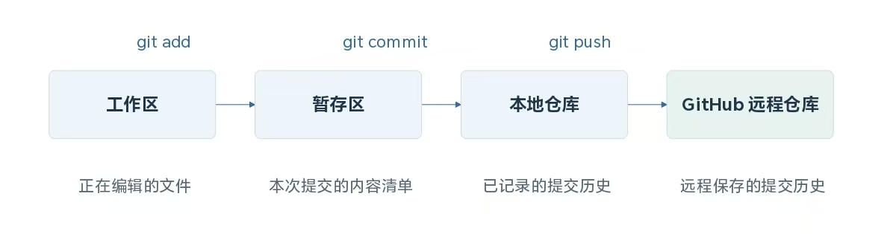
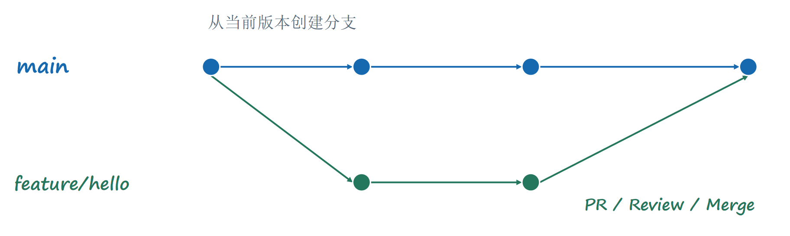
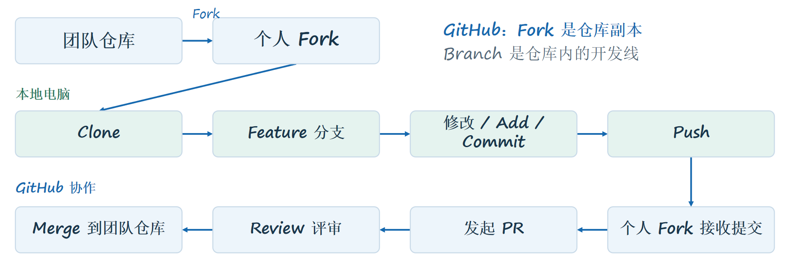
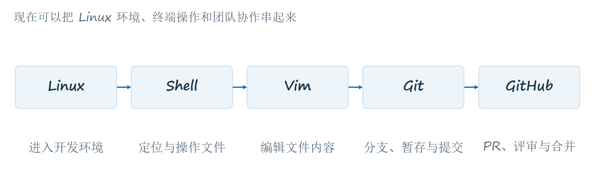

# DX第一次培训课程笔记
## 课程概要
  **1.Linux系统介绍及使用**  
  **2.终端命令与操作**  
  **3.Vim编辑器介绍及使用**  
  **4.Git与GitHub**  
  **5.GitHub的开发流程**
***
## 一、Linux系统介绍及使用
### 1.特点：
流程透明，可以看到程序的完整运行过程，更方便进行部署等操作，也更容易进行版本控制。   
 
### 2.Linux与发行版： 
Linux通常指系统内核，而发行版指一套可以安装和使用的系统。  
现有发行版包括Ubuntu,Debian,Fedora,Arch Linux。

### 3.目录：
#### （1）特点：  
对路径的大小写敏感；大部分不兼容中文路径名；~是当前用户的家目录，“.”是当前目录，“..”是上一级目录。  
#### （2）目录名含义：  
/home/user：用户文件；  
/etc：系统配置；  
/usr：程序与库；  
/var：日志等可变数据；  
/dev：设备文件；  
/home/user/example：绝对路径：从/开始；  
./hello.txt：相对路径：从当前位置开始；  
~/example：home目录中的example。  
### 4.终端、shell与命令：  
**流程：** *在终端输入命令，由shell解释，再交给程序执行。*  
**Terminal终端：** *输入输出界面*  
**Shell（Bash/Zsh)：** *解释命令、展开路径、组织执行*  
**程序/系统：** *ls查看文件、git管理版本*  
### 5.贯穿演示：  
创建目录（~/example）——→新建文件（hello.txt）——→编辑内容（Vim）——→记录修改（git）

***
## 二、终端命令与操作
### 1.Shell命令的结构
**ls**：命令，做什么。  
**-la**:选项，怎样执行。 -l表示详细信息，-a表示包含隐藏项。  
**~/projects**：参数，表示操作哪个对象，这里是目标目录。  
### 2.当前位置与目录切换
#### （1）
~ home 目录——（cd example）—→example
相对路径以当前位置为起点
#### （2）命令及其作用：
pwd：显示当前目录  
ls：列出目录内容（list）  
cd 目录：进入指定目录  
cd ..：返回上一级   
cd ~：返回home目录  
mkdir -p：创建目录，允许补齐父目录【示例：mkdir -p ~/linux_demo】  
touch：创建空文件/更新时间【示例：touch hello.txt】  
cp：复制文件到另一文件（copy）【示例：cp hello.txt hello-copy.txt】  
mv：移动或重命名（move）【示例：mv hello-copy.txt backup.txt】  
rm：删除文件（remove）{rm通常不进回收站，会直接删除，所以在删除前一定要先确认路径和文件名。}  
【示例：rm backup.txt】  
cat/less：直接查看/分页查看【示例：cat hello.txt】

### 3.Shell的四种常用组合
#### 变量
格式：【name = "RM" / echo"$name"】  
含义：保存一个值，再通过变量引用它。
#### 重定向
格式：【echo"hello">hello.txt】  
说明：>覆盖写入；>>追加到文本末尾。
#### 管道
格式：ls -la | grep txt  
含义：将输出交给下一个程序。
#### 条件连接
格式：【mkdir -p demo && cd demo】  
含义：前一条成功后，再执行下一条。

### 4.陌生命令的帮助入口
***先查用途与参数，再在练习目录李尝试***  
**ls --help**：快速查看选项和用法    
**man ls**：打开手册（按q退出）  
**Tab**：自动补全命令或路径  
**↑/↓**：调出历史命令

***
## 三、Vim编辑器介绍及使用
*常用于SSH和无桌面环境中的配置、代码编辑*  
### 1.三种模式：
（1）普通模式：移动、删除、复制  
（2）插入模式：输入文本  
（3）命令行：保存、退出
### 2.必备命令与按键
#### （1）模式间切换
普通模式——（i）——→插入模式（返回普通模式按Esc）
普通模式——（:）——→命令行输入（:w ,:q ,:wq ,:q!）  
[:w 保存][:q 退出][:wq 保存退出][:q! 放弃修改退出]
#### （2）普通模式按键及其作用
{1} h j k l ：左，下，上，右 （目的：使操作者不必使用鼠标，手始终放在键盘上，提高效率）  
{2} dd ：删除当前行  
{3} yy/p ：复制当前行/粘贴  
{4} u ：撤销
{5} /word  ：搜索word
### 3.Vim基本使用
01 ： vim hello.txt 打开练习文件  
02 ： i   进入插入模式，输入文本  
03 ： Esc 返回普通模式  
04 ： :wq 保存并退出  
05 ： vim hello.txt 再次打开文件  
06 ： dd u /word 删除一行、撤销、搜索  
***
## 四、Git与GitHub
*多人修改同一项目，用版本记录和评审代替互传压缩包*
### 1.Git与GitHub的区别
**Git：本地版本控制**  
记录每次提交；比较修改、查看历史；为新功能创建分支  
**GitHub： 远程托管与协作**  
托管Git仓库；通过PR讨论和评审‘合并团队认可的修改 
### 2.Git的四个位置  
***先选择本次要记录的修改，再提交到本地，最后推送到远程***  

**commit只记录到本地仓库；push才把提交发送到远程**  
### 3.首次使用Git：提交作者  
*姓名与邮箱会写入提交记录*  
**格式：** git config --global user.name"Your Name"  
git config --global user.email"you@example.com"  
**提交作者信息** 回答这次修改由谁提交  
**SSH认证** 证明你有权访问远程仓库  
### 4.SSH密钥：公钥与私钥
*使用公钥完成远程认证，私钥保留在自己的电脑上*  
**公钥 .pub**  
例：id_ed25519.pub  
其为复制到GitHub上的SSH设置
**私钥**  
例：id_ed25519  
不上传，不截图，不分享，关乎你的计算机安全，泄露易导致被攻击  
### 5.把SSH公钥添加到GitHub
***1.settings→2.SSH and GPGkeys→3.New SSH key（选择Authentication Key填写名称，粘贴完整公钥）***
### 6.Git常用命令
git clone<仓库地址>  下载仓库及其提交历史  
git status         查看当前分支和文件状态  
git diff           查看尚未暂存的修改  
git log --oneline  用简短格式查看提交历史  
git switch -c feature/hello  创建并切换到功能分支  
git commit -m "Add greeting" 记录一次本地提交  
git push -u origin feature/hello  推送并建立跟踪关系  
git switch main    切回主分支  
git pull           获取并整合当前分支的远程更新  
### 7.分支
*为新功能保留独立开发线*  
***main 保持稳定，feature/hello 承载本次修改，评审后再合并***  

**分支让同一仓库中的开发互不打扰，提交点记录每一步修改。**  
***
## 五、GitHub的开发流程
### 8.团队 PR 工作流
*默认使用 Fork 协作：远程复制仓库，本地开发，再向团队发起合并请求*  

GitHub：Fork 是仓库副本,Branch 是仓库内的开发线  
*有团队仓库推送权限时，可省略 Fork，使用同仓库分支协作。*  

### 9.一次团队贡献的完整过程

*Git 记录版本，GitHub 支持协作。*  

