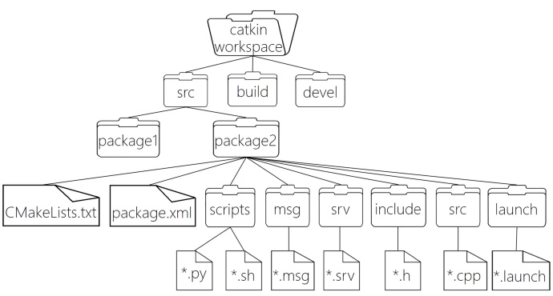
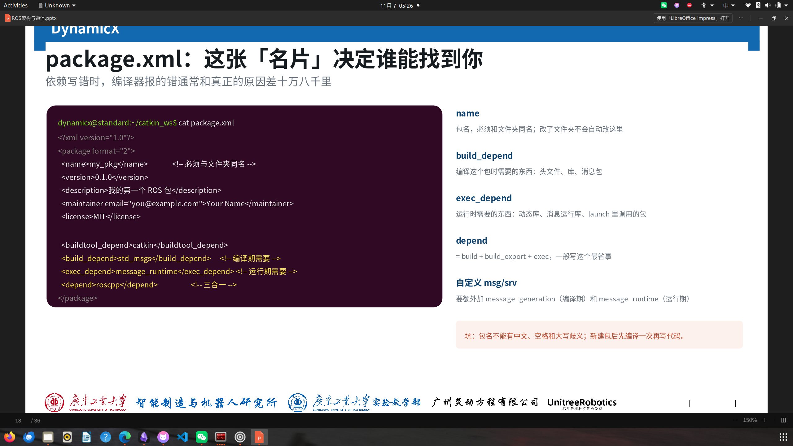
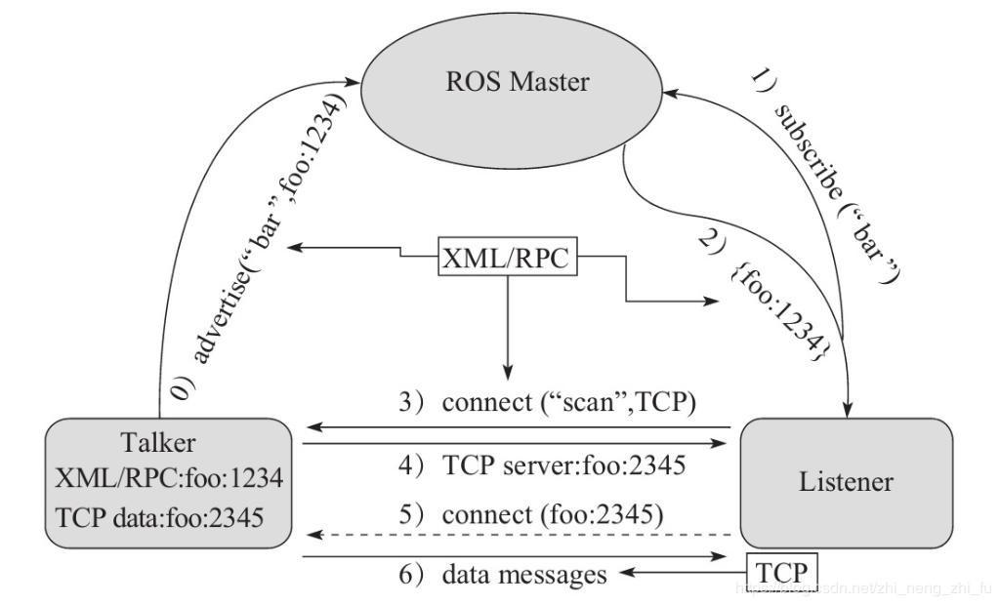
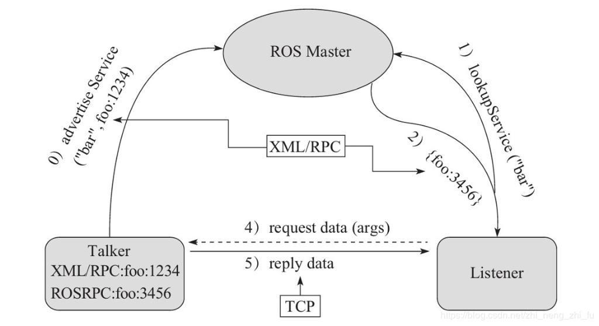
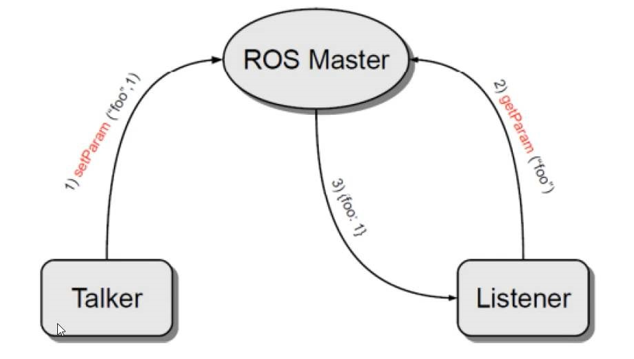

______
>**前请提要：以下内容参考[赵虚左的ROS讲义](http://www.autolabor.com.cn/book/ROSTutorials/)，还有[机器人工匠阿杰的ROS快速入门教程](https://www.bilibili.com/video/BV1BP4y1o7pw/?spm_id_from=333.1387.collection.video_card.click&vd_source=122522eb297264af9cf2593deaa80109),最后还有我们dx的ppt。**
 *ps:我主要是根据赵虚左的ROS讲义进行学习的，阿杰视频辅助学习，之后再根据ppt上我不怎么了解的内容进行补充学习的，再用ai纠错我的认知错误。以下内容涉及相关实例的将直接进行链接跳转，主要是我按顺序理清ROS的相关内容，还有一些我的个人见解。*
 *当然其中不可避免的含有原本讲义和ppt之中的内容，但下面的笔记并非随意找几点照抄，而是我认真学习过了之后梳理的。*
________
# ROS简介
==这个简介主要回答ROS下述几点：==
1. ROS是什么？
2. ROS为什么诞生？
3. ROS的特点？
----
  以下按顺序展开回答：
1. ROS是适用于机器人的**开源**元操作系统，它集成了大量的工具，库，协议，提供类似OS所提供的功能，简化对机器人的控制， 还提供了用于在**多台计算机**上获取，构建，编写和运行代码的工具和库，ROS在某些方面类似于“机器人框架”。
2. 机器人体系是相当庞大的，其复杂度之高，以至于没有任何个人、组织甚至公司能够独立完成系统性的机器人研发工作。为了让机器人研发者专注于自己擅长的领域，让其他模块可以直接复用相关领域更专业研发团队的实现，并且让自身的研究也可以被他人继续复用，ROS应运而生。
3. ROS有着以下特点：代码复用；分布式：松耦合；精简；语言独立性；易于测试；大型应用；丰富的组件化工具；免费且开源。
----
# ROS架构
- *立足于不同的角度，对ROS结构的看法也是不同的，在此之前我对ROS的看法还是满偏向于设计者的角度的，毕竟因为我之前对ROS的认识就是里面集成了大量的工具，库等等，然后里面有不同的节点通过通讯。*
- *但现在通过学习ROS的自身系统架构，我又对ROS有了更深刻的认识，特别是结合了上节课学习的catkin，感觉对它的文件系统有了更深的认识。*
---



**上述这张图可以很好的体现了ROS的文件系统了**：
1. 工作空间下面的src里面存放功能包。
2. build:编译空间，用于存放CMake和catkin的缓存信息、配置信息和其他中间文件。
3. devel:开发空间，用于存放编译后生成的目标文件，包括头文件、动态&静态链接库、可执行文件等。
4. 在功能包之中，除了主要的编译配置文件：CMakeLists.txt和package.xml，还有存放.cpp源文件的src目录，和头文件目录、与通信相关的msg和src的目录等，功能包下面的这些目录基本上就是围绕怎么实现这些功能，和怎么实现在ROS这个架构上实现这些功能。
5. 当然功能包下面的目录远不仅仅于此，但在这主要认识以下ROS的文件系统架构，其他先不进行深入了解。

 **系统相关命令**
 ```
 roscore === 是 ROS 的系统先决条件节点和程序的集合， 必须运行 roscore 才能使 ROS 节点进行通信。
 rosrun 包名 可执行文件名 === 运行指定的ROS节点
 roslaunch 包名 launch文件名 === 执行某个包下的 launch 文件
 catkin_create_pkg 自定义包名 依赖包 === 创建新的ROS功能包
 sudo apt install xxx === 安装 ROS功能包
 sudo apt purge xxx ==== 删除某个功能包
 rospack list === 列出所有功能包
 rospack find 包名 === 查找某个功能包是否存在，如果存在返回安装路径
 roscd 包名 === 进入某个功能包
 rosls 包名 === 列出某个包下的文件
 apt search xxx === 搜索某个功能包
 rosed 包名 文件名 === 修改功能包文件
 ```

**ROS计算图**
- rqt-graph -> 是一个实用的工具。ROS文件系统结构是静态的，而但在ros 程序运行之后，不同的节点之间是错综复杂的，这个时候rqt_graph能够创建一个显示当前系统运行情况的动态图形,方便对节点之间关系的观察。
- 在运行节点后，可以使用```rosrun rqt_graph rqt_graph```来显示不同节点之间的关系。

----
# package.xml和CMakeLists.txt
>*既然讲到了ROS的文件爱你系统，那就顺便介绍一下这两个配置文件，相关的文件格式与内容请跳转至[例子](https://www.autolabor.com.cn/book/ROSTutorials/chapter1/15-ben-zhang-xiao-jie/151-roswen-jian-xi-tong.html)处查看，并在写这实操写这两个文件时，比照着来写。*
>发现ppt中总结的精简，基本上涵盖了自己修改CMakeLists.txt和package.xml所需要注意的地方，所以引入这两张图片，后续我写这些配置文件的时候就不需要翻ppt了，直接看笔记。
- package.xml该文件定义有关软件包的属性，例如软件包名称，版本号，作者，维护者以及对其他catkin软件包的依赖性。
- 值得注意的是其中的build_depend,exec_depend和build_export_depend这三种可以一次性用depend来代替，这就是三合一 )


- 文件**CMakeLists.txt**是CMake构建系统的输入，用于构建软件包。任何兼容CMake的软件包都包含一个或多个CMakeLists.txt文件，这些文件描述了如何构建代码以及将代码安装到何处。
- CMakeLists.txt 是 CMake 的构建配置文件，告诉 CMake 如何编译该包的源码。ROS 的构建工具（catkin/colcon）会遍历工作空间中的每个包，对每个包调用 CMake，CMake 读取该包的 CMakeLists.txt 和 package.xml 来完成编译与依赖解析。编译期，包之间通过 package.xml 的依赖声明和 CMakeLists.txt 的 find_package/target_link_libraries 建立链接；运行期，各节点再通过 ROS 的 topic/service/action 等通信机制协作。

----
# ROS基本通信机制
## 话题通信
- **话题通信是ROS中使用频率最高的一种通信模式，话题通信是基于发布订阅模式的，适用于不断更新的数据传输相关的应用场景。**
### 话题通信模型


>*如图所示，整个的流程我总结如下：首先Talker和Listenter都通过RPC在ROS Master里面注册自身信息还有发布(订阅)消息的话题名称，ROS Master随后在注册表里面将这两个节点的注册信息都加入到注册表之内，ROS Master通过信息匹配后，通过PRC向Listener发送Talker的PRC地址信息，之后Listener通过RPC向Talker发送链接请求，传输订阅的话题名称、消息类型以及通信协议(TCP/UDP)，Talker通过确认RPC向Listener确认连接信息后，发送自身的TCP地址信息，Listener通过TCP与Talker建立网络连接，之后不再需要ROS Master,Talker开始正常向LIstener发布消息。*

  **值的注意的是：**
  **1. Talker与Listener的启动不像Server跟Client一样，一定要Server(其中一个)先，而是可以不分先后顺序**
  **2. Talker与Listener都可以有多个**
  **3. Talker 与 Listener 连接建立后，不再需要 ROS Master。也即，即便关闭ROS Master，Talker 与 Listern 照常通信。**  

---
### 话题通信基本操作
>跟服务通信的基本操作一样，模型实现中，ROS master 不需要实现，而连接的建立也已经被封装了，需要关注的关键点只有三个：
>1. 发送消息的节点
>2. 接受消息的节点
>3. 数据
具体操作请见[话题通信基本操作](https://www.autolabor.com.cn/book/ROSTutorials/di-2-zhang-ros-jia-gou-she-ji/22hua-ti-tong-xin/212-hua-ti-tong-xin-zhi-c-shi-xian.html)
    
- *发布方的实现流程：*
1. 包含头文件 
2. 初始化 ROS 节点:命名(唯一)
3. 实例化 ROS 句柄
4. 实例化 订阅者 对象
5. 处理订阅的消息(回调函数)
6. 设置循环调用回调函数
- *订阅方的实现流程*：
1.包含头文件 
2.初始化 ROS 节点:命名(唯一)
3.实例化 ROS 句柄
4.实例化 订阅者 对象
5.处理订阅的消息(回调函数)
6.设置循环调用回调函数
- *配置好CMakeLists.txt文件(添加可执行文件并且连接库)*
- *注意：*
1. int main括号里面的const去掉
2. 如果前面的项目调用了find_package那么本次项目不调用那也能正常执行，但是最好还是在每次项目里面都调用以下，不然当项目单独构建的时候，容易出现问题。

----
### 话题通信自定义msg
- **当std_msgs里面的消息类型不够用的时候，可以通过自定义msg来满足自身使用需求。**
- **流程：**
1. 定义msg文件，创建自定义消息变量，文件里面可以有多个字段类型，但这些字段类型来源都是从std_msgs而来的。
2. **编辑配置文件:**
*package.xml中添加:*
```
  <build_depend>message_generation</build_depend>
  <exec_depend>message_runtime</exec_depend>
```

*配置CMakeLists.txt文件：*
```
find_package(catkin REQUIRED COMPONENTS
  roscpp
  rospy
  std_msgs
  message_generation
)
# 需要加入 message_generation,必须有 std_msgs
```

```
# 生成消息时依赖于 std_msgs
generate_messages(
  DEPENDENCIES
  std_msgs
)
```

```
#执行时依赖
catkin_package(
#  INCLUDE_DIRS include
#  LIBRARIES demo02_talker_listener
  CATKIN_DEPENDS roscpp rospy std_msgs message_runtime
#  DEPENDS system_lib
)
```

- *最后编译的中间文件都在工作空间/devel/包名/xxx.h之中，后续调用相关msg时，从这些中间文件调用。*

### 话题通信自定义msg调用
结合上面的话题通信自定义msg，其流程为：
1. 编写发布方实现；
2. 编写订阅方实现；
3. 编译配置文件；
4. 编译并执行。
（具体见[例子](https://www.autolabor.com.cn/book/ROSTutorials/di-2-zhang-ros-jia-gou-she-ji/22hua-ti-tong-xin/215-hua-ti-tong-xin-zhi-c-diao-yong-zi-ding-yi-xiao-xi.html)）
----
## 服务通信
- **服务通信是基于请求响应模式的，是一种应答机制。也即: 一个节点A向另一个节点B发送请求，B接收处理请求并产生响应结果返回给A。适用于对时时性有要求、具有一定逻辑处理的应用场景。**
### 服务通信理论模型

>如图所示，整个的流程我总结如下：首先Server和Client都通过RPC在ROS Master里面注册自身信息还有提供(请求)的服务名称，ROS Master随后在注册表里面将这两个节点的注册信息都加入到注册表之内，ROS Master通过信息匹配后，通过PRC向Client发送Server的TCP地址信息，之后Listener通过TCP与Server建立网络连接并发送请求数据，Server接收、解析请求的数据，并产生相应结果返回给Client。

---
### 服务通信自定义srv
- *整体流程跟话题通信的极为相似，主要差别就在：*
```
add_service_files(
  FILES
  AddInts.srv
)
```
*其他基本一致，所以不过多赘述。*

### 服务通信自定义srv调用
结合上面的服务通信自定义srv调用，整体流程为：
1. 编写服务端实现；
2. 编写客户端实现；
3. 编辑配置文件；
4. 编译并执行。
（[具体](https://www.autolabor.com.cn/book/ROSTutorials/di-2-zhang-ros-jia-gou-she-ji/23-fu-wu-tong-xin/223-fu-wu-tong-xin-zi-ding-yi-srv-diao-yong-a-c-shi-73b029.html)）

---
## 参数服务器
- **参数服务器在ROS中主要用于实现不同节点之间的数据共享，相当于是独立于所有节点的一个公共容器，可以将数据存储在该容器中，被不同的节点调用，当然不同的节点也可以往其中存储数据，适用于存在数据共享的一些应用场景。**
### 参数服务器理论模型

>如图所示，整个的流程我总结如下：首先Talker 通过 RPC 向参数服务器发送参数(包括参数名与参数值)，ROS Master 将参数保存到参数列表中。之后如果有需要查找参数的Listener，则 通过 RPC 向参数服务器发送参数查找请求，请求中包含要查找的参数名，ROS Master 会根据请求提供的参数名查找参数值，并将查询结果通过 RPC 发送给 Listener。

参数可使用的数据类型：
- 32-bit integers
- booleans
- strings
- doubles
- iso8601 dates
- lists
- base64-encoded binary data
- 字典

- **值得注意的是：参数服务器不是为高性能而设计的，因此最好用于存储静态的非二进制的简单数据**
---
### 参数操作
>主要是围绕两套 API `ros::NodeHandle` 和 `ros::param`，写在 C++ 中如何对 ROS 参数服务器做增、删、改、查。以下笔记利用了ai帮忙做整理，让整体更清晰直观。
#### 概述
参数服务器是 ROS 中存储全局配置参数的共享键值字典，节点可读写。
C++ 中操作它有两套**功能完全等价**的 API，任选其一，建议不要混用：

- `ros::NodeHandle` —— 成员函数风格，如 `nh.setParam(...)`
- `ros::param` —— 静态函数风格，如 `ros::param::set(...)`

支持的类型：整型、浮点、bool、字符串、`vector<string>`、`map<string,string>` 等。

---

#### 一、增 / 改参数

**新增和修改是同一个 API**：对已存在的键再 set 一次就是修改，没有单独的 update 函数。

| NodeHandle            | param                     | 说明                 |
| --------------------- | ------------------------- | ------------------ |
| `nh.setParam("键", 值)` | `ros::param::set("键", 值)` | 键不存在则新增，已存在则覆盖（修改） |

---

#### 二、查询参数

| 功能     | NodeHandle                 | param                            | 语义                            |
| ------ | -------------------------- | -------------------------------- | ----------------------------- |
| 带默认值获取 | `nh.param(键, 默认值)`         | `ros::param::param(键, 默认值)`      | 键存在返回其值，不存在返回默认值              |
| 获取到变量  | `nh.getParam(键, 变量)`       | `ros::param::get(键, 变量)`         | 成功返回 true 并赋值；失败返回 false 且不赋值 |
| 缓存获取   | `nh.getParamCached(键, 变量)` | `ros::param::getCached(键, 变量)`   | 同上，但走缓存，提高频繁读取的效率             |
| 获取所有键名 | `nh.getParamNames(vec)`    | `ros::param::getParamNames(vec)` | 把所有键名存入 vector                |
| 判断是否存在 | `nh.hasParam(键)`           | `ros::param::has(键)`             | 存在返回 true，否则 false            |
| 搜索键    | `nh.searchParam(键, 结果)`    | `ros::param::search(键, 结果)`      | 搜索键，把结果存入变量                   |

**选用建议**
- 有就用、没有就用默认值 → 用 `param()`
- 需要判断键是否存在、区分成功失败 → 用 `getParam()`
- 同一参数频繁读取 → 用 `getParamCached()` / `getCached()`

---

#### 三、删除参数

| NodeHandle            | param                  | 说明                       |
| --------------------- | ---------------------- | ------------------------ |
| `nh.deleteParam("键")` | `ros::param::del("键")` | 删除成功返回 true，键不存在返回 false |

---

#### 四、代码骨架

```cpp
#include "ros/ros.h"

int main(int argc, char *argv[])
{
    setlocale(LC_ALL, "");              // 让中文日志正常显示
    ros::init(argc, argv, "param_demo");
    ros::NodeHandle nh;

    // 增 / 改
    nh.setParam("nh_int", 10);          // 增
    nh.setParam("nh_int", 100);         // 改：同键再设一次

    // 查
    int v = nh.param("nh_int", 0);      // 带默认值
    nh.getParam("nh_int", v);           // 获取到变量
    nh.getParamCached("nh_int", v);     // 缓存获取
    nh.hasParam("nh_int");              // 是否存在
    std::vector<std::string> names;
    nh.getParamNames(names);            // 所有键名
    std::string key;
    nh.searchParam("nh_int", key);      // 搜索键

    // 删
    nh.deleteParam("nh_int");

    return 0;
}
```

---   
## 常用指令
>不侧重于理解，我仅在此列出这些指令，具体需要用时，点击连接进行跳转查看就行。

- [rosnode](https://www.autolabor.com.cn/book/ROSTutorials/di-2-zhang-ros-jia-gou-she-ji/24-chang-yong-ming-ling/241-rostopic.html) : 操作节点
- [rostopic](https://www.autolabor.com.cn/book/ROSTutorials/di-2-zhang-ros-jia-gou-she-ji/24-chang-yong-ming-ling/242-rostopic.html) : 操作话题
- [rosservice](https://www.autolabor.com.cn/book/ROSTutorials/di-2-zhang-ros-jia-gou-she-ji/24-chang-yong-ming-ling/243-rosservice.html) : 操作服务
- [rosmsg](https://www.autolabor.com.cn/book/ROSTutorials/di-2-zhang-ros-jia-gou-she-ji/24-chang-yong-ming-ling/244-rosmsg.html) : 操作msg消息
- [rossrv](https://www.autolabor.com.cn/book/ROSTutorials/di-2-zhang-ros-jia-gou-she-ji/24-chang-yong-ming-ling/245-rossrv.html) : 操作srv消息
- [rosparam](https://www.autolabor.com.cn/book/ROSTutorials/di-2-zhang-ros-jia-gou-she-ji/24-chang-yong-ming-ling/246-rosparam.html) : 操作参数

----   
## YAML
>私以为ppt上已经整理的足够好了，所以以下大部分内容都源自于ppt，特别是YMAL的五条硬规则跟它的三种结构将直接用ppt上的图片,然后再额外补充一点我在其他视频所学到的内容。
- **YAML是人类友好的数据序列化格式,它的设计哲学就是让数据配置变得更简单易懂。**
---
### YAML的硬规则

>这五条硬规则在排错的时候十分有用，大部分情况下都是这些硬规则没有遵循好而导致的。
 以下是遇到加载失败后的做法：
>1. **看空白**：编辑器显示 Tab/空格，看有没有混用。
>2. **看冒号**：找找有没有少写空格的 `key:value`。
>3. **用命令测**：
>```
    bash    
    $ rosparam load p.yaml /t
    $ rosparam get /t   # 看看输出的结构，如果报错，就是语法没过去；如果是空的，就是层级写错了。
>```    

---
### YAML的三种结构

>1. 标量 ：就是单一的值。
>2. 列表 ：有序集合。
>3. 字典：键值对。
---
### 三种加载方式
#### 1. 命令行加载(临时调试最方便)

使用 `rosparam` 命令将 YAML 文件加载到指定的命名空间：

```bash

$ rosparam load config/params.yaml /my_ns
```
#### 2. 在 launch 文件中加载(最常用)

使用 `<rosparam>` 标签，可以直接指定命名空间加载：

```xml

<rosparam file="$(find my_pkg)/config/params.yaml" command="load" ns="my_ns"/>
```
#### 3. 代码里读取(带默认值最稳)

在 C++ 代码中，使用 `ros::NodeHandle` 获取参数，并建议带上默认值，防止崩溃：

```cpp

ros::NodeHandle pnh("~");
int exposure;
// 获取参数，若不存在则使用默认值 30
pnh.param<int>("camera/exposure", exposure, 30);
```
---
### YAML最佳实践
1. *保持一致性的缩进（保持结构统一）*
- 使用 2 个或 4 个空格，绝对不要混用制表符。
2. *合理使用注释（解释 Why 而非 What）*
- 为复杂的配置添加注释说明。
3. *避免过度嵌套（扁平优于深层）*
- 保持结构清晰，避免过于复杂的层级。
 4. *使用描述性命名（见名知意）*
- 键名应该清晰表达其用途。
 5. *验证 YAML 语法（用工具排雷）*
- 使用工具检查语法错误。
---  
- **总的来看：在使用YAML的时候遵守，“统一缩进、清晰命名、克制嵌套、加好注释” 是保证项目长期可维护的基石。**
