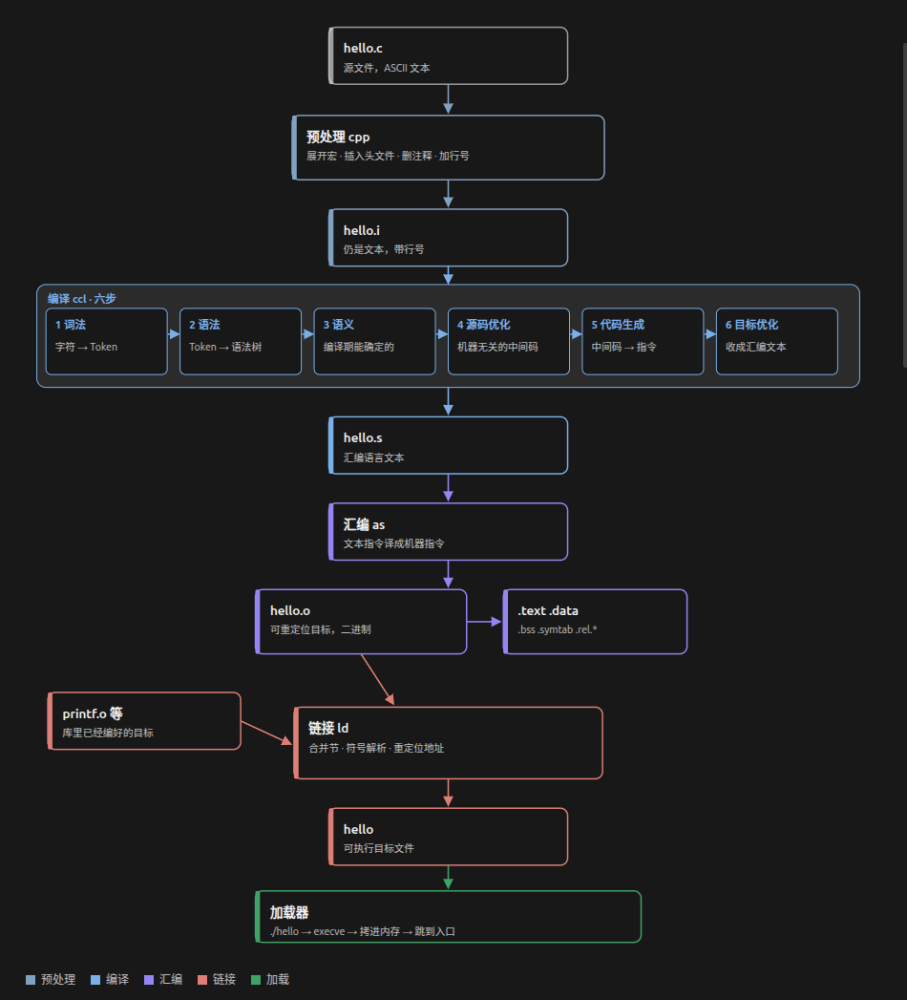
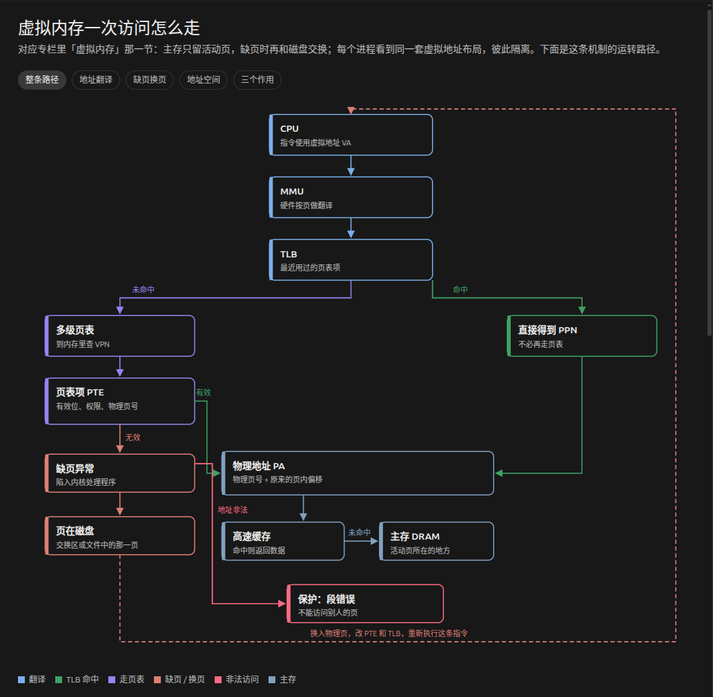
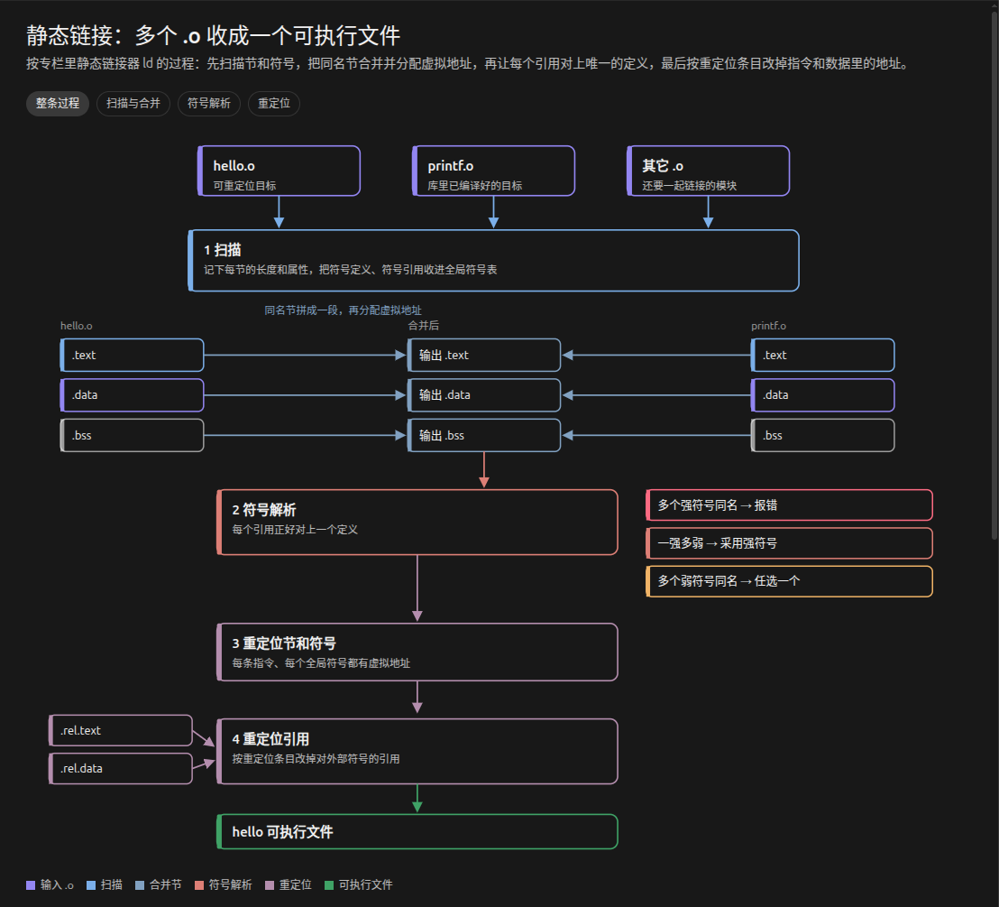
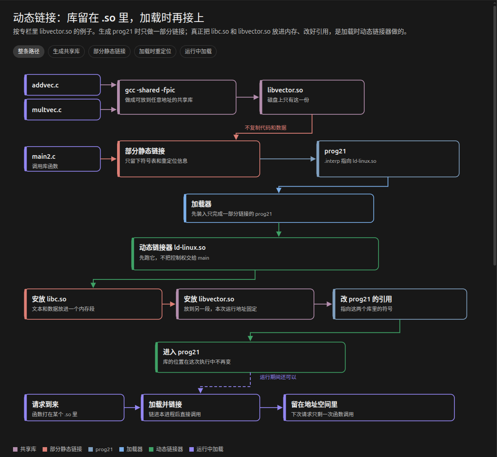
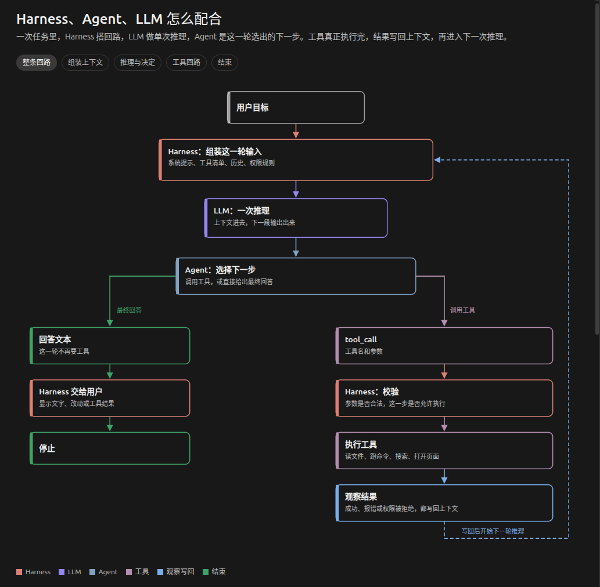
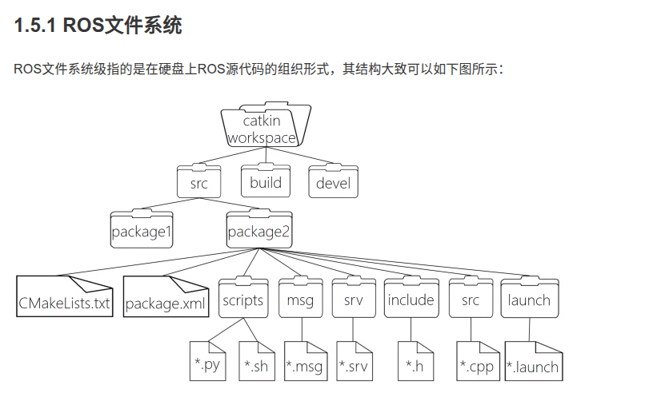

# 第二次作业学习笔记

> 下面是略微抽象的一节，关于这类原理解析，网上有许多相关的解析资料，这里不罗列太多知识点，只写一下框架和思考和当前的学习程度

## 1-程序详细编译过程和相关计算机系统原理

- 参考文献链接:[程序详细编译过程](https://zhuanlan.zhihu.com/p/476697014)

### 1.文章结构

大概是可以分成 **程序编译的整体流程**->**链接的概念和意义**->**虚拟内容存和虚拟空间**->**静态链接的详细过程**->**可执行文件加载**->**动态链接和共享库**

### 2.程序编译的整体流程

这里放一个流程图

**整个编译过程是由编译驱动程序来执行，从用高级语言写好的文本文件到可执行文件的过程**

**形成可执行文件前还有一个重要一环，就是将汇编出来的二进制魔表文件链接，而在链接这里可以体现计算机对物理硬件资源管理的抽象**

> 以前不了解，只知道汇编好像是一门语言，现在这里也是编译的一个阶段，由汇编器执行

### 3.链接的概念和意义

链接是将许多代码和数据段给拼接，实现一种**熵减**的过程，由链接器执行，在程序诞生的不同时期都可以发生，最后得到一个**单一文件**

其实就是当程序太大，文件太多时，为了**减少资源浪费和易于修改和管理**而诞生的技术

### 4.虚拟内存和虚拟地址空间

> 这里是关于链接的一个计算机体系的底层背景知识，解析连接器在执行时，需要为代码和数据确定虚拟地址，因此插入这里的知识

**虚拟内存**相当于一个机制，在实际物理内存和虚拟出来的进程存储间实现某种操作映射机制，套了一个层，每一个进程拥有独立的空间，因此不用处理和协调其他进程在实际物理内存中的位置（对他们自己来说），虚拟内存帮他们处理，每个进程自己看起来像是拿到一个连续的地址空间，实际上是虚拟出来的

> 哪有什么岁月静好，只不过是有虚拟内存在负重前行

### 5.静态链接详细过程

先是解析了目标文件的结构，也就是在Linux中的ELF格式文件，这些文件带一些命令行参数输入进**静态链接器**然后产生完全链接的，可以加载和运行的**可执行目标文件**

*那么链接器拿到这些文件后怎么链接呢*

#### 1.空间和地址分配

将文件的所有符号定义和引用经过一些操作的到合并后的**可执行文件和进程虚拟地址空间**的映射关系，这里就用到了虚拟内存的机制，实现还没有执行文件就以及得到了地址空间

#### 2.符号解析和重定位

每个可重定位目标模块都有符号表，根据一些解析机制和处理重定义的符号机制以及接下来的重定位，实现为每个符号分配运行时的地址，相当于就是一开始很多ELF格式的文件，很乱，现在全部解析将ELF中的区合并重组成一个有序的文件，**程序中的每条指令和全局变量都有唯一的运行时内存地址了。**

链接完成后得到一个可执行的目标文件

### 6.可执行文件的加载

拿到可执行文件后，从链接阶段进入**运行阶段**

步骤如下

- shell调用加载器
- 加载器吧可执行文件映射到进程内存
- 跳转都啊程序入口点开始执行

### 7.动态链接和共享库

上面解析的是静态库，但是静态库的缺点是浪费内存空间，当两个程序共享一个模块，会因为复制两份而浪费空间（*有点类似C++里的引用传递或者指针传地址,而不使用直接将类或字符串直接复制进函数*），因此诞生了**共享库**

它是在运行是可以和已经在内存中的程序链接起来，由**动态链接器**来执行

它和静态库区别是，它没有像静态库那样是**复制和嵌入**其他模块，而是先获取了库文件的**重定位和符号表**的信息,然后执行重定位，最后实现得到固定的共享库位置，实现动态链接

## 2-CMake流程

> 我之前学过部分的CMake,但是由于学的教程太老，导致有一些语法以及淘汰，后续也学了一下现代的语法，正好可以拿出来讲，这部分还是讲讲对CMake的理解，不罗列太多知识

先放文章的链接：[CMake基础](https://www.runoob.com/cmake/cmake-basic.html)

### 我自己的理解

这个CMake相当于一个上层的构建工程的写指令的工具，有点类似终端和电脑本机的关系，中间很繁杂的文件包含，找路径，编译，链接等过程的执行工具被封装好，可以说是工具链的启动总操作台。

**那么CMake主要做什么呢**

大概是，找到需要用的哪些软件包，功能包，依据一些我们制定的规范（版本，工具，路径），执行工具链，复现上面的编译过程，最后得到构建好的工程（生成库文件，可执行程序等）以及实现产出（安装）

**刚刚说的总操作台，那就是CMakeLists.txt了**

这边规定好工程名，工具版本，定义些变量，规定生成物的路径，安装路径，添加各种可执行文件或者库（使用哪些源文件），因此在这边直接是定义了整个工程的结构和内容

**说说工作区结构**

类似

Demo/
├── CMakeLists.txt          顶层：project、add_subdirectory
├── include/
│   └── demo.h              对外头文件
├── src/
│   ├── CMakeLists.txt      本目录怎么编
│   ├── main.cpp
│   └── demo.cpp
├── tests/
│   ├── CMakeLists.txt
│   └── test_demo.cpp
└── build/                  cmake 生成的目录

一般是在build里使用`cmake ..`来加载出中间的构建文件，重点是**makefile**，然后直接原地`make`执行makefile里的自动化构建步骤，工程就构建好了

所以相当于cmake是在makefile上的一层，最后还是要执行makefile

## 3-AI怎么被调用完成任务的

> Agent 的核心并不只是“强大的模型”或“复杂的提示词”，而是一个受控的闭环：模型提出动作，程序执行动作，执行结果再影响模型的下一步决策。

### 一般的结构

harness-agent-LLM

### agent是什么

很显然，agent中文意思是代理，那么很显然这里的代理是**`代替LLM处理`**的意思，嵌入它的架构是怎样呢，一般是我提出一个任务，然后发到LLM，它来判断下一步做什么，然后输出结构化调用工具，到这里LLM就停了，它本身只能输出内容，不能和物理世界交互，然后这里就到一些程序在本地执行工具链，得到的结果后返回给LLM，然后继续推理，如此循环，维持这个循环的东西可以说是agent

#### 整个运转配合流程

上面是加入了harness的三者运转关系

harness相当于一个运转的环境，提供了上下文，日志，工具，权限，沙箱环境等

agent相当于做出每一次**选择**的决策机构，下一步做什么？调用哪些工具，还是给harness校验

LLM相当于产出内容和推理的大脑，它不直接改任何文件（也没这个实力）

我自己的比喻是：

{大脑（LLM）-- 脊髓(agent) -- 身体(harness) } ---->要执行的对象（改文件，生代码等）

## 4-catkin 工作空间

参考文献[ros wiki](https://wiki.ros.org/catkin/Tutorials)

点击展开

 1. 先分清三样东西
​<strong><code>/opt/ros/noetic/</code></strong>​
系统装好的 ROS。小乌龟、​<code>roscore</code>​、​<code>geometry_msgs</code>​ 都在这。不要往里塞作业。
​<strong><code>~/catkin_ws</code></strong>​
你的工作空间。源码、编译、自己的包都在这，叠在官方 ROS 上面（overlay）。
​<strong><code>~/.bashrc</code></strong>​
bash 的个人启动脚本，<strong>不是</strong>工作空间的一部分，也不是编译产物。每个新终端启动时自动执行一遍。往里面写 ​<code>source</code>​，只是让以后每个窗口自动去读磁盘上的 ​<code>setup.bash</code>​。
对应关系：
动作	干什么
​<code>catkin_make</code>​	把结果写到 ​<code>build/</code>​、​<code>devel/</code>​（磁盘）
​<code>source .../setup.bash</code>​	把环境变量读进<strong>这个</strong>终端的内存
​<code>.bashrc</code>​ 里的 source	新终端启动时自动读同一份文件
窗口之间<strong>不同步内存</strong>。新窗口不是抄旧窗口，而是自己读磁盘上最新的 ​<code>devel/setup.bash</code>​。

2. 工作空间四个目录
<code class="language-text">~/catkin_ws/
  src/      源码：每个包一个文件夹
  build/    编译中间文件，不要手改
  devel/    结果：devel/lib/包名/、share/包名/、setup.bash
  install/  只有 catkin_make install 才有，入门不用
</code>
多个包共用 ​<code>devel/</code>​ 这个前缀，但仍按<strong>包名</strong>分开，A 不会盖掉 B，所以小练习都放同一个 ​<code>src</code>​ <strong>不会把 devel 搅乱</strong>。
<strong>你问的「创好 src 再回根目录</strong> ​<strong><code>catkin_make</code></strong>​ <strong>会不会自动生成工作空间」：会。</strong>
Noetic 不必 ​<code>catkin_init_workspace</code>​。必须在 ​<strong><code>~/catkin_ws</code></strong>​ <strong>根目录</strong>编译，不能在 ​<code>src</code>​ 里 ​<code>catkin_make</code>​。
​<code>~</code>​ 是 ​<code>/home/lichen</code>​。真正的文件是：
<code class="language-text">/home/lichen/catkin_ws/devel/setup.bash
</code>
没有 ​<code>~/devel/setup.bash</code>​。bashrc 必须写带 ​<code>catkin_ws</code>​ 的路径，因为新终端一打开当前目录通常是家目录。

3. 功能包
语法（<strong>必须在</strong> ​<strong><code>src</code></strong>​ <strong>里</strong>）：
<code class="language-bash">catkin_create_pkg &lt;包名&gt; [依赖...]
catkin_create_pkg test_pkg std_msgs rospy roscpp
</code>
​<code>std_msgs</code>​：标准消息
​<code>rospy</code>​ / ​<code>roscpp</code>​：Python / C++ 客户端
这只生成 ​<code>package.xml</code>​、​<code>CMakeLists.txt</code>​ 等架子，<strong>还不能</strong> ​<code>rosrun</code>​ 节点。要回根目录再 ​<code>catkin_make</code>​。
<strong>同名包</strong>指 ​<code>package.xml</code>​ 里的包名（通常也等于文件夹名）：
<strong>同一个</strong> ​<code>src</code>​：不允许两个 ​<code>test_pkg</code>​，​<code>catkin_make</code>​ 会冲突（视频「这是不允许的」）。
<strong>不同工作空间</strong>：可以都叫 ​<code>test_pkg</code>​。
ROS 用哪一个：​<code>ROS_PACKAGE_PATH</code>​ <strong>从左到右第一个</strong>。后 ​<code>source</code>​ 的工作空间通常排在最前，同名时<strong>盖住</strong>先 source 的（磁盘上还在，不是删掉）。不同名的包一般仍能找到。
入门标准做法：一个 ​<code>~/catkin_ws</code>​，练习做成 ​<code>test_pkg</code>​、​<code>turtle_demo</code>​ 等不同包。只 source 一次。这是正规用法。

4. source 与 bashrc（两边聊天的核心）
两处写的是<strong>同一个文件</strong>，时机不同：
	​<code>.bashrc</code>​ 里那行	​<code>catkin_make</code>​ 后那行
作用	新终端「开机加载」	当前窗口「刷新缓存」
解决什么	以后每个窗口都认识 ​<code>catkin_ws</code>​	刚编完立刻 ​<code>rosrun</code>​ 找不到包
​<code>catkin_make</code>​ 会重生 ​<code>devel/setup.bash</code>​（新包、新节点）。当前窗口还握着旧环境，所以同一窗口编译完要再 source。若这窗编译、另开新终端去跑，且 bashrc 已写对，新窗会读到磁盘上的新文件，不必再敲。
<strong>你问 echo 是不是开新终端执行：</strong> 不是。​<code>echo "..." &gt;&gt; ~/.bashrc</code>​ 是在<strong>当前</strong>终端往文件<strong>追加一行</strong>，马上写好。已经开着的窗口不会自动重读，要 ​<code>source ~/.bashrc</code>​ 或新开窗口。不要反复 echo，先：
<code class="language-bash">grep catkin_ws ~/.bashrc
</code>
你已经有了，<strong>不要再追加</strong>。
相对路径：已经 ​<code>cd ~/catkin_ws</code>​ 时可以用 ​<code>source devel/setup.bash</code>​。写进 bashrc 必须用 ​<code>source ~/catkin_ws/devel/setup.bash</code>​。
入门习惯：每次 ​<code>catkin_make</code>​ 成功，同一窗口立刻再 source 一次。

5. 工作空间越来越多怎么办
<strong>不要每做一个练习就往 bashrc 加一行 source。</strong> 后 source 的会叠在上面：同名包认错版本；个别 ​<code>setup.bash</code>​ 还可能整段改写环境，把前面的工作空间挤掉。
学习：就这一个 ​<code>~/catkin_ws</code>​（你已是这样）。
真正独立的大项目：另建 ws，<strong>用的那个终端手动 source</strong>，不写进 bashrc。
切换：新开终端（先只有 Noetic），再 source 目标空间。

6. 一份按顺序执行的清单
工作空间若已经编过，从第 4 步开始。
<code class="language-bash"># 1. 建目录（任意位置）
mkdir -p ~/catkin_ws/src
上面是我很久以前用AI生成的解析

接下来还是用理解性的框架语言来说

> 实际是我快饿死了

这个工作空间和cmake有点类似，因为catkin其实就是在cmake之上的一层ros工程的构建工具

这里可以嵌入[ros文件系统](https://www.autolabor.com.cn/book/ROSTutorials/chapter1/15-ben-zhang-xiao-jie/151-roswen-jian-xi-tong.html)的解析

这个catkin 可以用来构建类似的工程，因为类似package.xml这些文件cmake是不会去读的，还有catkin可以实现对ros功能包的一些声明依赖关系的操作，总之是涉及ros层面的文件管理

**工作区的构建**

一般的顺序是，先创建一个顶层的workplace,然后在创src，在src里`catkin_init_workspace`，然后回到顶层执行`catkin_make`然后这个工作空间就初始化好了

这还没完

ros很大的功能实现是依赖功能包

然后进到src，使用`catkin_create_pkg` pkg_name就可以初步创建一个包了

默认有CMakeList.txt和package.xml，这个时候就是构建ros工程的好机会了！

> 我猜师兄师姐不会看到这里，偷偷累一下，我去手敲了3000字累麻了，连续搞了4个半小时，先吃个饭了