# 第三课 ROS的总结和理解


## 前言

**爆肝4天整理的20681字超全面的ROS笔记，完结了！！**

> 首先呢，在学习这个ROS的过程，许多对知识和机制的解析我都是通过看视频，查文档，以及跟AI对线来完成的，很多知识点的解析是用AI直接生成的，毕竟有详细层次又清晰，**为什么不一边学一边用自己的方式总结呢**,因为我觉得总结这种东西，应该在学得差不多或者说到了一个新阶段前，可以去总节一下前一段时间学的，不然很多时候，刚刚开始学，体系都没架好，知识点都不一定理解对（虽然现在也不一定），总结啥啊，会很片面和结构混乱，当学完一个阶段后，大致能理解整个架构是怎样了，这样再去总结就可以梳理出一个比较清晰的文章，**这是我对古法手搓总结的个人看法**

> 因此捏，**这个笔记手写的部分都是我的个人心得和理解**，主要是理解，也会涉及相当一部分的重要机制的解析（也是用我自己的话来解析），同时会附上学习过程中用AI整的知识解析，因为它总结的太好了，我再抄一遍也是没必要，这里会选择用折叠的方式来附上它的内容

> 还有就是，如果没有基础（我的基础就是开学前学了5天的CMake和古月居ROS），在这么短时间内整理清楚这个东西，在没有做过一个项目的情况下，确实有点令人力竭了，**只能说，臣妾已经拼尽全力了，可以说是提前准备的不够多**,毕竟机会是留给有准备的人，我已经燃尽了（bushi，没事，还能燃

> 这就是我做笔记的个人习惯，留一个当时的状态的描述，内心自白在开头，往日回看，不乏一番乐趣，不然其实还不如让AI直接生成，**既然要做，那么就做的有人味**，行，废话不多说，直接开始

## 相关的学习资料

- [赵虚左的ROS文档](https://www.autolabor.com.cn/book/ROSTutorials/chapter1.html)

- [古月居ROS21讲](https://www.bilibili.com/video/BV1zt411G7Vn/?spm_id_from=333.337.search-card.all.click&vd_source=90c902c00fc92a118e19be3ee12a0347)

## 文章的结构

**我大概会先按照ROS的背后的运转体系来解析一下，就是ROS版本，社区资源，ROS干嘛的之类的角度，然后就介绍ROS的架构，就是关于ROS的三个层级，怎么组织起一个ROS系统的，然后会稍微深入ROS系统的各部分的解析，比如文件系统中各个文件的作用啥的**，看大纲好了

## 1. ROS的宏观背景介绍

> 这里就介绍一下ROS的定位是什么，用点官方回答，还有ROS的组成，在一个机器人系统中什么地位，ROS的时代背景

### 1.1 ROS的定位

- **关键词**：开源、元操作系统、硬件抽象、进程间通信、软件包管理。
- **与传统操作系统的区别**：
  - Linux 负责进程、内存、文件、设备等底层资源管理；
  - ROS 负责组织机器人软件，提供节点通信、硬件抽象和开发工具。
- **一句话概括**：
  ROS 是运行在 Linux 等操作系统上的机器人软件框架和工具链，
  重点是让机器人程序更容易组织、通信和复用。
- **注意**：ROS 不是完整的操作系统内核，也不是传统意义上的 OS

> **也就是说ROS这个是属于元操作系统，它也是“寄生”在别的操作系统上面，它相当于中间层，管理一些软件包和通信**

参考的官方文档：

- [ROS Introduction](https://wiki.ros.org/ROS/Introduction)
- [ROS Concepts](https://wiki.ros.org/ROS/Concepts)
- [ROS Noetic](https://wiki.ros.org/noetic)

这里附带一个关于元操作系统的解析：

<details>
<summary>点击展开：元操作系统是什么？以 ROS 为例</summary>
<h3>什么是元操作系统？</h3>
<p>“元操作系统”（meta-operating system）不是像 Linux、Windows 那样负责管理 CPU、内存和硬件的操作系统，而是<strong>建立在传统操作系统之上、为某一类复杂应用提供统一抽象和公共基础设施的软件层</strong>。它自己不替代操作系统，更像一套“领域专用的运行环境和中间件”，让人不必为每个程序重复实现通信、发现、启动、配置和工具链。</p>
<p>ROS 是最典型的例子。ROS 官方早期就把 ROS 描述为面向机器人的元操作系统。机器人开发通常涉及激光雷达、相机、定位、规划、控制等多个模块；ROS 在这些模块和 Linux 之间增加了一层统一机制：</p>
<table border="1" cellpadding="8" cellspacing="0">
<thead>
<tr><th>传统操作系统中的概念</th><th>ROS 中对应的概念</th></tr>
</thead>
<tbody>
<tr><td>进程</td><td>节点（node）</td></tr>
<tr><td>进程间通信</td><td>话题、服务、动作</td></tr>
<tr><td>设备或文件接口</td><td>传感器话题、参数、TF 坐标变换</td></tr>
<tr><td>程序启动和依赖管理</td><td>launch 文件、功能包</td></tr>
<tr><td>系统工具</td><td>rviz、rosbag、命令行工具</td></tr>
</tbody>
</table>
<h3>ROS 中的机器人数据流示例</h3>
<p>例如，一个移动机器人可以这样组织：</p>
<pre><code>激光雷达驱动节点 ── /scan ─────&gt; 定位与建图节点
                                      │
                                      v
                                路径规划节点
                                      │
                                      v
                               /cmd_vel 速度指令
                                      │
                                      v
                                 底盘驱动节点</code></pre>
<p>这些节点可能分别由不同开发者编写，甚至用不同语言实现。ROS 负责让它们发现彼此、按统一消息格式通信、设置参数并协调启动。例如雷达驱动节点向 <code>/scan</code> 话题发布数据，建图节点订阅该话题；规划节点发布 <code>/cmd_vel</code>，底盘节点订阅后控制轮子。</p>
<h3>它与真正的操作系统有什么关系？</h3>
<p>真正的“操作系统工作”仍由底层系统完成：Linux 负责线程调度、内存和设备驱动，ROS 负责机器人软件之间如何协作。因此可以这样理解：</p>
<blockquote><p><strong>Linux 让程序能够运行，ROS 让机器人各个模块能够像操作系统中的进程一样协同工作。</strong></p></blockquote>
<h3>补充说明</h3>
<p>随着 ROS 2 的发展，“元操作系统”这个说法已经有些过时。ROS 2 更常被称为<strong>机器人中间件、开发框架和工具集合</strong>，底层通信通常由 DDS 完成；但它提供的分层思想仍与“元操作系统”一致。</p>
</details>

### 1.2 ROS的核心组成

有一个比较精炼的公式：

**ROS = 通信中间件 + 开发工具链 + 软件生态**

- **通信中间件**：规定节点如何协作，用话题，服务等通信方式，和一些如XML-RPC和TCPROS等协议完成通信。对应实现库如 `roscpp`、`rospy`。
- **工具链**：辅助开发和运行，用例如 `catkin` 编译工作空间、`roslaunch` 启动、`rqt` 查看、`rosbag` 录包回放。
- **软件生态**：提供可复用的机器人能力，如 Navigation、传感器驱动和各类功能包。

> 但ROS不是操作系统吗，这里还有一些外围工具和功能包，所以我感觉这里是囊括了一些可拓展的基础设施，真正给我感觉在**操作**的部分应该是里面的通信结构和组织架构了，比如这个ROS1的rosmaster

## 1.3 ROS 在机器人系统中的角色或位置

**我的理解是**：

ROS它是一个更大范围的软件链路，ros_control是基于ros的一种组织协调机制，EtherCAT是负责硬件层的来回通信了，其实ROS也是到EtherCAT前的数据传输（如果用EtherCAT),这里的EtherCAT可以看成是ros_control里的硬件接口层的后端实现，但是EtherCAT它的驱动可以跑在ROS进程中，反正**我觉得，ROS更像是提供一种平台，然后接入什么东西，怎么接入是开发者自己的事情**，**它也可以类比成一个人，系统中不同的节点就像身体的不同部位的输入或者运转，比如视觉输入的驱动节点是眼睛，运算当然是大脑，其他传感器可以是皮肤触觉，传输的节点是神经，执行器是关节，驱动节点是肌肉，EtherCAT是神经的电位信号传输协议**，这是我不成熟的比喻（纯能工智人大脑想的比喻）

这里附一张经典机器人系统结构图

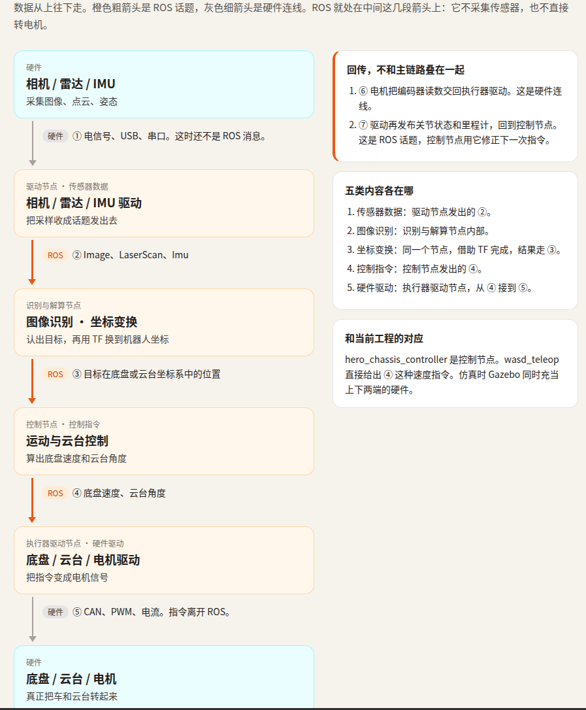


## 1.4 ROS 1 的时代结束了

大人们，时代变了，我们现在用的是最后一个ROS发行版 **ROS 1 Noetic** 已经在2025年终止维护，接下来的是ROS 2，我用的是 ubuntu 2026.04,然后用docker跑20.04来安装ROS1，ROS2很多通信机制，文件结构都很不一样，比如没有rosmaster

## 2. why ROS?

> **为什么用ROS呢，我第一次打开B站第一次打开了解ROS的大门就是，输入“ROS是什么”，当时我的感觉就是（这是完全没有相关的知识），哇，ROS，这个字母组合和发音听起来很高级的东西啊，心中不禁反复念唱：ROS，哦，ROS。。。这一节就讲讲这个为什么要用ROS，它解决了什么痛点**

这里要放当时的启蒙课，真是给到夯，给我看爽了（心流）：

[ROS 是什么](https://www.bilibili.com/video/BV1BP4y1o7pw/?spm_id_from=333.337.search-card.all.click&vd_source=90c902c00fc92a118e19be3ee12a0347)

### 2.1 ROS 解决了什么问题

当时很远古的时候，机器人开发就遇到一个很难受的问题，就是每一家机器人的协议和架构都不一样，没办法通用，也会遇到重复造轮子的问题，整个机器人是一个单体程序，不利于多人维护，每个节点间要手搓通信，十分麻烦

然后就有一个天才整出了ROS，后面逐渐发展

提供了：

- 现成的通信机制
- 相对完整的工具和开源生态
- 机器人模块化，便于分工
- 仿真，记录和回放功能

就带来了以下收益：

1. **通信机制现成**：节点之间可以直接使用统一的话题、服务等机制， 不必从零实现进程通信、数据序列化和连接管理。
2. **工具和生态完整**：编译、启动、可视化、调试和算法包都有成熟支持， 可以减少重复开发。
3. **适合模块化协作**：不同节点可以按功能拆分，通过明确的消息接口合作， 团队可以并行开发感知、规划和控制模块。
4. **便于调试和验证**：可以先用仿真运行，再通过录包和回放复现问题， 不必每次都依赖真实机器人。

**总结就是，ROS解决了机器人软件开发的“链接，复用，分工，调试”问题，让整个开发变得高效**

### 2.2 队伍里采用的架构

看PPT得知，队伍里用的是纯上位机控制，我了解了一番后大概知道，它跟上位机+单片机控制的优劣区别大概是：

- 有单片机控制的这种是比较稳的方案，而纯上位机相对高风险和高集成
- 用单片机的话就要同时维护两部分，纯上位机就可以统一记录，软件也具有统一性
- PC到单片机有通信的开销，纯上位机就没有，但是EtherCAT/CAN网关也不少
- 单片机相对更经济，纯上位机的机器人可能更体积大，对PC稳定系要求也高

## 3. ROS 架构总览

> 废话不多说，对于架构的梳理会有种学物理突然将一堆共性串联起来的“成体系”“大一统”的感觉，先上AI总结图，它大概可以分为三层

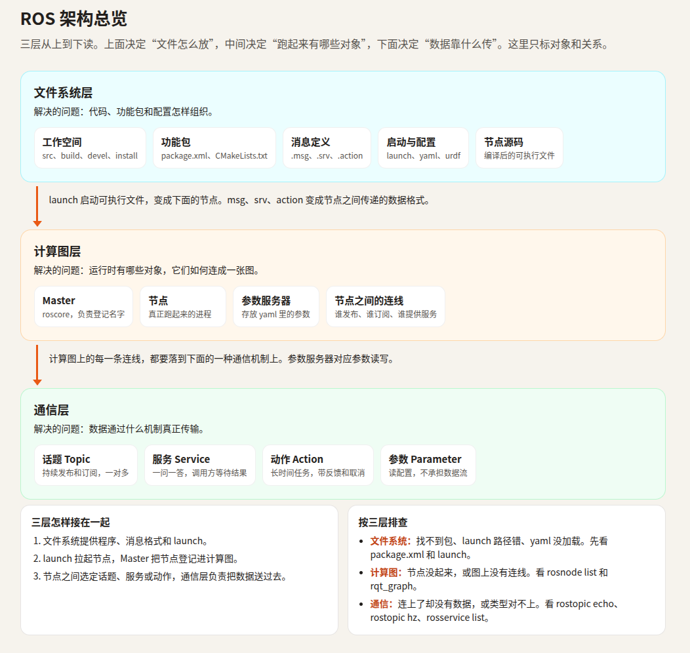

### 3.1 三层架构

先放个AI总结的表格，这个是按照我制作的skill的风格来总结的

| 层次       | 解决的问题                         | 代表实体                                                     | 排错入口                             |
| ---------- | ---------------------------------- | ------------------------------------------------------------ | ------------------------------------ |
| 文件系统层 | 代码、包和配置怎样组织与构建       | 工作空间、功能包、`package.xml`、`CMakeLists.txt`、`launch`、`config` | 包是否存在、依赖是否正确、能否编译   |
| 计算图层   | 运行时有哪些对象，它们怎样建立关系 | 节点、Master、话题和服务端点、参数、名称与类型               | 节点是否启动、名称和类型是否匹配     |
| 通信层     | 数据通过什么机制真正传输           | Publisher、Subscriber、Client、Server、消息序列化和连接      | 连接是否建立、数据是否实际发布和接收 |

那么三层如何组织起来呢，关系是怎样的呢

**这个文件系统层就是底座了，你需要在这一层制作管编译的CMakeList,关乎整个工程的根和怎么将系统树长出来，说白就是CMake编译的那边的东西，然后怎么声明，怎么启动，相关的配置文件，参数文件，工作空间中的构建文件等等，这个层呢，我觉得是开发者可以直接操作的一层**

**然后文件系统层到计算图层，也可以说是ROS图，怎么联系起来呢，我自个的理解是通过launch，launch前整个系统就是死的，之后就会真正跑出进程来，这时头顶就会有一张网，有一个巨型蜘蛛（rosmaster)来组织那些节点，各种话题的订阅，发布关系，服务啊，参数服务器的连接啊，这时你想去摸它们，就要通过ros相关的命令在终端来获取返回了，所以不能直接摸到了**

**通信层可以说是计算图层架起来后的一个结果，也不一定，毕竟通信机制一开始是写好的了，只是计算层分配好通信的对象后才能建立正确的通信，但是协议本身是写好的，这一层负责各种器之间的通信的格式和机制**

可以概括为：

- **文件系统层负责“代码在哪里、怎样构建”**；
- **计算图层负责“运行时有哪些对象、谁和谁连接”**；
- **通信层负责“连接建立后，数据怎样真正传输”**。

这边放一下官方的解释：

[ROS Concepts](https://wiki.ros.org/ROS/Concepts)

### 3.2 五个基本对象

| 对象           | 本质              | 主要作用               |
| -------------- | ----------------- | ---------------------- |
| 节点 Node      | 运行中的程序/进程 | 完成一项相对独立的工作 |
| 话题 Topic     | 持续的数据通道    | 传输连续数据流         |
| 消息 Message   | 有类型的数据结构  | 定义话题中传输的数据   |
| 服务 Service   | 请求—响应接口     | 完成一次远程功能调用   |
| 参数 Parameter | 全局共享的配置值  | 保存运行配置           |

**用作业的工程当例子，工程写的底盘控制器就不是一个节点，因为在CMakeList里写明了做成一个.so动态库，在这里可以说是一个控制器插件，因为它要插到另外一个宿主节点里，但是这个虽然不是节点，但是依然有其他4个基本对象的配置，因为在文件层，可以任意改造即将launch起计算图层的结构，实际的宿主节点是跑在gazebo里的ControllerManager，它通过一系列方式来把这个控制器插件拿到，然后在它的进程里实例化这个类，于是它就“插”进去了，还有一些独立节点，比如controller_spawner和wasd_teleop，分别是调用相关服务将插件名传递到manager那边，还有控制键盘的节点，所以节点 = 进程级运行单元**

这5个基本对象不是单独属于哪一层架构，而是一个贯通的ROS系统的对象，在不同层有不同表现心态：

| 对象           | 文件系统层的形态                    | 计算图层中的角色                       | 通信层中的作用                  |
| -------------- | ----------------------------------- | -------------------------------------- | ------------------------------- |
| 节点 Node      | 源码、可执行文件、launch 配置       | 运行时进程，创建通信端点               | 通信的参与者和数据生产者/消费者 |
| 话题 Topic     | 名称常在代码、launch 或 YAML 中声明 | 命名连接关系，发布者与订阅者通过它关联 | 连续异步数据的传输通道          |
| 消息 Message   | `.msg` 文件、生成的头文件           | 接口类型约定                           | 序列化后作为实际传输载荷        |
| 服务 Service   | `.srv` 文件、生成的头文件           | 客户端与服务器的调用关系               | 一次请求—响应通信               |
| 参数 Parameter | YAML 或 launch 配置                 | 参数服务器中的共享键值                 | 通常不参与节点间持续通信        |

**五个基本对象主要构成计算图层的运行时词汇表**

### 3.3 架构中的公共基础设施

这里最核心的就是ROS Master了

它负责下面这些活

- 记录节点、话题、服务等运行信息。
- 接收发布者、订阅者和服务端的注册。
- 为客户端提供连接对象的查询。
- 交换参与者的通信地址，帮助双方建立连接。
- 维护参数服务器中的全局参数。

**它不直接传递高频话题数据和服务调用，就是一个中间商吧，把订阅器，发布器，客户端，服务端的彼此的联系方式（地址）根据它们之间的话题和服务信息来匹配，给到对应的对象，然后它们自己通过通信方式来自己通信**

然后基础设施还有一个方便的启动方式：`roscore`

通常会启动：

- ROS Master；
- 参数服务器；
- `rosout` 日志节点。

如果 Master 退出，已经建立的连接可能暂时继续， 但新节点的注册、发现和参数访问会受到影响，系统不能保证正常扩展。

**差不多，下面给三层架构的排错方式，当问题出来，先从哪里开始排查是个问题**

| 现象                             | 优先检查层           | 常用入口                                                     |
| -------------------------------- | -------------------- | ------------------------------------------------------------ |
| 找不到功能包、依赖缺失、编译失败 | 文件系统层           | `rospack find`、`roscd`、`catkin_make`                       |
| 节点或话题没有出现在图中         | 计算图层             | `rosnode list`、`rqt_graph`                                  |
| 关系已经建立，但没有实际数据     | 通信层               | `rostopic list`、`rostopic info`、`rostopic hz`、`rostopic echo` |
| 参数没有生效                     | 计算图层中的参数系统 | `rosparam list`、`rosparam get`                              |

然后给一个官方的文档

[ROS Master](https://wiki.ros.org/Master)、[roscore](https://wiki.ros.org/roscore)、[Parameter Server](https://wiki.ros.org/Parameter%20Server)。

> ***接下来进入每一层架构的解析***

## 4. 文件系统层

照例，先来精美的结构图

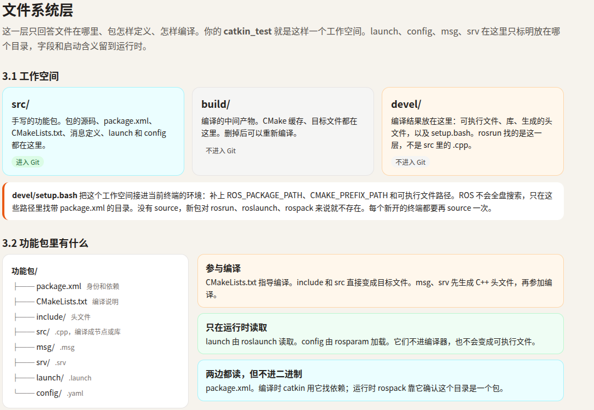

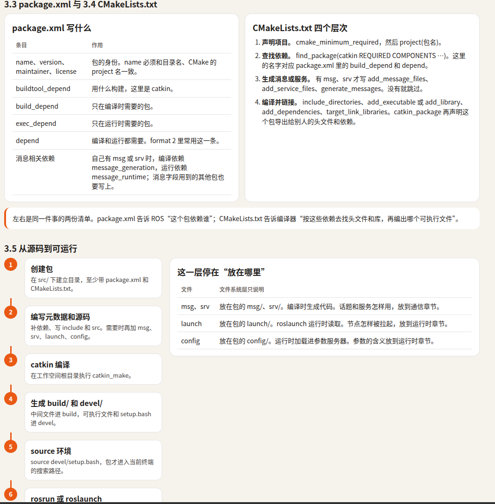


### 4.1 工作空间

#### 这是典型 catkin 工作空间：

```text
catkin_ws/
├── src/      源码空间
├── build/    构建空间
└── devel/    开发空间
```

**三个目录分别的职责**

| 目录     | 主要职责                                   | 是否进入 Git |
| -------- | ------------------------------------------ | ------------ |
| `src/`   | 存放功能包、源码、launch、config、msg、srv | 进入         |
| `build/` | CMake 缓存、中间文件、目标文件             | 不进入       |
| `devel/` | 编译生成的程序、动态库、头文件、环境脚本   | 不进入       |

#### 三个目录的区别

- `src/` 保存需要维护和共享的原始内容。
- `build/` 是编译过程产生的临时文件，可以删除后重新生成。
- `devel/` 是可以直接运行的开发空间产物，也可以删除后重新编译； 不应该把生成的 `.so`、可执行文件和 `setup.bash` 当作源码提交。

典型 `.gitignore`：

```
/build/
/devel/
```

#### *我来总结一手*

其实上面的表格已经梳理的很清楚了，其实还有一个install目录，但这不是必须的，看`CMakeList`有没有写，这里的控制器插件是没有的，这个工作空间可以说是文件系统层的框架，因为你所有的文件都是按这个格局来放置的

其实最重要的，我们花最多时间的是**`src/`**目录,源码都在这写，然后还有个`devel/`,这个是放一些生成的库文件和可执行程序等生成品，这个路径是catkin工具设置好的了，不要随便在`CMakeList`里set或者改变目标属性

然后还有一个就是

#### `devel/setup.bash` 的作用

这个用来修改当前终端的环境变量，使系统能够找到本工作空间生成的：

- 可执行程序；
- 动态库；
- Python 模块；
- 生成的头文件；
- 功能包和 `CMake` 配置。

最方便的方法是**直接将它写在`./bashrc`**里然后对工作区有修改直接把终端关了再开就行

#### 为什么包发现依赖环境

因为ROS 不会自动扫描整个硬盘寻找功能包，而是通过环境变量、`CMake` 前缀和 工作空间的环境钩子进行查找。没有 source 工作空间时，可能出现：

```
找不到自己新建的功能包
找不到生成的动态库
$(find hero_chassis_controller) 解析失败
运行时提示共享库加载失败
```

#### **总结就是**

> `src/` 放源码，build/ 放编译中间物，devel/ 放可直接使用的开发产物；
> devel/setup.bash 把当前终端接入这个工作空间。

### 4.2 ROS 功能包结构

功能包是组织源码、依赖和构建规则的单元，**不是节点**；
一个包可以生成多个节点、动态库或插件。

#### *这个是大致的功能包结构*

```text
my_package/
├── package.xml        包信息和依赖
├── CMakeLists.txt     构建规则
├── include/my_package/ 公共头文件
├── src/               .cpp 实现和 main()
├── msg/               消息定义
├── srv/               服务定义
├── launch/            启动文件
└── config/            参数文件
```

#### 相关目录的功能

- `include/` 放对外头文件，`src/` 放实现、节点入口或插件源码。
- `.msg`、`.srv` 用于生成通信数据类型，修改后需要重新编译。
- `launch/`、`config/` 不参与编译，由 `roslaunch` 或节点在运行时读取。
- `.h`、`.cpp`、`.msg`、`.srv` 参与构建；`YAML` 和 launch 通常只影响运行配置

| 内容                 | 主要用途             |
| -------------------- | -------------------- |
| `package.xml`        | 包身份、依赖关系     |
| `CMakeLists.txt`     | 编译目标、消息生成   |
| `include/`、`src/`   | 编译程序或动态库     |
| `launch/`、`config/` | 运行时启动和参数配置 |

#### **总结就是**

上面的表格很清晰介绍功能包的结构和每一个目录的功能，其实这里可以提一个关于`packge.xml`的功能，它可以标记功能包的位置，不是说放在`src/`里的就是功能包，可能会出现多层嵌套的分类文件夹，最终让系统识别出功能包的是含`package.xml`的这个目录,`src/`里可以有很多功能包

> **下面会介绍两个功能包里非常核心的两个文件**

### 4.3 **`package.xml`**

#### 主要包含：

- **包身份**：名称、版本、描述、维护者、许可证。
- **构建依赖**：编译时需要，如 `roscpp`、`pluginlib`。
- **运行依赖**：运行节点或库时需要，如消息包、运行库。
- **消息依赖**：生成自定义消息通常需要：
  - 构建阶段：`message_generation`
  - 运行阶段：`message_runtime`
- **导出依赖**：其他包使用本包头文件时还需要哪些依赖。

#### 工程里实际代码

这样看着太抽象，看看工程里的实际代码，只截取部分

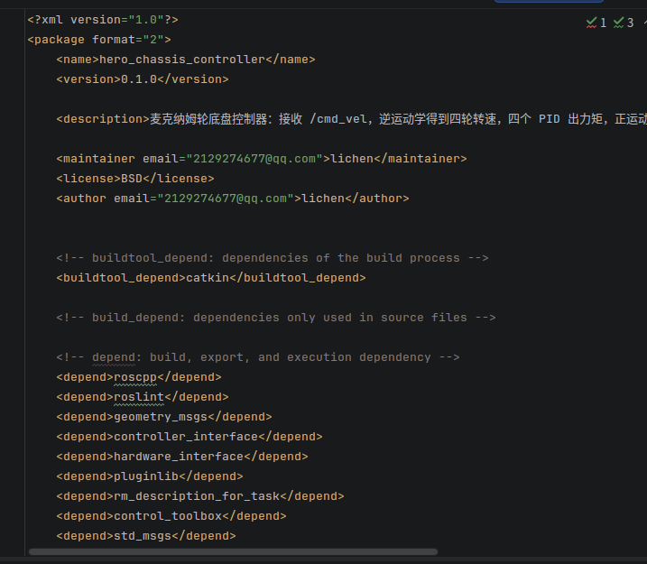

我一开始学这个文件时看到哪些**“声明依赖”**之类的介绍，其实根本不知道有什么用，后续复习中就深入了解了这个文件到底是给谁用：

#### 读取`package.xml`的对象和时机

`package.xml` 不是由一个进程统一读取后传给所有模块，而是被不同工具在生命周期的不同阶段分别读取。

| 读取者                | 读取时机           | 读取什么                                      | 用来做什么                                      |
| --------------------- | ------------------ | --------------------------------------------- | ----------------------------------------------- |
| `catkin`、`cmake`     | 构建配置阶段       | 名称、版本、构建依赖、导出依赖                | 建立包依赖关系、计算构建顺序、生成构建信息      |
| `rosdep`              | 环境安装阶段       | `<depend>`、`<build_depend>`、`<exec_depend>` | 把依赖名称映射为系统软件包并安装                |
| `rospack`             | 查找包或运行工具时 | 包的名称和路径、`<export>`                    | `rospack find`、`$(find pkg)`、查找插件描述     |
| `roslaunch`           | 启动系统时         | 通常间接使用 `rospack` 查找包路径             | 找到 launch 文件、节点程序或配置文件            |
| `rosrun`              | 手动启动节点时     | 通过 `rospack` 找包                           | 找到包内的可执行程序                            |
| `pluginlib`           | 动态加载插件时     | `<export>` 中的插件描述路径                   | 找到插件 XML，再加载对应 `.so`                  |
| 消息生成工具          | 构建阶段           | 消息相关依赖、包信息                          | 解析消息并生成 C++、Python 等类型               |
| `dynamic_reconfigure` | 构建及运行阶段     | 主要依赖前一步生成的配置代码和库              | 提供动态参数服务，不靠 `package.xml` 保存配置值 |

**以我的工程为例，这里的<export>是给`pluginlib`工具查看的，声明类插件描述文件的路径，它进而去`plugin.xml`去查看具体相关的类声明**

**开头的depend相关的依赖包声明，catkin工具在编译前会来查看，然后计算依赖关系进而得到构建的顺序，所以这里的声明是这个意思**

**然后还有一些工程相关的信息和作者的信息，大概就是理解“身份证”的比喻来源了，一个ROS相关的命令如 `rospack $(find packename) roslaunch`都需要用到这个package.xml，因为这个文件声明了功能包的路径**

#### 然后这里放一份关于它和`CMakeList`的区别以及对`package.xml`查找机制解析的内容

<details>
<summary>点击展开：CMakeLists.txt 与 package.xml 的配合机制</summary>
<h2>为什么 CMakeLists.txt 和 package.xml 都要声明依赖？</h2>
<p>这不是重复声明。<code>package.xml</code> 和 <code>CMakeLists.txt</code> 属于两个不同的协议层：前者是 ROS 包清单，后者是构建脚本。</p>
<table>
<thead>
<tr><th>内容</th><th>主要解决什么</th></tr>
</thead>
<tbody>
<tr><td><code>package.xml</code></td><td>这个包是谁、依赖谁、什么时候依赖，以及有哪些运行时和插件信息</td></tr>
<tr><td><code>project()</code></td><td>CMake 内部把当前构建项目叫什么</td></tr>
<tr><td><code>find_package()</code></td><td>当前这次构建如何找到依赖的头文件、库和 CMake target</td></tr>
<tr><td><code>catkin_package()</code></td><td>当前包向其他包导出什么 CMake 使用接口</td></tr>
</tbody>
</table>
<h3>典型执行顺序</h3>
<pre><code>catkin 扫描 package.xml
↓
发现 ROS 包并计算构建顺序
↓
CMake 读取 CMakeLists.txt
↓
find_package() 找实际依赖
↓
编译、链接并生成 catkin 导出文件
↓
rosrun、roslaunch、pluginlib 等工具继续使用 package.xml</code></pre>
<p>关键在前两步：catkin 必须先知道工作空间里有哪些 ROS 包、谁依赖谁，才能决定先构建谁。这个包依赖图来自 <code>package.xml</code>，不是来自 <code>find_package()</code>。</p>
<h3>一个具体例子</h3>
<p>CMakeLists.txt 可能是：</p>
<pre><code>project(hero_controller)
find_package(catkin REQUIRED
  COMPONENTS
    roscpp
    std_msgs
)
catkin_package(
  CATKIN_DEPENDS roscpp std_msgs
)</code></pre>
<p>对应的 package.xml 可能是：</p>
<pre><code>&lt;name&gt;hero_controller&lt;/name&gt;
&lt;buildtool_depend&gt;catkin&lt;/buildtool_depend&gt;
&lt;depend&gt;roscpp&lt;/depend&gt;
&lt;depend&gt;std_msgs&lt;/depend&gt;
&lt;exec_depend&gt;controller_manager&lt;/exec_depend&gt;</code></pre>
<p>这里 <code>controller_manager</code> 可能不需要被链接，所以不一定出现在 <code>find_package()</code> 中，但运行时必须安装。<code>find_package()</code> 无法完整表达这种运行时依赖。</p>
<h3>几处看似重复的内容</h3>
<ul>
<li><code>project(hero_controller)</code>：CMake 的项目名。</li>
<li><code>&lt;name&gt;hero_controller&lt;/name&gt;</code>：ROS 包名，<code>rospack</code>、<code>rosrun</code>、<code>roslaunch</code> 和 <code>package://</code> 使用它。</li>
<li><code>find_package(roscpp)</code>：当前构建实际取用 <code>roscpp</code>。</li>
<li><code>&lt;depend&gt;roscpp&lt;/depend&gt;</code>：告诉 catkin、rosdep、构建服务器和发布工具，本包依赖 <code>roscpp</code>。</li>
<li><code>catkin_package(CATKIN_DEPENDS roscpp)</code>：本包把 <code>roscpp</code> 作为公开构建接口传给下游。</li>
<li><code>&lt;exec_depend&gt;</code>：只在运行阶段需要，可能完全不参与编译和链接。</li>
</ul>
<h3>package.xml 还负责什么？</h3>
<p><code>package.xml</code> 还承载了很多 CMakeLists 不负责的内容：版本、作者、维护者、许可证、<code>rosdep</code> 安装依赖、构建与运行依赖的区分，以及 <code>pluginlib</code> 等运行时插件信息。</p>
<pre><code>&lt;export&gt;
  &lt;controller_interface plugin="${prefix}/plugin.xml"/&gt;
&lt;/export&gt;</code></pre>
<p><code>find_package()</code> 和 <code>catkin_package()</code> 都不知道这个控制器插件应该由 <code>pluginlib</code> 怎样加载。</p>
<h3>核心理解</h3>
<blockquote>
<p><code>package.xml</code> 是 ROS 生态使用的“包契约”，<code>CMakeLists.txt</code> 是 CMake 使用的“构建实现”。<code>find_package()</code> 在当前构建里消费依赖，<code>catkin_package()</code> 把构建接口生产给下游，而 <code>package.xml</code> 负责包发现、依赖排序、安装、运行和发布。</p>
</blockquote>
<p>有时 <code>find_package()</code> 写对了，工程在当前机器上也能编译，但 <code>package.xml</code> 漏写依赖后，<code>rosdep</code> 不会安装它，catkin 也可能不知道正确的构建顺序。这类问题正好说明两者不能互相替代。</p>
</details>

#### 总之

**`package.xml `负责声明包身份和依赖**

### 4.4 `CMakeList.txt`

#### 我试图总结

这个文件在之前学`CMake`时的笔记里写的很清楚了,这个文件主要是决定这个工程应该怎么编译，用哪些包，给一些限制（比如版本限制，警告就报错），如何导向产物（可执行程序还是库），它和launch文件很大不同是，launch有点跨包的功能，可以把其他节点给拉起来，这个节点可以是其他包，也会把一些系统组件，比如参数文件给上传到服务器，这些活是构建起一个计算机图，但这个`CMakeList.txt`负责这个功能包怎么构建

## 5. 计算图层

> 来到了ROS系统运转的核心层（我自己说的），先来结构图

#### 结构图

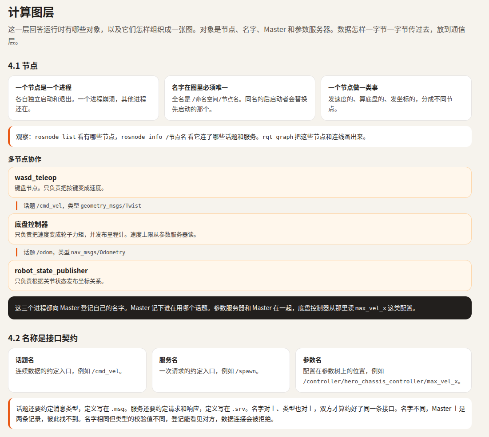

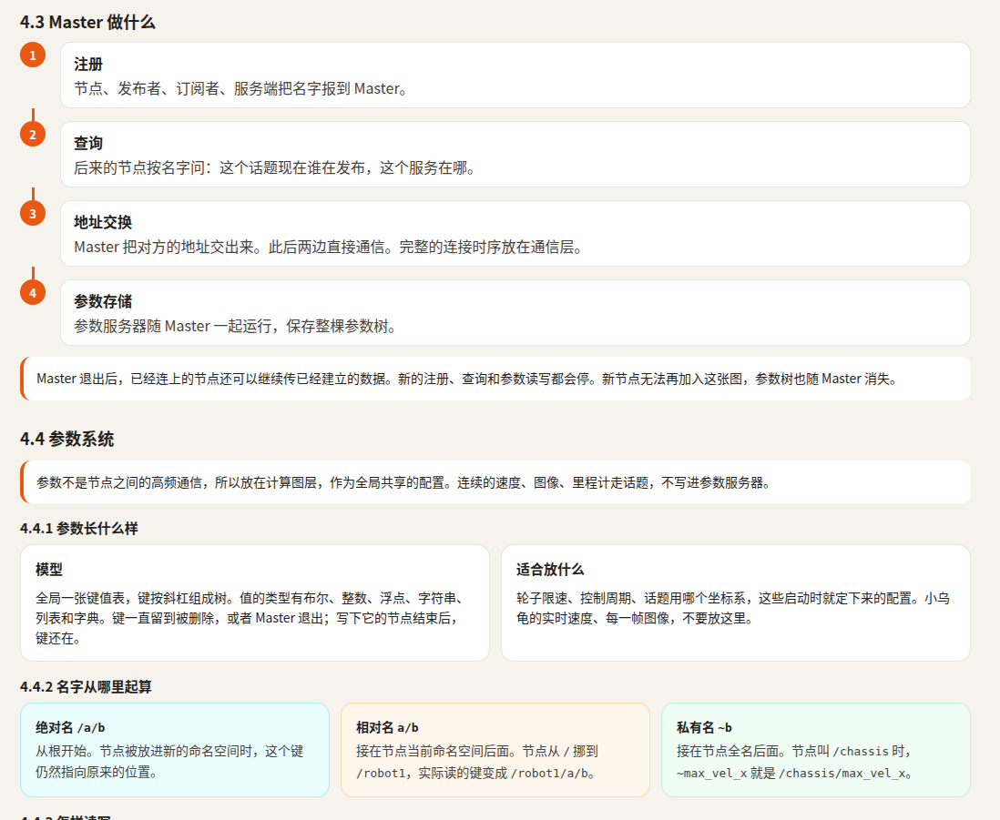

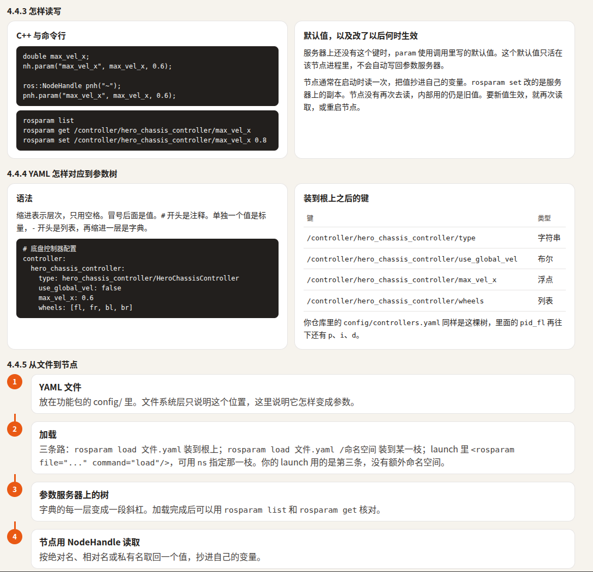

### 5.1 节点

#### 总结在前

节点这个可以说是计算图的一个单位组成部分，它和其他节点组成了计算图，它对外提供话题和服务(其他节点订阅或调用，形成节点间通信)，然后还有自己的命名空间，可以实现资源信息分区

它一般是可执行程序：

<node pkg="demo" type="camera_node"
      name="camera" ns="/robot1"/>

这里有几个很重要的部分，节点名和它的**命名空间**

最终得到节点：`robot1/camera`

它的命名空间是：`/robot1`

这会影响它里面的定义的句柄的默认命名空间

#### 节点内部组件的命名空间

比如：`ros::NodeHandle `

是在这个节点内部给话题、服务和参数取名前缀：

```
ros::NodeHandle nh;                 // 默认：/robot1
ros::NodeHandle sensors_nh("sensors"); // /robot1/sensors
ros::NodeHandle absolute_nh("/shared");// /shared
ros::NodeHandle private_nh("~");       // /robot1/camera
```

例如：

```
sensors_nh.advertise<std_msgs::String>("image_raw", 10);
```

会得到：

```
/robot1/sensors/image_raw
```

所以，`NodeHandle` 可以理解成**资源命名的作用域和接口创建器**，不是节点本身。

绝对名称会绕过命名空间：

```
nh.advertise<std_msgs::String>("/chatter", 10);
```

无论 `nh` 的命名空间是什么，生成的话题都是 `/chatter`，而不是 `/robot1/chatter`。

**特别的**

```
ros::NodeHandle private_nh("~");
```

会把 `~` 展开成当前节点的完整名称：

```
~  →  /robot1/camera
```

命名空间为 `/robot1/camera`

### 5.2 名称与接口契约

> **核心关系：** 接口连接必须同时：**名称对得上，类型也对得上。**


```
节点 A
  → 接口名称：找到图中的通信对象
  → 接口类型：确认数据格式和含义
  → 节点 B
```

#### **名称层**

名称回答“连接谁”。代码里写出的名称会先结合当前命名空间解析成完整名称，再参与连接：

```
当前命名空间：/chassis
相对名：cmd_vel
解析结果：/chassis/cmd_vel
```

因此，两个节点即使写了字面上相同的相对名，只要命名空间不同，最终也可能不是同一个接口。

#### **类型层**

类型回答“双方能不能交流”。相同的接口名称下，数据还必须具有一致的类型和结构：

```
/turtle1/cmd_vel : geometry_msgs/Twist
```

`.msg` 定义话题消息包含哪些字段；`.srv` 定义一次请求和一次响应分别包含什么内容。它们是接口契约的来源，也是生成对应程序类型的基础。

#### **我来总结一下**

其实就是在计算机图中两个节点通信的端口是具有”接口名“这个名是节点通过命名空间解析出来的，就看里面的`NodeHandle`如何解析一个服务，话题的接口名,可以是相对当前节点的相对名，也可以是跨节点的绝对名，两个对象想要通信先确保通信的两个对象的接口名相同，比如是话题，关键不是订阅端“必须写绝对名”，而是**订阅端解析后的完整话题名必须与发布端解析后的完整话题名一致**。命名空间只是负责完成这个解析。最终参与匹配的仍然是：

```
完整话题名 + 消息类型
```

在写通信两方时得确认接口名是否相同，有时用绝对名会比较方便，数据类型的话就是像话题的消息类型和服务的类型

### 5.3 Master与节点发现

`rosmaster`这个它负责找到节点，然后节点向Master注册它自己的相关信息，比如话题，服务之类的，然后master通过计算给匹配的节点相关的通信地址（它接收的或订阅的节点的通信地址）然后节点间就相互通信

**所以Master负责一个转接的作用**

master还负责公共的参数服务器

###  5.4 参数系统

#### 前言

这个参数系统呢我觉得最核心的是他的参数路径或者说作用域，这些参数一般是通过YAML文件上传到参数服务器，由master来管理，节点可以通过函数读取特定路径下的参数，也可以通过`dynamic_reconfige`来重写参数服务器上的参数，这个是提供修改参数的服务，可以实现一调用修改参数的服务，这边server就可以即时进入回调，如果是通过轮询获取参数服务器上的值，那么就会降低实时性和增加`RPC`开销

#### 4.4.1 参数模型

/controller
└── hero_chassis_controller
    ├── max_vel_x: 0.6
    ├── global_frame: odom
    └── pid_fl
        ├── p: 1.0
        └── i: 4.0

**它大概是像这样的一个配置树，通过参数作用域来分配不同的参数，参数服务器上的参数不会因节点进程退出而消失，而且节点获取它的参数时是通过拷贝赋值给节点里的变量**

#### 4.4.2 参数作用域

**这里有点像上面节点图通信接口的话题或服务名，这里的参数也是有绝对名，相对名和私有名，和上面的推导方式一致，也会在某些情况下依赖节点的作用域，使用NodeHandle来制定作用域**

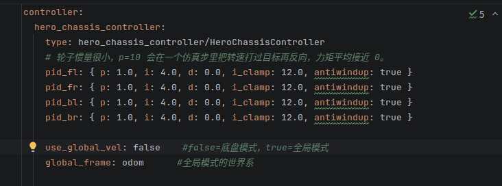

像这里每一层级就是不同作用域，读取时也要指定作用域才能正确读取

#### 4.4.3 读写参数

**这里是一些读取参数服务器上的参数的方法，一般要设置读取失败的那一判断支**

比如：

```
ros::NodeHandle pnh("~");

double max_vel_x;
if (!pnh.getParam("max_vel_x", max_vel_x)) {
  ROS_WARN("max_vel_x is missing");
  return false;
}
```

也可以用默认值（第三个参数）：

```
pnh.param("max_vel_x", max_vel_x, 0.6);
```

**这里是一些读写的接口或命令**

基本读写接口：

```
getParam()     // 读取
setParam()     // 写入
hasParam()     // 判断是否存在
deleteParam()  // 删除
```

命令行查看：

```
rosparam list
rosparam get /controller/hero_chassis_controller/max_vel_x
rosparam set /controller/hero_chassis_controller/max_vel_x 0.8
rosparam delete /controller/hero_chassis_controller/max_vel_x
```

**生效关系：**

```
rosparam set
  → 只修改参数服务器
  → 节点成员变量不会自动改变

节点重新读取或收到更新机制
  → 新值进入节点内存
  → 控制行为改变
```

#### 4.4.4 YAML参数文件

YAML 用缩进表示参数层级：

```
controller:
  hero_chassis_controller:
    max_vel_x: 0.6
    global_frame: odom
    pid_fl:
      p: 1.0
      i: 4.0
      d: 0.0
    wheels: [fl, fr, bl, br]
```

对应参数树：

```
/controller/hero_chassis_controller/max_vel_x = 0.6
/controller/hero_chassis_controller/global_frame = "odom"
/controller/hero_chassis_controller/pid_fl/p = 1.0
/controller/hero_chassis_controller/wheels[0] = "fl"
```

YAML 与参数树的对应关系：

```
缩进层级       → 参数命名空间
键名           → 参数名
标量值         → 参数值
字典           → 参数子树
列表           → 带索引的参数集合
```

**这里的参数树的形式是和我们通过NodeHandle来制定参数作用域是同步的，两边是相互对应，如果一边路径错误，那么就没办法正确读取，这个YAML文件是用来创建参数树的，这里是写了一个文件，离它真正上参数服务器还差一步**

> **那就是load**

三种常用加载方式：

**1. launch 顶层加载**

```
<rosparam file="$(find 包名)/config/params.yaml" command="load"/>
```

在没有额外命名空间时，YAML 顶层键直接挂在 `/` 下。

**2. 在节点内部加载**

```
<node name="chassis" pkg="..." type="...">
  <rosparam file="$(find 包名)/config/params.yaml" command="load"/>
</node>
```

参数会加载到该节点的私有命名空间下。

**3. 命令行加载**

```
rosparam load params.yaml
rosparam load params.yaml /robot
```

第二种会额外加上 `/robot` 前缀。

**小结**

- 参数不是高频数据流，而是集中保存的配置状态。
- YAML 只负责提供配置，真正读取它的是节点代码。
- **YAML 层级、加载命名空间、NodeHandle 命名空间和代码参数名必须共同解析到同一个完整路径。**
- 修改参数服务器后，要单独判断新值何时进入节点内存。

## 6. 通信层

> 到了通信层，这边就要管通信时的一些具体协议和机制了，上面的计算图虽然也有一些，不过那些是关于节点通信端口的，端口与端口间的连接是这里的重要部分

### 先上结构图

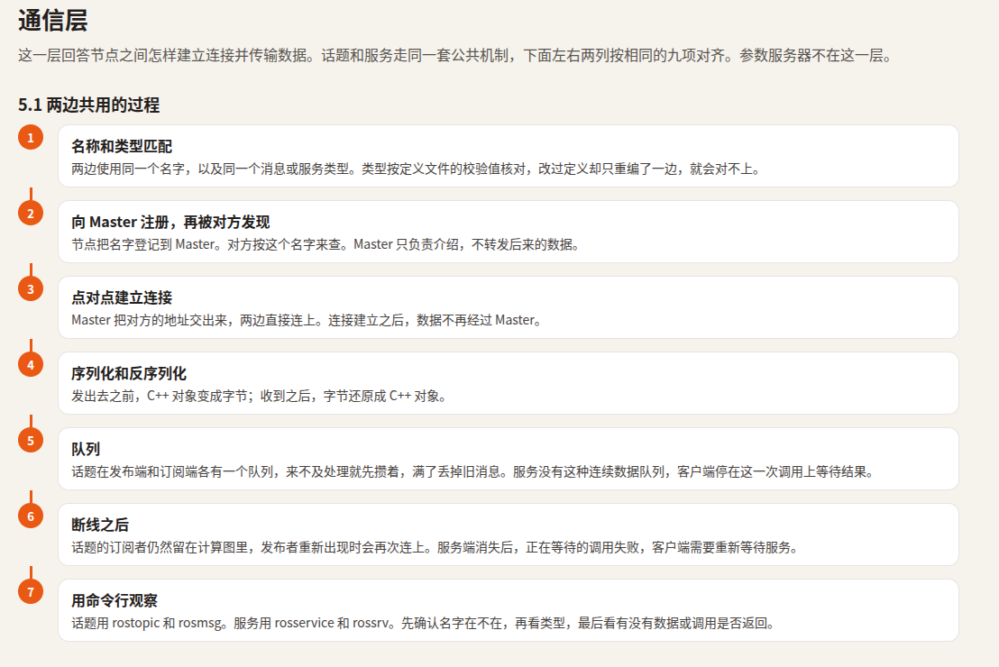

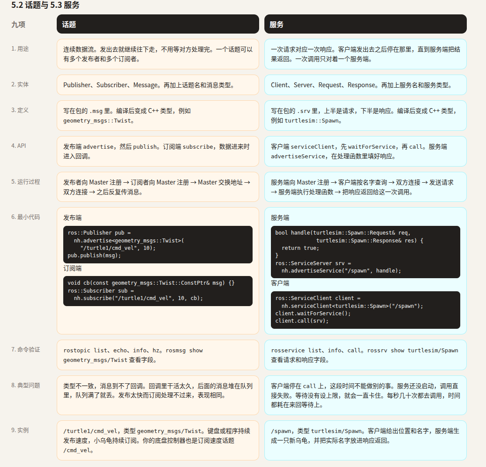

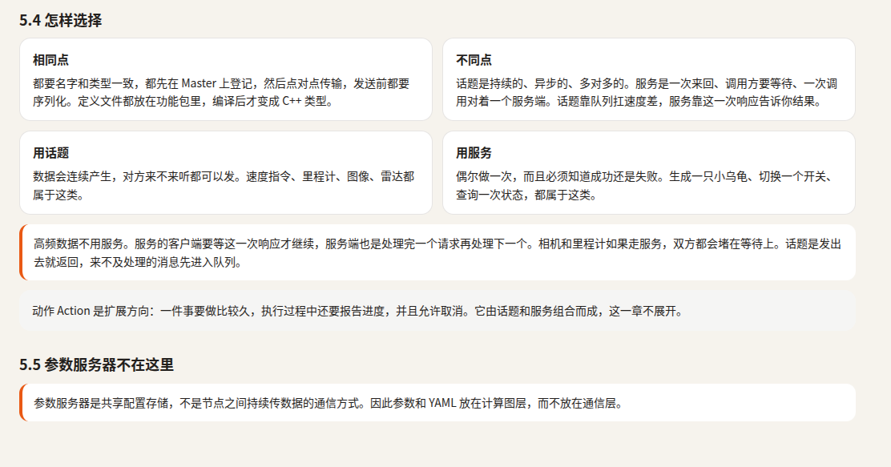

### 6.1 通信公共机制

**这边是比上面计算图多的，关于两个节点端口连接的具体过程或机制**

> **核心关系：** 先发现并匹配接口，再建立直接连接，最后按接口类型传输数据。


```
名称解析
  → 端点注册
  → Master 匹配
  → 地址交换
  → 建立连接
  → 序列化
  → 队列与传输
  → 反序列化
  → 回调处理
```

**这里的是通信的统一机制，下面解析两种核心通信方式**

### 6.2 话题通信

话题适合持续、异步的数据流。一个话题可以有多个发布者和多个订阅者。

需要4个组件：**话题名和消息类型，发布者和订阅者**

消息类型是由`.msg`文件来确定

比如下面的示例代码

```
// 发布端
ros::Publisher pub =
    nh.advertise<geometry_msgs::Twist>("/turtle1/cmd_vel", 10);

geometry_msgs::Twist msg;
msg.linear.x = 1.0;
pub.publish(msg);

// 订阅端
void callback(const geometry_msgs::Twist::ConstPtr& msg) {
  // 处理数据
}

ros::Subscriber sub =
    nh.subscribe("/turtle1/cmd_vel", 10, callback);
```

**话题名呢就类似上面的参数作用域或节点作用域，其实就是信息的分配树，机制都差不多，也可以看成是一个管道，通信双方都接上这个话题的路径，然后规定消息的类型，这里消息就是一个类，通过类的接口来更新需要发送的消息，然后把这个类序列化（publish那一步）成字节流，然后传输，到那边后（前提是有人接）然后反序列化为类赋值给那里的变量，然后取值**

> **这里的队列也是有点说法的，传输速度慢同时产生新消息的速度快或者接收消息的速度快于处理的速度就会导致队列积压，需要针对性处理**

### 6.3  服务通信

服务适合“发起一次请求，等待一次结果”的调用。一次请求对应一个服务端响应。

需要**客户端，服务端，服务名，服务类型**，和上面的话题是类似的对称关系，但是也有明显不同

比如下面的示例代码

```
服务端：

bool handleRequest(turtlesim::Spawn::Request& req,
                   turtlesim::Spawn::Response& res) {
  // 根据 req 执行功能，填写 res
  return true;
}

ros::ServiceServer server =
    nh.advertiseService("/spawn", handleRequest);

客户端：

ros::ServiceClient client =
    nh.serviceClient<turtlesim::Spawn>("/spawn");

turtlesim::Spawn srv;
srv.request.x = 2.0;
srv.request.y = 3.0;
srv.request.theta = 0.0;

if (client.call(srv)) {
  // 使用 srv.response
}
```

**服务是由客户端调用（传入request数据，然后call调用，然后就挂机等对面的服务端server处理完后返回数据response**

**所以它和服务的关键区别是，话题是一直发不管有没有人接，服务是客户端调用了才处理**

下面给一个表格来对照

| 关系     | 话题                   | 服务                       |
| -------- | ---------------------- | -------------------------- |
| 交互形式 | 持续数据流             | 一次请求—响应              |
| 时间关系 | 异步                   | 通常同步等待               |
| 连接关系 | 多对多                 | 每次调用一对一             |
| 结果     | 通常不要求每次回复     | 必须返回成功或失败         |
| 数据积压 | 可以通过队列缓冲       | 等待调用完成               |
| 典型场景 | 传感器、状态、控制指令 | 创建对象、查询、一次性操作 |

高频场景通常不用服务，因为每次调用都要等待请求处理与响应，并把调用链耦合在一起。

## 7.ROS CONTROL!

> **这一部分相当有说法的，如果说上面的ROS系统架构是一张网，那么这个ROS control就是把网弄成机器人的模样，因为这里有大脑，有神经，有关节**

### 相关知识笔记

**先来点精华知识梳理**

- 官方的

[ros control wiki](https://wiki.ros.org/ros_control)

- 下面是我自己的

<details>
<summary>ros_control 中spawner manager pluginlib配合机制</summary>
<p>下面按 ROS 1（Melodic/Noetic 的 <code>ros_control</code>）说明。核心结论是：</p>
<blockquote>
<p><code>spawner</code> 只负责调用 ROS 服务；<code>controller_manager</code> 根据控制器实例名读取 <code>type</code>；pluginlib 再把 <code>type</code> 解析成某个 <code>.so</code> 中的 C++ 类；最后发生 <code>dlopen</code>、对象构造、配置和启动。</p>
</blockquote>
<p>整体结构可以表示为：</p>
<pre><code>机器人驱动 / Gazebo / 控制线程
        │
        ├─ RobotHW::read()
        ├─ controller_manager.update()
        │       └─ 各个运行中的 Controller::update()
        └─ RobotHW::write()
外部：
spawner ──ROS service──&gt; controller_manager
                                │
                                ├─ 参数：实例名 → type
                                └─ pluginlib → .so → Controller 对象
</code></pre>
<h2>1. 三个层次分别负责什么</h2>
<p><code>ros_control</code> 主要分成三层：</p>
<table>
<thead>
<tr>
<th>层次</th>
<th>典型类型</th>
<th>职责</th>
</tr>
</thead>
<tbody>
<tr>
<td>硬件抽象层</td>
<td><code>hardware_interface::RobotHW</code></td>
<td>声明有哪些关节以及 State、Command、Effort、Velocity 等接口</td>
</tr>
<tr>
<td>控制器层</td>
<td><code>controller_interface::ControllerBase</code></td>
<td>实现具体控制算法，读取状态并写入命令</td>
</tr>
<tr>
<td>管理层</td>
<td><code>controller_manager::ControllerManager</code></td>
<td>加载、启动、停止控制器，并在控制周期调用它们</td>
</tr>
</tbody>
</table>
<p>机器人驱动负责把真实电机数据写进硬件接口，并把控制器的命令发送给电机。控制器不直接访问电机，只操作类似 <code>EffortJointInterface</code>、<code>JointStateInterface</code> 的句柄。这样同一种控制器可以用于仿真、真实机器人或不同的机械臂。</p>
<h2>2. Controller 插件是怎样声明的</h2>
<p>以自定义控制器 <code>my_pkg/MyController</code> 为例，<code>package.xml</code> 通常会有：</p>
<pre><code>&lt;export&gt;
  &lt;controller_interface plugin=&quot;${prefix}/controller_plugins.xml&quot;/&gt;
&lt;/export&gt;
</code></pre>
<p>其中的 <code>&lt;controller_interface&gt;</code> 不是控制器的实例名，而是一个插件导出分类。它的含义是：</p>
<blockquote>
<p>本包提供了基于 <code>controller_interface::ControllerBase</code> 的插件，插件描述文件是 <code>controller_plugins.xml</code>。</p>
</blockquote>
<p><code>controller_plugins.xml</code> 再建立插件查找键、C++ 类型和动态库之间的映射：</p>
<pre><code>&lt;library path=&quot;lib/libmy_controller&quot;&gt;
  &lt;class
    name=&quot;my_pkg/MyController&quot;
    type=&quot;my_pkg::MyController&quot;
    base_class_type=&quot;controller_interface::ControllerBase&quot;&gt;
    &lt;description&gt;My controller&lt;/description&gt;
  &lt;/class&gt;
&lt;/library&gt;
</code></pre>
<p>这里有三个不同概念：</p>
<ul>
<li><code>name=&quot;my_pkg/MyController&quot;</code>：pluginlib 使用的插件查找键。</li>
<li><code>type=&quot;my_pkg::MyController&quot;</code>：真正的 C++ 类。</li>
<li><code>lib/libmy_controller</code>：存放该类的共享库。</li>
</ul>
<p>YAML 中的 <code>type</code> 通常对应第一个查找键：</p>
<pre><code>my_controller:
  type: my_pkg/MyController
  joints: [joint1, joint2]
  update_rate: 100
</code></pre>
<p>这里必须区分：</p>
<table>
<thead>
<tr>
<th>名称</th>
<th>含义</th>
</tr>
</thead>
<tbody>
<tr>
<td><code>my_controller</code></td>
<td>控制器实例名，也是参数命名空间</td>
</tr>
<tr>
<td><code>my_pkg/MyController</code></td>
<td>pluginlib 插件查找键</td>
</tr>
<tr>
<td><code>my_pkg::MyController</code></td>
<td>C++ 实现类</td>
</tr>
<tr>
<td><code>libmy_controller.so</code></td>
<td>动态库文件</td>
</tr>
</tbody>
</table>
<h2>3. 从 launch 到加载控制器的完整流程</h2>
<p>一个典型 launch 配置是：</p>
<pre><code>&lt;rosparam file=&quot;$(find my_pkg)/config/controllers.yaml&quot; command=&quot;load&quot;/&gt;
&lt;node pkg=&quot;controller_manager&quot; type=&quot;spawner&quot;
      name=&quot;controller_spawner&quot;
      args=&quot;joint_state_controller my_controller&quot;/&gt;
</code></pre>
<p>实际过程如下。</p>
<ol>
<li>
<p><code>rosparam</code> 把 YAML 写入 ROS 参数服务器，例如形成：</p>
<pre><code>/my_controller/type
/my_controller/joints
/my_controller/update_rate
</code></pre>
</li>
<li>
<p><code>spawner</code> 启动，并等待 <code>controller_manager</code> 的 ROS 服务出现。</p>
</li>
<li>
<p><code>spawner</code> 调用类似 <code>load_controller</code> 的服务，请求中主要是：</p>
<pre><code>controller = &quot;my_controller&quot;
</code></pre>
</li>
<li>
<p><code>controller_manager</code> 收到实例名后，到参数服务器读取：</p>
<pre><code>my_controller/type
</code></pre>
<p>得到一个插件键，例如：</p>
<pre><code>my_pkg/MyController
</code></pre>
</li>
<li>
<p><code>controller_manager</code> 调用 pluginlib 的 <code>ClassLoader::createInstance()</code>。</p>
</li>
<li>
<p>pluginlib 在自己的插件清单缓存中查找这个键，得到：</p>
<pre><code>C++ 类型：my_pkg::MyController
动态库：libmy_controller.so
</code></pre>
</li>
<li>
<p>在 <code>controller_manager</code> 所在的进程里，底层动态加载器执行：</p>
<pre><code>handle = dlopen(&quot;/path/to/libmy_controller.so&quot;, ...);
factory = dlsym(handle, &quot;...&quot;);
</code></pre>
<p>然后用工厂函数构造 <code>my_pkg::MyController</code> 对象。</p>
</li>
<li>
<p>控制器对象构造完成后，manager 调用它的 <code>init(...)</code>。控制器在这里获取：</p>
<ul>
<li><code>JointStateHandle</code></li>
<li><code>JointHandle</code></li>
<li><code>EffortJointHandle</code></li>
<li>ROS <code>NodeHandle</code></li>
<li>自己的参数命名空间</li>
</ul>
</li>
<li>
<p>加载成功后，控制器处于已加载但尚未运行的状态。默认情况下，<code>spawner</code> 随后还会调用 <code>switch_controller</code> 服务启动它；如果使用 <code>spawner --stopped</code>，则只加载而不启动。</p>
</li>
</ol>
<p>因此更准确的时序是：</p>
<pre><code>spawner 发请求
   ↓
controller_manager 查 type
   ↓
pluginlib 查插件清单
   ↓
dlopen + dlsym
   ↓
构造 Controller 对象
   ↓
Controller::init()
   ↓
Controller::starting()
   ↓
每个控制周期调用 Controller::update()
</code></pre>
<h2>4. dlopen 为什么此时才发生</h2>
<p><code>dlopen()</code> 是 POSIX/Linux 动态链接接口。它的作用是：</p>
<ul>
<li>把 <code>.so</code> 映射到当前进程的地址空间；</li>
<li>加载该动态库依赖的其他动态库；</li>
<li>完成必要的符号重定位；</li>
<li>让库中的函数和符号可以被当前进程使用。</li>
</ul>
<p>它不等于“创建一个控制器”，插件对象仍需要经过：</p>
<pre><code>dlopen → dlsym 获取工厂 → 工厂构造对象
</code></pre>
<p>标准 ROS 插件加载路径通常是懒加载：读取 <code>package.xml</code> 和插件 XML 只建立“插件键 → 动态库”的索引，并不需要把 <code>.so</code> 立即打开。真正发生 <code>dlopen</code> 的时间点通常是 <code>createInstance()</code>，也就是确定控制器 <code>type</code> 后。</p>
<p>需要注意，<code>spawner</code> 通常是独立进程，它不会把控制器加载到自己里面。真正执行 <code>dlopen</code> 的是拥有 <code>ControllerManager</code> 的进程，例如：</p>
<ul>
<li>机器人驱动节点；</li>
<li><code>ros_control_boilerplate</code> 创建的控制节点；</li>
<li><code>gazebo_ros_control</code> 的 Gazebo 插件进程。</li>
</ul>
<h2>5. Controller 的生命周期</h2>
<p>一个控制器大致经历以下阶段：</p>
<ol>
<li><strong>构造</strong>：pluginlib 创建对象。</li>
<li><strong>初始化 <code>init()</code></strong>：获取硬件句柄，读取参数，分配内存；同一个实例只执行一次。</li>
<li><strong>启动 <code>starting()</code></strong>：从停止状态进入运行状态，通常在此把目标或命令初始化到当前状态，避免突然跳变。</li>
<li><strong>运行 <code>update(time, period)</code></strong>：每个控制周期被 manager 调用，读取状态、计算控制量、写命令。</li>
<li><strong>停止 <code>stopping()</code></strong>：停止计算，可保存或清理运行状态。</li>
<li><strong>卸载</strong>：只有在已停止状态下才能卸载；对象析构，pluginlib 释放动态库引用。</li>
</ol>
<p>控制器可以在不卸载对象的情况下多次启动和停止，所以 <code>init()</code> 和 <code>starting()</code> 不能混为一谈。</p>
<h2>6. 运行时控制循环</h2>
<p>真正的时间循环通常由机器人驱动或仿真器提供：</p>
<pre><code>while (ros::ok())
{
  robot_hw.read();                    // 读取编码器、力矩等，更新 StateHandle
  controller_manager.update(now, dt); // 运行各个 Controller::update()
  robot_hw.write();                   // 下发 CommandHandle 中的命令
  rate.sleep();
}
</code></pre>
<p><code>controller_manager::update()</code> 本身通常不负责调用 <code>read()</code> 和 <code>write()</code>；它主要负责：</p>
<ul>
<li>处理排队中的切换请求；</li>
<li>调用所有运行中控制器的 <code>update()</code>；</li>
<li>维护控制器状态和切换时序。</li>
</ul>
<p><code>read()</code>、<code>update()</code> 和 <code>write()</code> 的先后顺序不能随意变换。否则控制器可能使用旧状态，或者命令不能及时下发。</p>
<p>在 ROS 1 中，所有运行中的控制器通常共享 manager 的控制周期，而不是每个控制器独立拥有一个定时器。因此控制频率主要由硬件循环决定。</p>
<h2>7. spawner 和 switch_controller 的关系</h2>
<p>常见服务包括：</p>
<ul>
<li><code>list_controllers</code></li>
<li><code>load_controller</code></li>
<li><code>unload_controller</code></li>
<li><code>switch_controller</code></li>
<li><code>reload_controller_libraries</code></li>
</ul>
<p><code>spawner</code> 一般会：</p>
<ol>
<li>通过 <code>list_controllers</code> 检查控制器是否已经加载；</li>
<li>对未加载的控制器调用 <code>load_controller</code>；</li>
<li>默认再调用 <code>switch_controller</code> 启动它。</li>
</ol>
<p>加载和启动是两个不同动作：</p>
<pre><code>load_controller     → 构造、init，但不运行
switch_controller   → starting/stopping，改变运行状态
</code></pre>
<p>切换请求通常不是直接由服务回调在硬件线程里执行，而是进入 manager 的请求队列，在下一次 <code>update()</code> 周期中统一处理，以减少并发状态变化。</p>
<p>当两个控制器使用相同的硬件资源时，不能同时运行；<code>switch_controller</code> 会按请求停止旧控制器、启动新控制器。常见配置中还会配合 <code>strictness</code> 和超时参数决定切换失败时的处理方式。</p>
<h2>8. 常见异常点</h2>
<p>理解这条链路后，很多报错就容易定位了：</p>
<ul>
<li><strong>找不到 <code>type</code></strong>：控制器实例名和 YAML 的命名空间不匹配。</li>
<li><strong>找不到 plugin</strong>：<code>type</code> 与插件 XML 中的 <code>name</code> 不一致。</li>
<li><strong>找不到插件描述文件</strong>：<code>package.xml</code> 的 export 或 <code>controller_plugins.xml</code> 安装位置不对。</li>
<li><strong><code>.so</code> 打开失败</strong>：路径、依赖库、编译产物或 ABI 不匹配。</li>
<li><strong>符号解析失败</strong>：动态库缺少符号，或运行时链接到了错误版本的依赖。</li>
<li><strong>base class 不匹配</strong>：控制器没有正确继承 <code>controller_interface::ControllerBase</code>。</li>
<li><strong>init 失败</strong>：关节名称不存在，或者 <code>RobotHW</code> 没有导出控制器请求的接口。</li>
<li><strong>控制器无法启动</strong>：硬件资源被其他控制器占用。</li>
</ul>
<h2>9. 与 ROS 2 的主要区别</h2>
<p>如果你看的材料实际是 ROS 2，链路中的名称有一部分会变化：</p>
<ul>
<li>ROS 2 没有 ROS 1 那种由 master 管理的集中式参数服务器；YAML 主要成为 <code>controller_manager</code> 节点的参数。</li>
<li>控制器类型仍由 <code>controller_name.type</code> 一类配置提供。</li>
<li><code>spawner</code> 仍通过服务请求加载控制器。</li>
<li>插件描述通常通过 <code>pluginlib_export_plugin_description_file(...)</code> 在构建时注册，而不是只依赖 ROS 1 的 <code>package.xml</code> export。</li>
<li>生命周期多了显式的 <code>load → configure → activate → deactivate → unload</code>，<code>configure()</code> 与 <code>activate()</code> 分开。</li>
</ul>
<p>但核心模型没有变：</p>
<blockquote>
<p>控制器实例名只是运行时身份；<code>type</code> 决定插件；pluginlib 把插件解析到动态库；<code>dlopen</code> 加载库；管理器最终在控制线程中调用控制器实例。</p>
</blockquote>
</details>

<details>
<summary>hero_chassis_controller 的 ros_control 结构</summary>
<p>对照图：Dave Coleman 的 <em>ROS Control — Data flow of controllers</em>（Controller Manager、Controller、Hardware Resource Interface、<code>hardware_interface::RobotHW</code>、Real Robot 五层）。<br>
对象：<code>~/DX_test/catkin_test</code> 里当前能跑起来的这条链——<code>hero_chassis_controller</code> + <code>rm_description</code> 的 hero 模型 + Gazebo。<br>
<code>hero.launch</code> 里 <code>use_rm_gazebo</code> 默认 <code>false</code>，所以硬件层是 <code>libgazebo_ros_control.so</code>，不是 <code>librm_robot_hw_sim.so</code>。</p>
<p><strong>核心：</strong> 图上的五层在本工程里都有落点，但「真机器人 + 板载 PID」这一格是空的。PID 写在黄色 Controller 里，最底下是 Gazebo 在积分力矩。控制器不直接碰轮子，只碰 <code>EffortJointInterface</code> 上的关节句柄。</p>
<hr>
<h2>0. 图上每一格在本工程是谁</h2>
<table>
<thead>
<tr>
<th>图上的格子</th>
<th>本工程里的实体</th>
<th>关键类型 / 调用</th>
</tr>
</thead>
<tbody>
<tr>
<td>Controller Manager</td>
<td><code>gzserver</code> 里 <code>gazebo_ros_control</code> 创建的 <code>controller_manager::ControllerManager</code></td>
<td>对外服务：<code>load_controller</code> / <code>switch_controller</code> / <code>list_controllers</code>。调用方是 launch 里的 <code>controller_spawner</code></td>
</tr>
<tr>
<td>ROS Interface（图上的 joint_trajectory 等）</td>
<td>不是关节轨迹。设定值是 <code>geometry_msgs/Twist</code></td>
<td><code>wasd_teleop</code> 发 <code>/cmd_vel</code>；控制器在 <code>init</code> 里 <code>root_nh.subscribe</code></td>
</tr>
<tr>
<td>Controller 1</td>
<td><code>hero_chassis_controller::HeroChassisController</code></td>
<td>继承 <code>controller_interface::Controller&lt;EffortJointInterface&gt;</code>，插件名 <code>hero_chassis_controller/HeroChassisController</code></td>
</tr>
<tr>
<td>黄框里的 PID</td>
<td><code>control_toolbox::Pid</code> 四个：<code>pid_fl_</code> … <code>pid_br_</code></td>
<td><code>init</code> 里 <code>pid_*.init(...)</code>；<code>update</code> 里 <code>computeCommand</code> 再 <code>setCommand</code></td>
</tr>
<tr>
<td>Controller 2</td>
<td><code>joint_state_controller/JointStateController</code></td>
<td>只读关节状态，发 <code>/joint_states</code>。插件表不在本包</td>
</tr>
<tr>
<td>Hardware Resource Interface</td>
<td><code>EffortJointInterface</code>（命令）+ <code>JointStateInterface</code>（状态）</td>
<td>底盘控制器只用前者：<code>getHandle</code> / <code>getVelocity</code> / <code>setCommand</code></td>
</tr>
<tr>
<td><code>hardware_interface::RobotHW</code></td>
<td>Gazebo 插件里的 <code>gazebo_ros_control::DefaultRobotHWSim</code></td>
<td>每个仿真步 <code>readSim</code> → <code>ControllerManager::update</code> → <code>writeSim</code></td>
</tr>
<tr>
<td>Joint Limits（虚线，可选）</td>
<td>轮关节 URDF <code>&lt;limit effort=&quot;20&quot; velocity=&quot;50&quot;&gt;</code></td>
<td><code>gazebo_ros_control</code> 注册限制接口，写出力矩前裁剪</td>
</tr>
<tr>
<td>Effort Transmissions（虚线，可选）</td>
<td>四条 <code>transmission_interface/SimpleTransmission</code></td>
<td><code>mechanicalReduction</code> 为 <code>19.2032</code> 或 <code>-19.2032</code></td>
</tr>
<tr>
<td>Real Robot / 板载 PID / 编码器</td>
<td><strong>没有实物，也没有板载 PID</strong></td>
<td>Gazebo 关节力矩 + 关节速度；麦轮摩擦由 <code>libmecanum_contact.so</code> 补</td>
</tr>
</tbody>
</table>
<pre><code class="language-mermaid">flowchart TB
  subgraph 外部进程[&quot;外部进程：只提供设定值或发加载请求&quot;]
    WASD[&quot;wasd_teleop&lt;br/&gt;发布 /cmd_vel&quot;]
    MODE[&quot;/chassis_use_global_vel&quot;]
    SPAWN[&quot;controller_spawner&lt;br/&gt;load + switch&quot;]
    YAML[&quot;controllers.yaml&lt;br/&gt;type 与 PID 初值&quot;]
  end
  subgraph GZ[&quot;gzserver 进程&quot;]
    subgraph MGR[&quot;Controller Manager&quot;]
      CM[&quot;controller_manager::ControllerManager&lt;br/&gt;update(time, period)&quot;]
    end
    subgraph CT[&quot;Controller 层&quot;]
      HERO[&quot;HeroChassisController&lt;br/&gt;update → IK + Pid::computeCommand&quot;]
      JSC[&quot;JointStateController&lt;br/&gt;发布 /joint_states&quot;]
    end
    subgraph HWIF[&quot;Hardware Resource Interface&quot;]
      EFF[&quot;EffortJointInterface&lt;br/&gt;四轮 JointHandle&quot;]
      JS[&quot;JointStateInterface&lt;br/&gt;位置 / 速度&quot;]
    end
    subgraph RHW[&quot;RobotHW&quot;]
      SIM[&quot;DefaultRobotHWSim&lt;br/&gt;readSim / writeSim&quot;]
      TR[&quot;SimpleTransmission × 4&quot;]
      LIM[&quot;关节限制 effort 20 / vel 50&quot;]
    end
    subgraph WORLD[&quot;图上的 Real Robot，这里是 Gazebo&quot;]
      JOINT[&quot;四个 revolute 轮关节&lt;br/&gt;SetForce / 读速度&quot;]
      CONTACT[&quot;mecanum_contact&lt;br/&gt;接地方向摩擦&quot;]
    end
  end
  YAML --&gt; SPAWN
  SPAWN --&gt;|&quot;load_controller / switch_controller&quot;| CM
  CM --&gt; HERO
  CM --&gt; JSC
  WASD --&gt;|&quot;/cmd_vel&quot;| HERO
  MODE --&gt; HERO
  HERO --&gt;|&quot;getVelocity&quot;| EFF
  HERO --&gt;|&quot;setCommand 力矩&quot;| EFF
  JSC --&gt;|&quot;只读&quot;| JS
  EFF --- SIM
  JS --- SIM
  SIM --&gt; TR
  SIM --&gt; LIM
  SIM --&gt;|&quot;readSim：速度上来&quot;| JOINT
  SIM --&gt;|&quot;writeSim：力矩下去&quot;| JOINT
  JOINT --&gt; CONTACT
</code></pre>
<hr>
<h2>1. 先分清进程：Manager 不在 spawner 里</h2>
<p><strong>核心：</strong> <code>controller_spawner</code> 只是客户端。真正每个仿真步去叫 <code>update()</code> 的，是挂在 Gazebo 模型上的 <code>gazebo_ros_control</code> 插件，和两个控制器、<code>RobotHW</code> 住在同一个 <code>gzserver</code> 进程里。</p>
<p><code>run_simulation_and_controller.launch</code> 拉起三件互相独立的事：</p>
<ol>
<li><code>include hero.launch</code>：空世界、把 xacro 放进 <code>/robot_description</code>、<code>spawn_model</code> 生成模型。模型 URDF 里带插件 <code>libgazebo_ros_control.so</code>。模型一生成，插件在 <code>gzserver</code> 里建好 <code>RobotHW</code> 和 <code>ControllerManager</code>。</li>
<li><code>rosparam load controllers.yaml</code>：参数先进参数服务器，此时控制器对象还没有。</li>
<li><code>controller_spawner</code> 带两个名字：<code>controller/hero_chassis_controller</code>、<code>controller/joint_state_controller</code>。它调用 Manager 的服务：加载插件、再 <code>switch</code> 到 running。</li>
</ol>
<p><code>wasd_teleop</code> 是第四个进程。它不实现 <code>Controller</code>，不进 Manager 的控制器列表。</p>
<pre><code class="language-mermaid">flowchart LR
  subgraph 启动顺序
    A[&quot;hero.launch&lt;br/&gt;空世界 + spawn hero&quot;] --&gt; B[&quot;gazebo_ros_control 在 gzserver 内&lt;br/&gt;建 RobotHW 和 ControllerManager&quot;]
    C[&quot;rosparam load&lt;br/&gt;controllers.yaml&quot;] --&gt; D[&quot;spawner 调用&lt;br/&gt;load_controller + switch_controller&quot;]
    B --&gt; D
    D --&gt; E[&quot;HeroChassisController::init&lt;br/&gt;再 starting&quot;]
    D --&gt; F[&quot;JointStateController::init / starting&quot;]
    G[&quot;wasd_teleop 节点&quot;] -.-&gt;|&quot;之后才有 /cmd_vel&quot;| E
  end
</code></pre>
<p>附带：<code>use_sim_time</code> 为 true。控制器 <code>update</code> 的 <code>time</code> / <code>period</code> 来自 Gazebo 的仿真步，不是墙钟。<code>cmdVelCallback</code> 里的 <code>ros::Time::now()</code> 在仿真时间下走，0.3 s 超时也是仿真时间。</p>
<hr>
<h2>2. Controller Manager：加载、切换、每个周期 update</h2>
<p><strong>核心：</strong> Manager 不计算底盘速度。它按 yaml 的 <code>type</code> 字符串造出控制器对象，之后每个仿真步对所有 running 的控制器调用一次 <code>update(time, period)</code>。</p>
<p>图左边四条服务，本工程实际只用到加载和切换，由 spawner 一次做完：</p>
<table>
<thead>
<tr>
<th>图上的操作</th>
<th>本工程谁触发</th>
<th>结果</th>
</tr>
</thead>
<tbody>
<tr>
<td><code>load_controller</code></td>
<td>spawner 参数 <code>controller/hero_chassis_controller</code></td>
<td>pluginlib 按 yaml 的 <code>type: hero_chassis_controller/HeroChassisController</code> 打开 <code>libhero_chassis_controller.so</code>，<code>new</code> 出对象，调用 <code>init</code></td>
</tr>
<tr>
<td><code>switch_controller</code></td>
<td>同一个 spawner，把该控制器切到 running</td>
<td>调用 <code>starting</code>，之后每个周期都会进 <code>update</code></td>
</tr>
<tr>
<td><code>list_controllers</code> / <code>unload_controller</code></td>
<td>这条 launch 不调用</td>
<td>服务仍在 <code>/controller_manager</code> 上，需要时用 <code>rosservice</code></td>
</tr>
</tbody>
</table>
<p>yaml 的键 <code>controller/hero_chassis_controller</code> 是 <strong>参数命名空间</strong>，不是 C++ 类名。类名在该命名空间下的 <code>type</code> 字段。<code>init</code> 拿到的 <code>controller_nh</code> 就指在这个命名空间上，所以 <code>pid_fl</code>、<code>max_vel_x</code> 不用写绝对路径。</p>
<p><code>init</code> 返回 false（四个 PID 任一初始化失败）时，spawner 不会把它留在 running。<code>starting</code> 只在每次进入 running 时清 PID 积分、里程计和斜坡，不负责读关节。</p>
<hr>
<h2>3. 两个 Controller 共用一个 RobotHW</h2>
<p><strong>核心：</strong> 图上的 Controller 1 / 2 / 3 是同一套接口上的多个插件。本工程加载两个：底盘控制器写力矩，关节状态控制器只读状态。它们不互相调用，由 Manager 在同一次 <code>update</code> 里依次调用。</p>
<pre><code class="language-mermaid">flowchart TB
  CM[&quot;ControllerManager::update&quot;]
  CM --&gt; H[&quot;HeroChassisController::update&lt;br/&gt;读四轮速度，写四轮力矩&quot;]
  CM --&gt; J[&quot;JointStateController::update&lt;br/&gt;读全部关节状态，发布 /joint_states&quot;]
  H --&gt; EFF[&quot;EffortJointInterface&quot;]
  J --&gt; JSI[&quot;JointStateInterface&quot;]
  EFF --- HW[&quot;同一个 DefaultRobotHWSim&quot;]
  JSI --- HW
  J --&gt; RSP[&quot;robot_state_publisher&lt;br/&gt;用 /joint_states 发模型 TF&quot;]
  H --&gt; ODOM[&quot;自己的 tf_broadcaster_&lt;br/&gt;只发 odom → base_link&quot;]
</code></pre>
<table>
<thead>
<tr>
<th></th>
<th>HeroChassisController</th>
<th>JointStateController</th>
</tr>
</thead>
<tbody>
<tr>
<td>插件查找名</td>
<td><code>hero_chassis_controller/HeroChassisController</code></td>
<td><code>joint_state_controller/JointStateController</code></td>
</tr>
<tr>
<td>基类模板</td>
<td><code>Controller&lt;EffortJointInterface&gt;</code></td>
<td>读 <code>JointStateInterface</code></td>
</tr>
<tr>
<td>对硬件做什么</td>
<td><code>getVelocity</code> + <code>setCommand</code></td>
<td>只发布状态</td>
</tr>
<tr>
<td>设定值从哪来</td>
<td><code>/cmd_vel</code></td>
<td>无设定值</td>
</tr>
<tr>
<td>本包有没有它的源码</td>
<td>有，<code>src/hero_chassis_controller.cpp</code></td>
<td>没有，发行版里的标准控制器</td>
</tr>
</tbody>
</table>
<p><code>robot_state_publisher</code> 在 <code>hero.launch</code> 里，吃的是 <code>/joint_states</code>。底盘控制器自己广播的 <code>odom → base_link</code> 不经过它。两条 TF 来源不同：一条是关节角，一条是轮速积分出来的里程计。</p>
<hr>
<h2>4. 图上的 ROS Interface：设定值进控制器，不进 Manager</h2>
<p><strong>核心：</strong> 青色方块是「别的节点送来的目标」。本工程的目标是底盘速度，不是图例里的 <code>joint_trajectory</code>。话题直接订在 <code>HeroChassisController::init</code> 里，Manager 不转发这条消息。</p>
<table>
<thead>
<tr>
<th>图上的概念</th>
<th>本工程通道</th>
<th>落在哪个函数</th>
</tr>
</thead>
<tbody>
<tr>
<td>Set point from ROS Interface</td>
<td><code>/cmd_vel</code>：<code>geometry_msgs/Twist</code></td>
<td><code>cmdVelCallback</code> 只把 <code>vx_ vy_ wz_</code> 和时刻存下来</td>
</tr>
<tr>
<td>模式开关（图上没有单独一格）</td>
<td><code>/chassis_use_global_vel</code></td>
<td><code>modeCallback</code> 改 <code>use_global_vel_</code></td>
</tr>
<tr>
<td>启动时的参数</td>
<td>yaml：<code>pid_*</code>、<code>max_vel_*</code>、<code>max_acc_*</code>、<code>use_global_vel</code></td>
<td><code>init</code> 里 <code>controller_nh.param</code> 和 <code>Pid::init</code></td>
</tr>
<tr>
<td>运行中改斜坡上限</td>
<td><code>dynamic_reconfigure</code>，挂在 <code>controller_nh</code></td>
<td><code>dynReconfigCb</code> 写 <code>max_vel_*</code> / <code>max_acc_*</code></td>
</tr>
</tbody>
</table>
<p>回调和时间节拍是分开的。<code>cmdVelCallback</code> 可以在任意 ROS 回调里改三个数；真正拿这三个数去做 IK 和 PID 的，是 Manager 每个仿真步调用的 <code>update</code>。超时 0.3 s 也在 <code>update</code> 开头检查，不在回调里清零。</p>
<pre><code class="language-mermaid">flowchart LR
  K[&quot;键盘 wasd_teleop&quot;] --&gt;|&quot;Twist&quot;| CB[&quot;cmdVelCallback&lt;br/&gt;写入 vx_ vy_ wz_&quot;]
  R[&quot;rqt_reconfigure&quot;] --&gt; DR[&quot;dynReconfigCb&lt;br/&gt;写入 max_vel / max_acc&quot;]
  B[&quot;/chassis_use_global_vel&quot;] --&gt; MC[&quot;modeCallback&lt;br/&gt;写入 use_global_vel_&quot;]
  CB --&gt; MEM[&quot;控制器成员&quot;]
  DR --&gt; MEM
  MC --&gt; MEM
  MEM --&gt; UP[&quot;下一个 HeroChassisController::update&lt;br/&gt;才读这些成员&quot;]
</code></pre>
<hr>
<h2>5. 黄色 Controller 内部：PID 在这里，不在电机板上</h2>
<p><strong>核心：</strong> 图中黄框右下角的小 PID，就是四个 <code>control_toolbox::Pid</code>。它们把「轮角速度误差」变成「关节力矩」，再通过 <code>JointHandle::setCommand</code> 交给接口层。控制器自己不调用 Gazebo。</p>
<p><code>update</code> 里和 ros_control 接口有关的只有头尾两下，中间是本包自己的底盘算法：</p>
<pre><code class="language-text">getVelocity × 4          ← 接口层上来的轮速（图上 Robot States）
    超时则目标速度清零
    可选：tf 把 odom 系速度旋到 base_link
    clamp_abs + slew     ← 限幅和斜坡，吃 dynamic_reconfigure 的上限
    麦轮 IK              ← 底盘速度 → 四轮目标角速度
    Pid::computeCommand  ← 黄框里的 PID
setCommand × 4           → 接口层下去的力矩（图上 Robot Commands，单位 N·m）
    之后的 FK / odom / Path / TF 不再写硬件
</code></pre>
<p>和接口咬合的三行：</p>
<pre><code class="language-cpp">front_left_joint_ = effort_joint_interface-&gt;getHandle(&quot;left_front_wheel_joint&quot;);
// update 内：
const double wfl_real = front_left_joint_.getVelocity();
front_left_joint_.setCommand(pid_fl_.computeCommand(e_fl, period));
</code></pre>
<p>关节名必须和 URDF 一致：<code>left_front_wheel_joint</code>、<code>right_front_wheel_joint</code>、<code>left_back_wheel_joint</code>、<code>right_back_wheel_joint</code>。<code>getHandle</code> 在 <code>init</code> 里做一次；名字写错，<code>init</code> 会抛，控制器起不来。</p>
<p><code>period</code> 有两个用途：PID 的积分/微分步长，以及 <code>slew</code> 的 <code>dt</code>。这个 <code>period</code> 就是 Manager 从 Gazebo 步长传下来的，所以限加速度和仿真步对齐。</p>
<p>FK、<code>/odom</code>、<code>/chassis_path</code>、<code>odom→base_link</code> 是控制器的附加输出，图上没有对应格子。它们读的是同一拍 <code>getVelocity</code> 的结果，不再次向硬件要数据。</p>
<hr>
<h2>6. Hardware Resource Interface：控制器唯一能碰到的硬件</h2>
<p><strong>核心：</strong> <code>EffortJointInterface</code> 是命令口，<code>JointStateInterface</code> 是状态口。底盘控制器只声明了前者。<code>JointHandle::getVelocity</code> 能读到速度，是因为 effort 句柄同时带着该关节的状态，不是因为本类又继承了一个状态接口。</p>
<p>图上这一层画成一条横带，命令向下、状态向上：</p>
<pre><code class="language-mermaid">flowchart TB
  subgraph 控制器看见的
    HERO[&quot;HeroChassisController&quot;]
    JSC[&quot;JointStateController&quot;]
  end
  subgraph 资源接口
    EFF[&quot;EffortJointInterface&lt;br/&gt;命令：力矩&quot;]
    JS[&quot;JointStateInterface&lt;br/&gt;状态：位置、速度&quot;]
  end
  HERO --&gt;|&quot;init: getHandle 四个轮&quot;| EFF
  HERO --&gt;|&quot;update: getVelocity&quot;| EFF
  HERO --&gt;|&quot;update: setCommand&quot;| EFF
  JSC --&gt;|&quot;update: 读位置和速度&quot;| JS
  EFF --&gt;|&quot;句柄内部连着同一份状态&quot;| JS
</code></pre>
<p>这一层没有麦轮公式，也没有 PID。谁要换执行器（仿真换成真电机驱动），换的是下面的 <code>RobotHW</code>，控制器的 <code>getHandle</code> / <code>setCommand</code> 可以不动。前提是新的 <code>RobotHW</code> 仍注册同名的 <code>EffortJointInterface</code> 关节。</p>
<hr>
<h2>7. RobotHW：read、限幅、传动、write</h2>
<p><strong>核心：</strong> 图中间橙色大块在本工程不是自己写的类。<code>use_rm_gazebo:=false</code> 时，URDF 加载 <code>libgazebo_ros_control.so</code>，里面的 <code>DefaultRobotHWSim</code> 充当 <code>RobotHW</code>。<code>readSim</code> 把 Gazebo 关节速度填进句柄，<code>writeSim</code> 把 <code>setCommand</code> 留下的力矩写回 Gazebo。</p>
<p>插件在 <code>hero.urdf.xacro</code>：</p>
<pre><code class="language-xml">&lt;plugin name=&quot;gazebo_ros_control&quot; filename=&quot;libgazebo_ros_control.so&quot;&gt;
    &lt;robotNamespace&gt;/&lt;/robotNamespace&gt;
&lt;/plugin&gt;
</code></pre>
<p>它做的事对应图上橙色块的三格：</p>
<table>
<thead>
<tr>
<th>图上的虚线功能</th>
<th>URDF 里有没有</th>
<th>谁执行</th>
</tr>
</thead>
<tbody>
<tr>
<td>Joint Limits</td>
<td>有。<code>mecanum_wheel</code> 的 <code>&lt;limit effort=&quot;${max_effort}&quot; velocity=&quot;${max_velocity}&quot;&gt;</code>，hero 底盘传入 20 N·m、50 rad/s</td>
<td><code>gazebo_ros_control</code> 的关节限制接口，在 <code>writeSim</code> 前裁剪</td>
</tr>
<tr>
<td>Effort Transmissions</td>
<td>有。四条 <code>SimpleTransmission</code>，关节与执行器的 <code>hardwareInterface</code> 都是 <code>EffortJointInterface</code></td>
<td>插件按 URDF 建 transmission，把减速比放在关节空间和 Gazebo 关节之间</td>
</tr>
<tr>
<td>Forward State Transmissions</td>
<td>同一条 <code>SimpleTransmission</code> 的状态方向</td>
<td><code>readSim</code> 时把仿真速度换到控制器 <code>getVelocity</code> 看见的那一侧</td>
</tr>
</tbody>
</table>
<p>减速比写在 <code>chassis.urdf.xacro</code>：左轮 <code>19.2032</code>，右轮 <code>-19.2032</code>。负号用来对齐左右轮正方向。控制器 IK 里不再乘这个数；<code>setCommand</code> 的量是关节侧力矩。传动比由这一层消化。</p>
<p><code>HeroChassisController</code> 的源码里没有 <code>read()</code> / <code>write()</code>。这两个函数属于 <code>RobotHW</code>，由插件在调用 <code>ControllerManager::update</code> 的前后各执行一次。控制器若在 <code>update</code> 之外去 <code>setCommand</code>，要等下一次 <code>writeSim</code> 才会作用到仿真关节。</p>
<hr>
<h2>8. 图最底下的 Real Robot：这里是 Gazebo，没有板载 PID</h2>
<p><strong>核心：</strong> 图底部「Embedded Controllers 里再跑一个 PID」在本工程不存在。力矩环已经在第 5 节的 <code>Pid::computeCommand</code> 完成。Gazebo 收到的是力矩，物理引擎积分出转速，下一拍 <code>readSim</code> 再送回来。</p>
<pre><code class="language-mermaid">flowchart TB
  PID[&quot;控制侧 PID&lt;br/&gt;Pid::computeCommand&quot;] --&gt; CMD[&quot;JointHandle::setCommand&quot;]
  CMD --&gt; W[&quot;DefaultRobotHWSim::writeSim&quot;]
  W --&gt; F[&quot;Gazebo 关节 SetForce&quot;]
  F --&gt; PHY[&quot;物理步：轮子加速&lt;br/&gt;mecanum_contact 约束接地方向&quot;]
  PHY --&gt; R[&quot;DefaultRobotHWSim::readSim&quot;]
  R --&gt; V[&quot;下一拍 getVelocity&quot;]
  V --&gt; PID
</code></pre>
<p>和真机图的对应：</p>
<table>
<thead>
<tr>
<th>图上的硬件</th>
<th>仿真里谁代替</th>
</tr>
</thead>
<tbody>
<tr>
<td>Actuators / Servos</td>
<td>URDF 里四个 <code>revolute</code> 轮关节，轴 <code>0 1 0</code></td>
</tr>
<tr>
<td>Encoders</td>
<td>Gazebo 的关节速度，经 <code>readSim</code> 变成 <code>getVelocity</code></td>
</tr>
<tr>
<td>Communication bus</td>
<td>没有总线。插件和物理引擎在同一进程里调用</td>
</tr>
<tr>
<td>Embedded PID</td>
<td>无。不要在 Gazebo 关节上再套一层速度环，否则和 <code>control_toolbox::Pid</code> 叠成两个环</td>
</tr>
</tbody>
</table>
<p><code>libmecanum_contact.so</code> 挂在底盘 xacro 里，按辊子方向改接触摩擦。它不属于 <code>ros_control</code> 的类层次，但没有它，上面写下去的力矩不会走出麦轮的横移。它站在图的最底层物理侧。</p>
<p><code>roller_type</code> 当前 launch 用 <code>simple</code>：轮子碰撞是一个球，不是 16 个辊子刚体。<code>realistic</code> 不会改变 Controller / Interface 的代码，只改变 Gazebo 里「地面怎么响应力矩」。</p>
<hr>
<h2>9. 一个仿真步：各层按什么顺序配合</h2>
<p><strong>核心：</strong> 每一拍的顺序是固定的：硬件读状态 → Manager 调每个控制器的 <code>update</code> → 硬件把命令写回去。底盘算法全部发生在中间那一次 <code>update</code> 里，读和写都不在控制器内部完成。</p>
<pre><code class="language-mermaid">flowchart TB
  STEP[&quot;Gazebo 世界步&lt;br/&gt;period = 这一步的仿真时长&quot;]
  STEP --&gt; READ[&quot;DefaultRobotHWSim::readSim&lt;br/&gt;关节速度写入句柄&quot;]
  READ --&gt; MGR[&quot;ControllerManager::update(time, period)&quot;]
  MGR --&gt; U1[&quot;HeroChassisController::update&quot;]
  MGR --&gt; U2[&quot;JointStateController::update&quot;]
  U1 --&gt; S1[&quot;getVelocity × 4&quot;]
  S1 --&gt; S2[&quot;超时 / 全局系 TF / clamp / slew&quot;]
  S2 --&gt; S3[&quot;IK → 四轮目标角速度&quot;]
  S3 --&gt; S4[&quot;Pid::computeCommand&quot;]
  S4 --&gt; S5[&quot;setCommand × 4&quot;]
  S5 --&gt; S6[&quot;FK、/odom、Path、odom TF&lt;br/&gt;不写硬件&quot;]
  U2 --&gt; P[&quot;发布 /joint_states&quot;]
  S6 --&gt; WRITE[&quot;DefaultRobotHWSim::writeSim&lt;br/&gt;限制 + 传动 + 力矩进入 Gazebo&quot;]
  P --&gt; WRITE
  WRITE --&gt; PHY[&quot;物理积分，供下一拍 readSim&quot;]
</code></pre>
<p>配合时几个容易错位的点：</p>
<ul>
<li><code>setCommand</code> 写入的是接口里的命令缓冲，不是立刻打到轮子上。同一拍里 <code>getVelocity</code> 看到的仍是本拍 <code>readSim</code> 的值，看不到自己刚写下的力矩造成的新速度。新速度要等物理步结束、下一拍 <code>readSim</code>。</li>
<li>两个控制器的 <code>update</code> 都看同一份刚读进来的状态。底盘控制器写力矩不会改掉本拍 <code>JointStateController</code> 读到的速度。</li>
<li><code>/cmd_vel</code> 若在两次 <code>update</code> 之间到达，只改 <code>vx_ vy_ wz_</code>。下一次 <code>update</code> 才使用。一个仿真步内不会因为回调重入再跑一遍 IK。</li>
</ul>
<hr>
<h2>10. 图上有、这条工程没有的部分</h2>
<table>
<thead>
<tr>
<th>图上的格子</th>
<th>本工程</th>
</tr>
</thead>
<tbody>
<tr>
<td><code>joint_trajectory</code> / <code>joint_position</code> / <code>joint_velocity</code> 那几路 ROS Interface</td>
<td>不加载这些控制器。底盘设定值是 <code>Twist</code></td>
</tr>
<tr>
<td>第三个业务控制器</td>
<td>只有底盘 + <code>joint_state_controller</code></td>
</tr>
<tr>
<td>自己实现的 <code>RobotHW::read</code> / <code>write</code></td>
<td>仿真路径用 <code>DefaultRobotHWSim</code>。<code>use_rm_gazebo:=true</code> 才会换成 <code>rm_gazebo/RmRobotHWSim</code>，当前 launch 不走那条</td>
</tr>
<tr>
<td>板载 PID、编码器、串口/以太网</td>
<td>无。PID 在 <code>HeroChassisController::update</code></td>
</tr>
<tr>
<td>Manager 自己订阅 <code>/cmd_vel</code></td>
<td>不订阅。订阅在控制器 <code>init</code></td>
</tr>
</tbody>
</table>
<p>从 simple 底盘换到 hero，ros_control 的骨架没有变：仍是一个写 <code>EffortJointInterface</code> 的控制器插件，加一个只读的关节状态控制器，硬件仍由 <code>gazebo_ros_control</code> 提供。hero 多出来的斜坡、全局系、里程计和 Path，都塞在黄色 Controller 的 <code>update</code> 里面，没有新加一层 Interface，也没有新写一个 <code>RobotHW</code>。</p>
</details>

当然，不能少了经典架构图

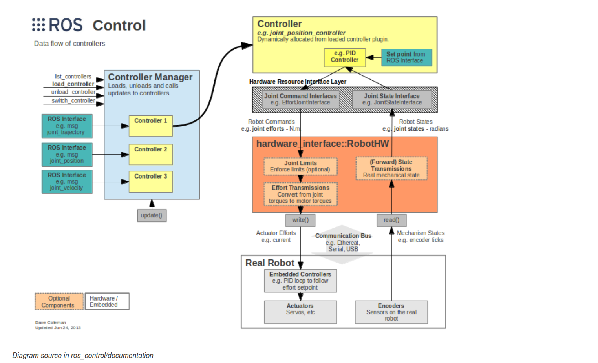

### 7.1 核心机制

> **上面的笔记其实以及阐述清楚了，所以下面就是用最直白，最简单，最不绕弯子的方法来整理这部分的内容**

核心关系： Controller Manager 管生命周期，Controller 算控制量，RobotHW 负责硬件读写，三者通过硬件接口衔接。

### **我来一波费曼总结**

最上层呢就是那个Controller Manager,它负责调用一些管理控制器的命令（加载，卸载，切换等），它手下会有许多种类的控制器，比如我现在的工程里的hero_chassis_controller,怎么注册？它是有一套流程，让不同的组件把控制器的信息给到manager后续再加载出来的，这个控制器之于manager的关系类似插件（其实就是插件），它本身就是一个.so库，在我的工程里，controller_spawner拿到控制器的实例名后，这个实例名就有说法了，有了上面的命名空间相关的知识，现在可以理解：这个实例名就是spawner拿到后，调用服务传输它给manager，然后在它那一层用这个名（这个名就是一个相当命名空间）用NodeHandle来创建一个控制器句柄，（卧槽原来是这样？？！），仔细观察，我们的控制器init函数是有NodeHandle传入的，那这个controller_nh的命名空间怎么来？就是这么来的，然后刚刚还有一个步骤没说，就是这个控制器类怎么出来的呢?刚刚说到这个spawner拿到了控制器实例名，其实这个实例名是一个命名空间，manager去参数服务器里读取这个命名空间下的type键的值，这个值就是控制器名（这个名是什么都没关系，但是这里为了能看出含义，就和真正的类有点像），然后pluginlib拿这个type值去翻功能包里的package.xml，找到export那一元素，得到插件描述文件的路径，也就是pluginlib.xml，然后去那里找一个属性name = 那个type值的类，然后读取类的信息，然后就能找到这个类的本体，然后就在manager那一层将它实例化，于是这个控制器类就出现了，工程里的是跑在gazebo里，

上面说完了控制器怎么被加载出来，下面说ros control的下层部分

控制器里会有一些接口，就是上图的Hardware Resource interface Layer 这一层，其实就是一个类接口，也可以说是一个命名空间里的一些接口类，你通过这些接口类，可以创建出关节句柄，这个是方便在控制器这一层传递硬件信息的类，还有可以有其他接口，用来找到一些硬件资源（比如自己通过xacro写好的模型），把这些模型的接口赋值给那个句柄，就可以用了。这里用的资源就是上面hardware_interface::RoboHW的那一层的，这一层的另外一面就是接上了真正的硬件，用write和read来传递信息（比如编码器读取值等），但一般读取和写是在manager那一层控制的，有一个外层的大循环

**这里的每层间不要看成是继承或包含关系，应该看成是接口与资源调用的关系**

> **打字给我打到手软了，希望给个5星好评**

> 下面来一些表格

### 7.1 各层的职责

| 层                 | 负责                                 | 不负责                |
| ------------------ | ------------------------------------ | --------------------- |
| Controller Manager | 加载、初始化、启停和周期调用控制器   | 具体控制算法          |
| Controller         | 通信、数据处理、控制算法和输出命令   | 电机驱动与硬件通信    |
| RobotHW            | 连接硬件接口，执行状态读取和命令写入 | 底盘运动学与 PID 计算 |

### 7.2 一个控制周期

```
RobotHW::read()
  → 读取编码器、关节状态
  → ControllerManager::update()
  → Controller::update()
  → 计算控制量
  → JointHandle::setCommand()
  → RobotHW::write()
  → 电机执行
```

两者的区别：

- `read()`：硬件状态进入软件系统。
- `write()`：软件计算出的命令进入硬件系统。

**大概是上面这些**

## 8. 大总结

**说实话我真燃尽了，我花了4天头脑风暴全力整理这篇ROS.md，几乎是重新梳理了一遍，什么体验呢，大致是当你学了挺多，就会有种不太想从头梳理的想法，会觉得累，但是这4天（因为我之前不小心把大作业做完了才有时间慢慢整理（深感抱歉），我在从头梳理时，确实是发现了很多还不熟的机制，可以说是边整理边学吧，20000多字，匠心力作，虽然不知道能获得多少评分，但是我基本是全程hold住人类作为监管者的身份，不可否认，这篇文章高度集成了AI生成的内容，但是我亲手思考理解并手敲的内容也不少，AI的内容只是方便我插入，全文大量包含了我自己的理解的输出，希望这样能体现出我的认真（bushi**

**噢对了，如果师兄师姐注意到这里，那么感谢观看，辛苦了，阅卷也不容易**