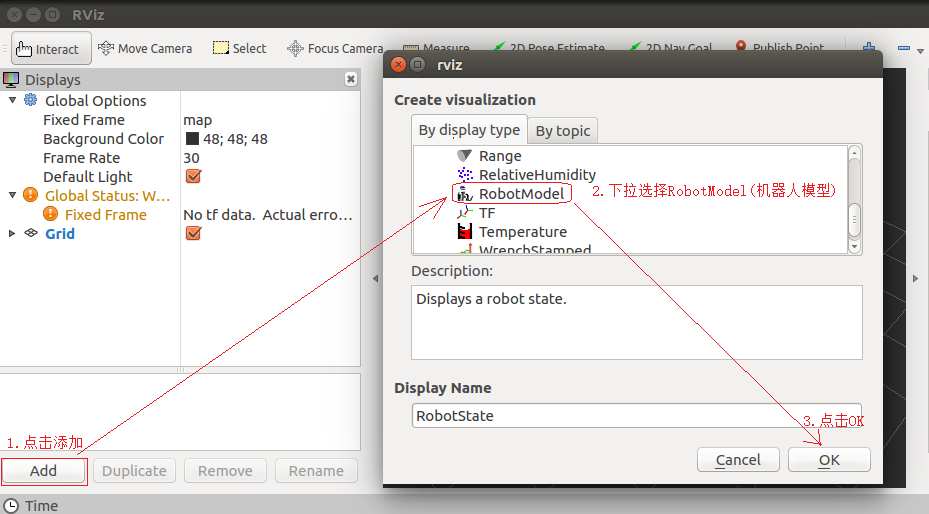
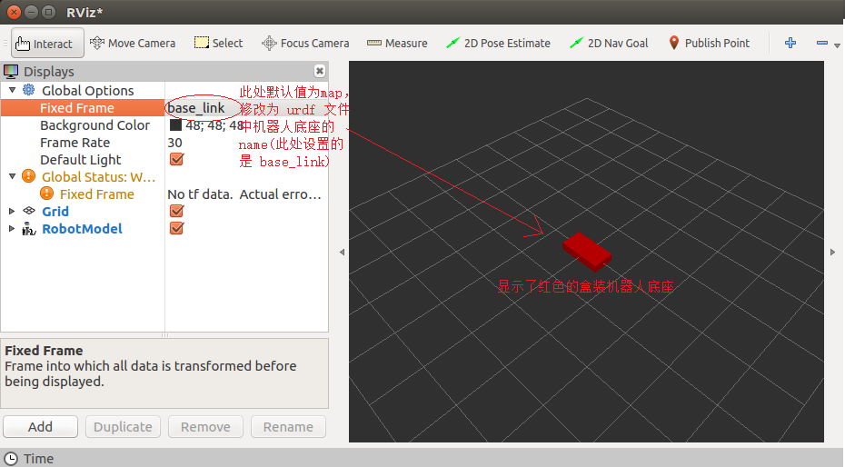

# ROS笔记

## 一.认识ROS

### 1.ROS简介

  **ROS 是一个适用于机器人的开源的元操作系统。**

  **ROS提供了操作系统应有的服务，包括硬件抽象，底层设备控制，常用函数的实现，进程间消息传递，以及包管理。它也提供用于获取、编译、编写、和跨计算机运行代码所需的工具和库函数。**

  **ROS还提供了用于在多台计算机上获取，构建，编写和运行代码的工具和库，ROS在某些方面类似于“机器人框架”。**

  **ROS是通讯机制、工具软件包、机器人高层技能以及机器人生态系统的集合体。**

### 2.RoboMaster里的ROS

**DynamicX方案：纯上位机**

**意味着其中视觉和控制逻辑都跑在上位机miniPC的ROS节点里**

**顶层(上位机)：** ROS节点，检测，解算，闭环，状态机都在这里运行

**中层(通信)：** 使用EtherCAT总线进行通信，只做帧转换传输，高实时性

**底层：** EtherCAT转CAN板卡，驱动N个电机

*以车上的一条流水线为例：*

输入：相机驱动

中间处理：识别 ---> 解算 ---> 决策

输出：通过通信中枢(EtherCAT)将指令下达给电机执行


## 二.ROS架构

### 1.三层架构

**文件系统层：** 工作空间/功能包/源代码，配置（解决代码怎么组织）

**计算图层：** 节点，话题，服务，参数，消息（解决程序怎么协作：发布，订阅，提供服务）

**通信层：** 节点之间建一条TCP（解决数据要怎么走）

*如何排错：*

*找不到包？--->找文件系统层：source了吗？包在src里面吗？*

*连不上/收不到？--->计算图层：名字对不对？类型对不对？*

*延迟高？--->通信层：队列太浅？带宽不够？*

*节点一启动就退?--->先看终端第一行红色FATAL*
 

### 2.ROS文件系统

```plaintext
WorkSpace --- 自定义的工作空间

    |--- build:编译空间，用于存放CMake和catkin的缓存信息、配置信息和其他中间文件

    |--- devel:开发空间，用于存放编译后生成的目标文件，包括头文件、动态&静态链接库、可执行文件等

    |--- src: 源码

    ├── config ：存放 YAML 参数文件的标准位置

        |-- package：功能包(ROS基本单元)包含多个节点、库与配置文件，包名所有字母小写，只能由字母、数字与下划线组成

            |-- CMakeLists.txt 配置编译规则，比如源文件、依赖项、目标文件

            |-- package.xml 包信息，比如:包名、版本、作者、依赖项...

            |-- scripts 存储python文件

            |-- src 存储C++源文件

            |-- include 头文件

            |-- msg 消息通信格式文件

            |-- srv 服务通信格式文件

            |-- action 动作格式文件

            |-- launch 可一次性运行多个节点 

            |-- config 配置信息

        |-- CMakeLists.txt: 编译的基本配置
```

### 3.ROS文件系统命令

#### 常用命令
| 命令 | 作用 |
| --- | --- |
| `catkin_create_pkg 自定义包名 依赖包` | 创建新的ROS功能包 |
| `sudo apt install xxx` | 安装 ROS功能包 |
| `sudo apt purge xxx` |   删除某个功能包 |
| `rospack list` | 列出所有功能包 |
| `rospack find 包名` | 查找某个功能包是否存在，如果存在返回安装路径 |
| `roscd 包名` | 进入某个功能包 |
| `rosls 包名` | 列出某个包下的文件 |
| `apt search xxx` | 搜索某个功能包 |
| `rosed 包名 文件名` | 修改功能包文件 |
| `roscore` | 使 ROS 节点进行通信,启动ros master，ros 参数服务器，rosout 日志节点 |
| `rosrun 包名 可执行文件名` | 运行指定的ROS节点 |
|`rqt_graph` | 创建一个显示当前系统运行情况的动态图形，可以显示不同节点之间的关系 |

## 三.配置文件

### 1.package.xml

功能包清单/包描述文件

`<name>`: 包名，必须与文件夹同名

`<build_depend>`:编译这个包需要的东西：头文件，库，消息包

`<exec_depend>`:运行时需要的东西：动态库，消息运行库，launch里调用的包

`<depend>`: = build + build_expend + exec

`自定义msg/srv`: 要额外加`message_generation`和`message_runtime`

### 2.CMakeLists.txt

告诉编译器编译什么，链接什么

**声明：** 项目名，cmake最低版本

**找依赖：** COMPONENTSH后面写包名；package.xml里有的这里也要有

```cmake
find_package(catkin REQUIRED COMPONENTS
    roscpp std_msgs message_generation)
```

**生成消息：** 只有自定义才要

```cmake
add_message_files(FILES MyMsg.msg)
add_service_files(FILES MySrv.srv)
generation_messages(DEPENDNCIES std_msgs)
catkin_package(CATKIN_DEPENDS roscpp std_msgs messsage_runtime)
```

**目标与链接：** 每加一个.cpp就加一条`add_executable`

### 3.launch文件

launch 文件是一个 XML 格式的文件，可以启动本地和远程的多个节点，还可以在参数服务器中设置参数

**1.`<launch>`:根标签**

**2.`<node>`:用于指定 ROS 节点**

```xml
<node name="节点名" 
      pkg="包名" 
      type="可执行文件名"       
      respawn="true | false"  (如果节点退出，是否自动重启) 
      output="log | screen"   (日志发送目标，可以设置为 log 日志文件，或 screen 屏幕,默认是 log)
      args="xxx xxx xxx"      (将参数传递给节点)
/>
```

**3.`<inlude>`:用于将另一个 xml 格式的 launch 文件导入到当前文件**

```xml
<include file="$(find 包名)/xxx/xxx.launch"（要包含的文件路径）
         ns="xxx" （在指定命名空间导入文件）
/>
```

**4.`<param>`:在参数服务器上设置参数**

```xml
<param name="命名空间/参数名"
       value="xxx" 
       type="str | int | double | bool | yaml"  (指定参数类型)
/>
```

**5.`<rosparam>`:从 YAML 文件导入参数，或将参数导出到 YAML 文件，也可以用来删除参数，<rosparam>标签在<node>标签中时被视为私有**

```xml
<rosparam command="load | dump | delete" (加载、导出或删除参数,默认加载)
          file="$(find xxxxx)/xxx/yyy...."
          param="参数名称"
          ns="命名空间"
/>
```

**6.`<arg>`:用于动态传参，类似于函数的参数**

```xml
<arg name="参数名称"
     value="数值"
     doc="描述"
/>
```

**6.1如何传参？**

*A.launch文件传参：*

```xml
<launch>
    <arg name="xxx" />
    <param name="param" value="$(arg xxx)" />
</launch>
```
*B.命令行传参：*

`roslaunch hello.launch xxx:=值`


**7.`<remap>`:用于话题重命名**

```xml
<remap from="原话题名称"
       to="目标名称"
/>
```

**8.`<group>`:对节点分组**

```xml
<group ns="名称空间" 
       clear_params="true | false" (启动前，是否删除组名称空间的所有参数)
/>
```


## 四.ROS通信机制

### 1.话题通信

#### 1.1 理论模型

  **1.Talker(发布者)和Listener(订阅者)通过RPC在ROS Master中注册自身信息，包含消息的话题名称**

  **2.ROS Master 会根据注册表中的信息匹配Talker和Listener，并通过RPC向Listener发送Talker的RPC地址信息**

  **3.Listener通过RPC向Talker发送连接请求，传输订阅的话题名称、消息类型以及通信协议**

  **4.Talker接收到Listener的请求后，也是通过RPC向Listener确认连接信息，并发送自身的TCP地址信息**

  **5.Listener根据步骤4返回的消息使用TCP与Talker建立网络连接**

  **6.连接建立后，Talker开始向Listener发布消息**

#### 1.2 基本操作

##### 1.编写发布者节点

**实现流程：**

        1.包含头文件 
        2.初始化 ROS 节点:命名(唯一)
        3.实例化 ROS 句柄
        4.实例化 发布者 对象
        5.组织被发布的数据，并编写逻辑发布数据


**示例：**

```cpp
        // 1.包含头文件 
        #include "ros/ros.h"
        #include "std_msgs/String.h" //普通文本类型的消息
        #include <sstream>

        int main(int argc, char  *argv[])
        {   
            //设置编码
            setlocale(LC_ALL,"");

            //2.初始化 ROS 节点:命名(唯一)
            // 参数1和参数2 后期为节点传值会使用
            // 参数3 是节点名称，是一个标识符，需要保证运行后，在 ROS 网络拓扑中唯一
            ros::init(argc,argv,"talker");
            //3.实例化 ROS 句柄
            ros::NodeHandle nh;//该类封装了 ROS 中的一些常用功能

            //4.实例化 发布者 对象
            //泛型: 发布的消息类型
            //参数1: 要发布到的话题
            //参数2: 队列中最大保存的消息数，超出此阀值时，先进的先销毁(时间早的先销毁)
            ros::Publisher pub = nh.advertise<std_msgs::String>("chatter",10);

            //5.组织被发布的数据，并编写逻辑发布数据
            //数据(动态组织)
            std_msgs::String msg;
            // msg.data = "你好啊！！！";
            std::string msg_front = "Hello 你好！"; //消息前缀
            int count = 0; //消息计数器

            //逻辑(一秒10次)
            ros::Rate r(1);

            //节点不死
            while (ros::ok())
            {
                //使用 stringstream 拼接字符串与编号
                std::stringstream ss;
                ss << msg_front << count;
                msg.data = ss.str();
                //发布消息
                pub.publish(msg);
                //加入调试，打印发送的消息
                ROS_INFO("发送的消息:%s",msg.data.c_str());

                //根据前面制定的发送贫频率自动休眠 休眠时间 = 1/频率；
                r.sleep();
                count++;//循环结束前，让 count 自增
                //暂无应用
                ros::spinOnce();
            }


            return 0;
        }
```

##### 2.编写订阅者节点

**实现流程：**

        1.包含头文件 
        2.初始化 ROS 节点:命名(唯一)
        3.实例化 ROS 句柄
        4.实例化 订阅者 对象
        5.处理订阅的消息(回调函数)
        6.设置循环调用回调函数

**示例：**       

```cpp
        // 1.包含头文件 
        #include "ros/ros.h"
        #include "std_msgs/String.h" //普通文本类型的消息
        #include <sstream>

        int main(int argc, char  *argv[])
        {   
            //设置编码
            setlocale(LC_ALL,"");

            //2.初始化 ROS 节点:命名(唯一)
            // 参数1和参数2 后期为节点传值会使用
            // 参数3 是节点名称，是一个标识符，需要保证运行后，在 ROS 网络拓扑中唯一
            ros::init(argc,argv,"talker");
            //3.实例化 ROS 句柄
            ros::NodeHandle nh;//该类封装了 ROS 中的一些常用功能

            //4.实例化 发布者 对象
            //泛型: 发布的消息类型
            //参数1: 要发布到的话题
            //参数2: 队列中最大保存的消息数，超出此阀值时，先进的先销毁(时间早的先销毁)
            ros::Publisher pub = nh.advertise<std_msgs::String>("chatter",10);

            //5.组织被发布的数据，并编写逻辑发布数据
            //数据(动态组织)
            std_msgs::String msg;
            // msg.data = "你好啊！！！";
            std::string msg_front = "Hello 你好！"; //消息前缀
            int count = 0; //消息计数器

            //逻辑(一秒10次)
            ros::Rate r(1);

            //节点不死
            while (ros::ok())
            {
                //使用 stringstream 拼接字符串与编号
                std::stringstream ss;
                ss << msg_front << count;
                msg.data = ss.str();
                //发布消息
                pub.publish(msg);
                //加入调试，打印发送的消息
                ROS_INFO("发送的消息:%s",msg.data.c_str());

                //根据前面制定的发送贫频率自动休眠 休眠时间 = 1/频率；
                r.sleep();
                count++;//循环结束前，让 count 自增
                //暂无应用
                ros::spinOnce();
            }


            return 0;
        }
```

##### 3.编写CMakeLists.txt

```cmake
add_executable( 包名
  src/talker.cpp
)

add_executable(包名
  src/listener.cpp
)

target_link_libraries(talker(节点名称)
  ${catkin_LIBRARIES}
)

target_link_libraries(listerner(节点名称)
  ${catkin_LIBRARIES}
)
```

##### 4.执行

**1.启动 roscore**

**2.启动发布节点**

**3.启动订阅节点**

#### 1.3 自定义msg

##### 1.3.1 准备工作

**1.定义msg文件**

功能包下新建 msg 目录，添加文件 Person.msg

```yml
string name
uint16 age
float64 height
```

**2.编辑配置文件**

**package.xml**中添加编译依赖与执行依赖

```xml
<build_depend>message_generation</build_depend>
<exec_depend>message_runtime</exec_depend>
```

**CMakeLists.txt**编辑 msg 相关配置

```cmake
find_package(catkin REQUIRED COMPONENTS
  roscpp
  rospy
  std_msgs
  message_generation
)
# 需要加入 message_generation,必须有 std_msgs
```

```cmake
## 配置 msg 源文件
add_message_files(
  FILES
  Person.msg
)
```

```cmake
# 生成消息时依赖于 std_msgs
generate_messages(
  DEPENDENCIES
  std_msgs
)
```

```cmake
#执行时依赖
catkin_package(
#  INCLUDE_DIRS include
#  LIBRARIES demo02_talker_listener
  CATKIN_DEPENDS roscpp rospy std_msgs message_runtime
#  DEPENDS system_lib
)
#CATKIN_DEPENDS只能有一行
```

**3.编译后头文件位置**

`工作空间/devel/include/包名/xxx.h`

##### 1.3.2 源代码调用

**流程：**

1.编写发布方实现；

2.编写订阅方实现；

3.编辑配置文件；

4.编译并执行。

**示例**

**1.发布者**
```cpp
        #include "ros/ros.h"
        #include "demo02_talker_listener/Person.h"

        int main(int argc, char *argv[])
        {
            setlocale(LC_ALL,"");

            //1.初始化 ROS 节点
            ros::init(argc,argv,"talker_person");

            //2.创建 ROS 句柄
            ros::NodeHandle nh;

            //3.创建发布者对象
            ros::Publisher pub = nh.advertise<demo02_talker_listener::Person>("chatter_person",1000);

            //4.组织被发布的消息，编写发布逻辑并发布消息
            demo02_talker_listener::Person p;
            p.name = "sunwukong";
            p.age = 2000;
            p.height = 1.45;

            ros::Rate r(1);
            while (ros::ok())
            {
                pub.publish(p);
                p.age += 1;
                ROS_INFO("我叫:%s,今年%d岁,高%.2f米", p.name.c_str(), p.age, p.height);

                r.sleep();
                ros::spinOnce();
            }


            return 0;
        }       
```

**2.订阅者**

```cpp
        #include "ros/ros.h"
        #include "demo02_talker_listener/Person.h"

        void doPerson(const demo02_talker_listener::Person::ConstPtr& person_p){
            ROS_INFO("订阅的人信息:%s, %d, %.2f", person_p->name.c_str(), person_p->age, person_p->height);
        }

        int main(int argc, char *argv[])
        {   
            setlocale(LC_ALL,"");

            //1.初始化 ROS 节点
            ros::init(argc,argv,"listener_person");
            //2.创建 ROS 句柄
            ros::NodeHandle nh;
            //3.创建订阅对象
            ros::Subscriber sub = nh.subscribe<demo02_talker_listener::Person>("chatter_person",10,doPerson);

            //4.回调函数中处理 person

            //5.ros::spin();
            ros::spin();    
            return 0;
        }
```

### 2.服务通信

#### 2.1 理论模型

**1.Server(服务端)和Client(客户端)会通过RPC在 ROS Master 中注册自身信息，其中包含提供/请求的服务的名称**

**2.ROS Master 会根据注册表中的信息匹配Server和 Client，并通过 RPC 向 Client 发送 Server 的 TCP 地址信息**

**3.Client 根据步骤2 响应的信息，使用 TCP 与 Server 建立网络连接，并发送请求数据**

**4.Server 接收、解析请求的数据，并产生响应结果返回给 Client**

#### 2.2 自定义msg

##### 2.2.1 准备工作

**1.定义msg文件**

功能包下新建 srv 目录，添加 xxx.srv 文件

**2.编辑配置文件**

**package.xml**中添加编译依赖与执行依赖

**CMakeLists.txt**编辑 srv 相关配置

```cmake
find_package(catkin REQUIRED COMPONENTS
  roscpp
  rospy
  std_msgs
  message_generation
)
# 需要加入 message_generation,必须有 std_msgs
```

```cmake
add_service_files(
  FILES
  AddInts.srv
)
```

```cmake
generate_messages(
  DEPENDENCIES
  std_msgs
)
```

**3.编译后头文件位置**

`工作空间/devel/include/包名/xxx.h`

##### 2.2.2 源代码调用

**1.服务端**

```cpp
        #include "ros/ros.h"
        #include "demo03_server_client/AddInts.h"

        // bool 返回值由于标志是否处理成功
        bool doReq(demo03_server_client::AddInts::Request& req,
                demo03_server_client::AddInts::Response& resp){
            int num1 = req.num1;
            int num2 = req.num2;

            ROS_INFO("服务器接收到的请求数据为:num1 = %d, num2 = %d",num1, num2);

            //逻辑处理
            if (num1 < 0 || num2 < 0)
            {
                ROS_ERROR("提交的数据异常:数据不可以为负数");
                return false;
            }

            //如果没有异常，那么相加并将结果赋值给 resp
            resp.sum = num1 + num2;
            return true;


        }

        int main(int argc, char *argv[])
        {
            setlocale(LC_ALL,"");
            // 2.初始化 ROS 节点
            ros::init(argc,argv,"AddInts_Server");
            // 3.创建 ROS 句柄
            ros::NodeHandle nh;
            // 4.创建 服务 对象
            ros::ServiceServer server = nh.advertiseService("AddInts",doReq);
            ROS_INFO("服务已经启动....");
            //     5.回调函数处理请求并产生响应
            //     6.由于请求有多个，需要调用 ros::spin()
            ros::spin();
            return 0;
        }
```

**2.客户端**

```cpp
        // 1.包含头文件
        #include "ros/ros.h"
        #include "demo03_server_client/AddInts.h"

        int main(int argc, char *argv[])
        {
            setlocale(LC_ALL,"");

            // 调用时动态传值,如果通过 launch 的 args 传参，需要传递的参数个数 +3
            if (argc != 3)
            // if (argc != 5)//launch 传参(0-文件路径 1传入的参数 2传入的参数 3节点名称 4日志路径)
            {
                ROS_ERROR("请提交两个整数");
                return 1;
            }


            // 2.初始化 ROS 节点
            ros::init(argc,argv,"AddInts_Client");
            // 3.创建 ROS 句柄
            ros::NodeHandle nh;
            // 4.创建 客户端 对象
            ros::ServiceClient client = nh.serviceClient<demo03_server_client::AddInts>("AddInts");
            //等待服务启动成功
            //方式1
            ros::service::waitForService("AddInts");
            //方式2
            // client.waitForExistence();
            // 5.组织请求数据
            demo03_server_client::AddInts ai;
            ai.request.num1 = atoi(argv[1]);
            ai.request.num2 = atoi(argv[2]);
            // 6.发送请求,返回 bool 值，标记是否成功
            bool flag = client.call(ai);
            // 7.处理响应
            if (flag)
            {
                ROS_INFO("请求正常处理,响应结果:%d",ai.response.sum);
            }
            else
            {
                ROS_ERROR("请求处理失败....");
                return 1;
            }

            return 0;
        }
```

**3.配置CMakeLists.txt文件**

```cmake
add_executable(AddInts_Server src/AddInts_Server.cpp)
add_executable(AddInts_Client src/AddInts_Client.cpp)


add_dependencies(AddInts_Server ${PROJECT_NAME}_gencpp)
add_dependencies(AddInts_Client ${PROJECT_NAME}_gencpp)


target_link_libraries(AddInts_Server
  ${catkin_LIBRARIES}
)
target_link_libraries(AddInts_Client
  ${catkin_LIBRARIES}
)
```

**4.执行**

需要先启动服务:`rosrun 包名 服务`

然后再调用客户端 :`rosrun 包名 客户端 参数1 参数2`


### 3.参数服务器

**参数服务器可以将数据存储在该容器中，被不同的节点调用，不同的节点也可以往其中存储数据**

#### 3.1 理论模型

**1.Talker(参数设置者) 通过 RPC 向参数服务器发送参数(包括参数名与参数值)，ROS Master 将参数保存到参数列表中**

**2.Listener(参数调用者) 通过 RPC 向参数服务器发送参数查找请求，请求中包含要查找的参数名**

**3.ROS Master 根据步骤2请求提供的参数名查找参数值，并将查询结果通过 RPC 发送给 Listener**

参数可使用数据类型:

    32-bit integers

    booleans

    strings

    doubles

    iso8601 dates

    lists

    base64-encoded binary data

    字典


#### 3.2 参数操作

需求:实现参数服务器参数的增删改查操作

##### 3.2.1 参数服务器操作

在 C++ 中实现参数服务器数据的增删改查，可以通过两套 API 实现:

    ros::NodeHandle

    ros::param

| 操作 | 作用 |
| --- | --- |
| nh.param<数据类型>("key", var, 默认值) | 读参数，读不到用默认值 |
| nh.getParam("key", var) | 读参数，返回bool |
| nh.setParam("key", value) | 写参数 |
| nh.deleteParam("key") | 删除参数 |
| nh.searchParam("key", out) | 搜索参数 |
| nh.getParamNames(names) | 列出所有参数 |
| nh.hasParam("key") | 判断存在，返回bool |

key：全局key-value,存在Master里，所有节点都能访问，参数服务器的变量名，通常在YAML文件定义

var：自己程序的变量名

类型：int,double,bool,string,list,dict

生命周期：随roscore存在

| 命令 | 作用 |
| --- | --- |
| rosparam list | 列出所有参数 |
| rosparam get/set | 读一个/改一个 |
| rosparam load/dump | 从YAML灌入/导出成YAML |
| rosparam delete | 删除一颗子树 |

##### 3.2.2 配置YAML文件

参数一多就写进YAML文件里，位置：`功能包/config/ .yaml`

**1.YAML的规矩：**
1.只用空格缩进，绝不用TAB，两个空格算一级

2.冒号后面必须有空格

3.大小写敏感

4.#是注释

5.---可以分隔多个文件

**2.YAML的三种结构**

*所有复杂的东西都由这三样嵌套出来的*

1.标量

```yml
speed: 1.5   #数字
name: "sentry"  #字符串
debug: true  #bool
empty: null #空值
```

2.列表

```yml
ports
  - 8080
  - 8081
#行内写法
ids: [1,2,3]
```

3.字典

```yml
camera: 
  width: 600
  height: 400
#行内写法
point: {x: 1,y:2}
```

**3.在ROS里怎么用YAML**

三种加载方式：

1.命令行(临时调试)

`rosparam load config/param.yaml / my_ns`

2.launch文件里(常用)

```xml
<rosparam file="$(find my_pkg)/config/param.yaml"
          command="load" ns="my_ns>
```

3.代码里读(带默认值最稳)

```cpp
ros::NodeHandle pnh("~");  //私有句柄
int exposure;              //var变量
pnh.param<int>("camera/exposure",exposure,30);   //桥：key ←→ var，默认 30
```

## 五.常用命令

### 1.rosnode

rosnode 是用于获取节点信息的命令

| 命令 | 作用 |
| --- | --- |
| `rosnode ping` | 测试到节点的连接状态 |
| `rosnode list` | 列出活动节点 |
| `rosnode info` | 打印节点信息 |
| `rosnode machine` | 列出指定设备上节点 |
| `rosnode kill` | 杀死某个节点 |
| `rosnode cleanup` | 清除不可连接的节点 |

**先list，再info**

### 2.rostopic

rostopic 用于显示有关ROS 主题的调试信息

| 命令 | 作用 |
| --- | --- |
| `rostopic bw` | 显示主题使用的带宽 |
|`rostopic delay`| 显示带有 header 的主题延迟|
|`rostopic echo`|   打印消息到屏幕|
|`rostopic find 消息类型`  | 根据类型查找主题|
|`rostopic hz`|     显示主题的发布频率|
|`rostopic info`   |显示主题相关信息|
|`rostopic list` |  显示所有活动状态下的主题|
|`rostopic pub`   | 将数据发布到主题|
|`rostopic type` |  打印主题类型|

### 3.rosmsg

rosmsg是用于显示有关 ROS消息类型的 信息的命令行工具

|命令|作用|
|---|---|
|`rosmsg show`|    显示消息描述|
|`rosmsg info`   |显示消息信息|
|`rosmsg list`|    列出所有消息|
|`rosmsg md5`    |显示 md5 加密后的消息|
|`rosmsg package 包名`|    显示某个功能包下的所有消息|
|`rosmsg packages`   | 列出包含消息的功能包|

### 4.rosservice

rosservice包含用于列出和查询ROSServices的rosservice命令行工具

|命令|作用|
|---|---|
|`rosservice args`| 打印服务参数|
|`rosservice call` |   使用提供的参数调用服务|
|`rosservice find`    |按照服务类型查找服务|
|`rosservice info`   |打印有关服务的信息|
|`rosservice list`    |列出所有活动的服务|
|`rosservice type`|    打印服务类型|
|`rosservice uri`   | 打印服务的 ROSRPC uri|

### 5.rossrv

rossrv是用于显示有关ROS服务类型的信息的命令行工具

|命令|作用|
|---|---|
|`rossrv show`| 显示服务消息详情|
|`rossrv info`    | 显示服务消息相关信息|
|`rossrv list`  | 列出所有服务信息|
|`rossrv md5`    | 显示 md5 加密后的服务消息|
|`rossrv package`| 显示某个包下所有服务消息|
|`rossrv packages` |显示包含服务消息的所有包|


### 6.rosparam

rosparam包含rosparam命令行工具，用于使用YAML编码文件在参数服务器上获取和设置ROS参数
|命令|作用
|---|---|
|`rosparam set`| 设置参数|
|`rosparam get`| 获取参数|
|`rosparam load`| 从外部文件加载参数|
|`rosparam dump` | 将参数写出到外部文件|
|`rosparam delete`| 删除参数|
|`rosparam list` | 列出所有参数|


## 六.常用工具

### 1.rqt

ROS基于 QT 框架，针对机器人开发提供了一系列可视化的工具，这些工具的集合就是rqt，可以方便的实现 ROS 可视化调试，并且在同一窗口中打开多个部件

`rqt_graph`:可视化显示计算图

`rqt_console`: ROS 中用于显示和过滤日志的图形化插件

`rqt_plot`:可以以 2D 绘图的方式绘制发布在 topic 上的数据

`rqt_bag`：录制和重放 bag 文件的图形化插件

### 2.rosbag

用于录制和回放 ROS 主题的一个工具集，实现了数据的复用，方便调试、测试

#### 2.1 rosbag使用_命令行

1.创建目录保存录制文件

2.开始录制

`rosbag record -a -O 目标文件`

结束录制使用 ctrl + c，在创建的目录中会生成bag文件

3.查看文件 

`rosbag info 文件名`

4.回放文件

`rosbag play 文件名`

#### 2.2 rosbag使用_编码

1.写bag

```cpp

    #include "ros/ros.h"
    #include "rosbag/bag.h"
    #include "std_msgs/String.h"


    int main(int argc, char *argv[])
    {
        ros::init(argc,argv,"bag_write");
        ros::NodeHandle nh;
        //创建bag对象
        rosbag::Bag bag;
        //打开
        bag.open("/home/rosdemo/demo/test.bag",rosbag::BagMode::Write);
        //写
        std_msgs::String msg;
        msg.data = "hello world";
        bag.write("/chatter",ros::Time::now(),msg);
        bag.write("/chatter",ros::Time::now(),msg);
        bag.write("/chatter",ros::Time::now(),msg);
        bag.write("/chatter",ros::Time::now(),msg);
        //关闭
        bag.close();

        return 0;
    }

```

2.读bag

```cpp

    #include "ros/ros.h"
    #include "rosbag/bag.h"
    #include "rosbag/view.h"
    #include "std_msgs/String.h"
    #include "std_msgs/Int32.h"

    int main(int argc, char *argv[])
    {

        setlocale(LC_ALL,"");

        ros::init(argc,argv,"bag_read");
        ros::NodeHandle nh;

        //创建 bag 对象
        rosbag::Bag bag;
        //打开 bag 文件
        bag.open("/home/rosdemo/demo/test.bag",rosbag::BagMode::Read);
        //读数据
        for (rosbag::MessageInstance const m : rosbag::View(bag))
        {
            std_msgs::String::ConstPtr p = m.instantiate<std_msgs::String>();
            if(p != nullptr){
                ROS_INFO("读取的数据:%s",p->data.c_str());
            }
        }

        //关闭文件流
        bag.close();
        return 0;
    }

```

### 3.TF2坐标变换

在 ROS 中用于实现不同坐标系之间的点或向量的转换

#### 3.1 坐标msg消息

1.geometry_msgs/TransformStamped

用于传输坐标系相关位置信息

```yaml
std_msgs/Header header                     #头信息
  uint32 seq                                #|-- 序列号
  time stamp                                #|-- 时间戳
  string frame_id                            #|-- 坐标 ID
string child_frame_id                    #子坐标系的 id
geometry_msgs/Transform transform        #坐标信息
  geometry_msgs/Vector3 translation        #偏移量
    float64 x                                #|-- X 方向的偏移量
    float64 y                                #|-- Y 方向的偏移量
    float64 z                                #|-- Z 方向上的偏移量
  geometry_msgs/Quaternion rotation        #四元数
    float64 x                                
    float64 y                                
    float64 z                                
    float64 w
```

2.geometry_msgs/PointStamped

用于传输某个坐标系内坐标点的信息

```yaml
std_msgs/Header header                    #头
  uint32 seq                                #|-- 序号
  time stamp                                #|-- 时间戳
  string frame_id                            #|-- 所属坐标系的 id
geometry_msgs/Point point                #点坐标
  float64 x                                    #|-- x y z 坐标
  float64 y
  float64 z
```

### 4.URDF集成Rviz&Gazebo

#### 4.1 URDF语法

URDF 文件是一个标准的 XML 文件，在 ROS 中预定义了一系列的标签用于描述机器人模型

1.`<robot>`:根标签
```xml
<robot name="机器人模型的名称">
```
2.`<link>`:用于描述机器人某个部件(也即刚体部分)的外观和物理属性

**示例：**
```xml
    <link name="base_link">
        <visual>
            <!-- 形状 -->
            <geometry>

                <!-- 长方体的长宽高 -->
                <box size="0.5 0.3 0.1" /> 

                <!-- 圆柱，半径和长度 -->
                <cylinder radius="0.5" length="0.1" />

                <!-- 球体，半径-->
                <sphere radius="0.3" />

                <!-- 为连杆添加皮肤 -->
                <mesh filename=资源路径(格式:package://<packagename>/<path>/文件)>

            </geometry>

            <!-- xyz坐标 rpy翻滚俯仰与偏航角度(3.14=180度 1.57=90度) -->
            <origin xyz="0 0 0" rpy="0 0 0" />

            <!-- 颜色: r=red g=green b=blue a=alpha -->
            <material name="black">
                <!-- rgba=红绿蓝权重值与透明度 -->
                <color rgba="0.7 0.5 0 0.5" />
            </material>

        </visual>

        <collision>(连杆的碰撞属性)
        ...
        </collision>

        <Inertial>(连杆的惯性矩阵)
        ...
        </Inertial>

    </link>

```

3.`<joint>`:于描述机器人关节的运动学和动力学属性，还可以指定关节运动的安全极限,不同的关节有不同的运动形式

**示例：**
```xml
<!-- type:关节运动形式 -->
<joint name="camera2baselink" type="continuous">

        <!-- 父级连杆  -->
        <parent link="base_link"/>

        <!-- 子级连杆  -->
        <child link="camera" />

        <!-- 需要计算两个 link 的物理中心之间的偏移量 -->
        <!-- xyz=各轴线上的偏移量 rpy=各轴线上的偏移弧度 -->
        <origin xyz="0.2 0 0.075" rpy="0 0 0" />

        <!-- xyz用于设置围绕哪个关节轴运动 -->
        <axis xyz="0 0 1" />

    </joint>
```
**常用关节运动形式（type）**

continuous: 旋转关节，可以绕单轴无限旋转

revolute: 旋转关节，类似于 continues,但是有旋转角度限制

prismatic: 滑动关节，沿某一轴线移动的关节，有位置极限

#### 4.2 URDF工具

`check_urdf urdf文件`:检查复杂的 urdf 文件是否存在语法问题

`urdf_to_graphiz urdf文件`：查看 urdf 模型结构，显示不同 link 的层级关系

#### 4.3 URDF优化_xacro

概念：Xacro 是 XML Macros 的缩写，Xacro 是一种 XML 宏语言，是可编程的 XML

原理：Xacro 可以声明变量，可以通过数学运算求解，使用流程控制控制执行顺序，还可以通过类似函数的实现，封装固定的逻辑，将逻辑中需要的可变的数据以参数的方式暴露出去，从而提高代码复用率以及程序的安全性

作用：较之于纯粹的 URDF 实现，可以编写更安全、精简、易读性更强的机器人模型文件，且可以提高编写效率

**语法：**

**1.属性与算数运算：** 用于封装 URDF 中的一些字段，比如: PAI 值，小车的尺寸，轮子半径 ....

属性定义：
```xml
<xacro:property name="xxxx" value="yyyy" />
```

属性调用：
`${属性名称}`

算数运算：
`${数学表达式}`

**2.宏：** 类似于函数实现，提高代码复用率，优化代码结构，提高安全性

宏定义：

```xml
<xacro:macro name="宏名称" params="参数列表(多参数之间使用空格分隔)">

    .....

    参数调用格式: ${参数名}

</xacro:macro>
```

宏调用：
```xml
<xacro:宏名称 参数1=xxx 参数2=xxx/>
```

**3.文件调用:** 机器人由多部件组成，不同部件可能封装为单独的 xacro 文件，最后再将不同的文件集成，组合为完整机器人，可以使用文件包含实现

文件包含：
```xml
<robot name="xxx" xmlns:xacro="http://wiki.ros.org/xacro">
      <xacro:include filename="my_base.xacro" />
      <xacro:include filename="my_camera.xacro" />
      <xacro:include filename="my_laser.xacro" />
      ....
</robot>
```

#### 4.4 Rviz

URDF 只是一个文件，需要在 Rviz 或 Gazebo 中渲染成图形化的机器人模型

**用一个例子讲解怎么用：**

需求：在 Rviz 中显示一个盒状机器人

**实现流程：**

**1.准备:新建功能包，导入依赖**

创建一个新的功能包，名称自定义，导入依赖包:urdf与xacro

在当前功能包下，再新建几个目录:

`urdf`:存储 urdf 文件的目录

`meshes`:机器人模型渲染文件

`config`:配置文件

`launch`:存储 launch 启动文件

**2.核心:编写 urdf 文件**

新建一个子级文件夹:`urdf`,文件夹中添加一个`.urdf`文件,内容如下：
```xml
<robot name="mycar">
    <link name="base_link">
        <visual>
            <geometry>
                <box size="0.5 0.2 0.1" />
            </geometry>
        </visual>
    </link>
</robot>
```

**3.核心:在 launch 文件集成 URDF 与 Rviz**

在`launch`目录下，新建一个 launch 文件,该 launch 文件需要启动 Rviz，并导入 urdf 文件

在 ROS 中，可以将 urdf 文件的路径设置到参数服务器，使用的参数名是:`robot_description`

```xml
<launch>

    <!-- 设置参数 -->
    <param name="robot_description" textfile="$(find 包名)/urdf/urdf/urdf01_HelloWorld.urdf" />

    <!-- 启动 rviz -->
    <node pkg="rviz" type="rviz" name="rviz" />

</launch>
```

**4.在 Rviz 中显示机器人模型**

rviz 启动后，会发现并没有盒装的机器人模型，这是因为默认情况下没有添加机器人显示组件，需要手动添加，添加方式如下:





#### 4.5 URDF集成Gazebo

**主要步骤：**

**1.创建功能包，导入依赖项**

创建新功能包，导入依赖包: `urdf、xacro、gazebo_ros、gazebo_ros_control、gazebo_plugins`

**2.编写 URDF 或 Xacro 文件**
```xml
<!-- 
    创建一个机器人模型(盒状即可)，显示在 Gazebo 中 
-->

<robot name="mycar">
    <link name="base_link">
        <visual>
            <geometry>
                <box size="0.5 0.2 0.1" />
            </geometry>
            <origin xyz="0.0 0.0 0.0" rpy="0.0 0.0 0.0" />
            <material name="yellow">
                <color rgba="0.5 0.3 0.0 1" />
            </material>
        </visual>
        <collision>
            <geometry>
                <box size="0.5 0.2 0.1" />
            </geometry>
            <origin xyz="0.0 0.0 0.0" rpy="0.0 0.0 0.0" />
        </collision>
        <inertial>
            <origin xyz="0 0 0" />
            <mass value="6" />
            <inertia ixx="1" ixy="0" ixz="0" iyy="1" iyz="0" izz="1" />
        </inertial>
    </link>
    <gazebo reference="base_link">
        <material>Gazebo/Black</material>
    </gazebo>

</robot>
```
*!注意：必须使用 collision和inertial 标签，颜色设置，也需要重新使用 gazebo 标签标注*


**3.启动 Gazebo 并显示机器人模型**

launch文件实现：
```xml
<launch>

    <!-- 将 Urdf 文件的内容加载到参数服务器 -->
    <param name="robot_description" textfile="$(find demo02_urdf_gazebo)/urdf/urdf01_helloworld.urdf" />

    <!-- 启动 gazebo -->
    <include file="$(find gazebo_ros)/launch/empty_world.launch" />
    <!-- 启动 Gazebo 的仿真环境，当前环境为空环境 -->

    <!-- 在 gazebo 中显示机器人模型 -->
    <node pkg="gazebo_ros" type="spawn_model" name="model" args="-urdf -model mycar -param robot_description"  />
    <!-- 
    在 Gazebo 中加载一个机器人模型，该功能由 gazebo_ros 下的 spawn_model 提供:
    -urdf 加载的是 urdf 文件
    -model mycar 模型名称是 mycar
    -param robot_description 从参数 robot_description 中载入模型
    -x 模型载入的 x 坐标
    -y 模型载入的 y 坐标
    -z 模型载入的 z 坐标
    -->

</launch>
```

